<p align="center">
  <a href="https://genoffice.ai/">
    <picture>
      <source srcset="../assets/readme/hero-dark.webp" media="(prefers-color-scheme: dark)">
      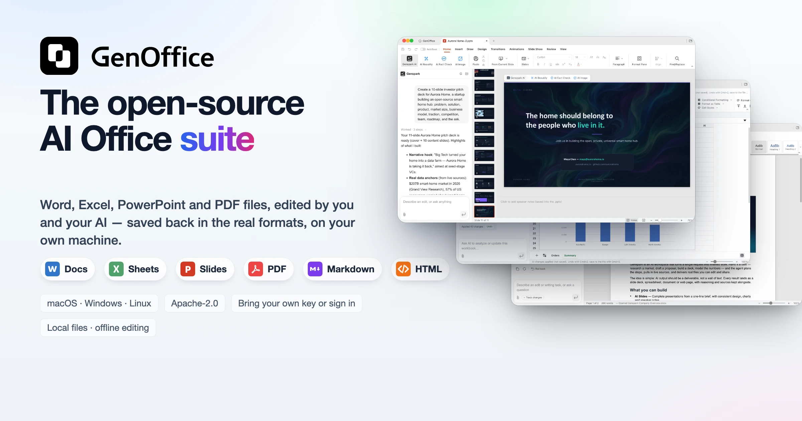
    </picture>
  </a>
</p>

<h1 align="center">GenOffice</h1>

<p align="center"><b>A világ első, teljes értékű, nyílt forráskódú AI-irodai programcsomagja.</b><br>
Word-, Excel-, PowerPoint- és PDF-fájlok, amelyeket te és az AI-d szerkesztetek, és amelyek valódi formátumban mentődnek vissza.</p>

<p align="center">
  <a href="../../LICENSE"></a>
  <a href="https://github.com/genspark-ai/genoffice/releases/latest"></a>
  <a href="https://github.com/genspark-ai/genoffice/releases"></a>
  <a href="https://github.com/genspark-ai/genoffice/stargazers"></a>
  <a href="https://x.com/merrickbuilds"></a>
</p>

<p align="center"><a href="../../README.md">English</a> · <a href="README.es.md">Español</a> · <a href="README.pt-BR.md">Português</a> · <a href="README.de.md">Deutsch</a> · <a href="README.fr.md">Français</a> · <a href="README.zh-CN.md">简体中文</a> · <a href="README.zh-TW.md">繁體中文</a> · <a href="README.ko.md">한국어</a> · <a href="README.ja.md">日本語</a> · <a href="README.ar.md">العربية</a> · <a href="README.ru.md">Русский</a> · <a href="README.it.md">Italiano</a> · <a href="README.nl.md">Nederlands</a> · <a href="README.pl.md">Polski</a> · <a href="README.cs.md">Čeština</a> · <a href="README.id.md">Bahasa Indonesia</a> · <a href="README.ms.md">Bahasa Melayu</a> · <a href="README.th.md">ไทย</a> · <a href="README.hi.md">हिन्दी</a> · <a href="README.he.md">עברית</a> · <a href="README.vi.md">Tiếng Việt</a> · <a href="README.tr.md">Türkçe</a> · <b>Magyar</b></p>

<p align="center">
  <a href="#download"><b>Letöltés</b></a> ·
  <a href="#skills"><b>Képességek</b></a> ·
  <a href="#command-line-and-agent-skill"><b>CLI</b></a> ·
  <a href="#mcp-server"><b>MCP</b></a> ·
  <a href="https://genoffice.ai/"><b>Weboldal</b></a> ·
  <a href="https://genoffice.ai/join"><b>Közösség</b></a> ·
  <a href="https://x.com/merrickbuilds"><b>X</b></a> ·
  <a href="../../PRIVACY.md"><b>Adatvédelem</b></a>
</p>

A GenOffice a Microsoft Office ingyenes, nyílt forráskódú alternatívája macOS, Windows
és Linux rendszerre. Natív `.docx`, `.xlsx` és `.pptx` fájlokat nyit meg és ment,
PDF-, Markdown- és HTML-fájlokat szerkeszt, és minden dokumentum mellé tesz egy
AI-ügynököt — nem egy utólag odatoldott csevegőablakot, hanem egy szerkesztőt,
amely beolvassa a fájlt, elvégzi a módosítást, és pontosan megmutatja, mit
változtatott meg. Az ODF-fájlok (`.odt`, `.ods`, `.odp`, valamint a
`.ott`/`.ots`/`.otp` sablonok) szerkeszthető OOXML-másolatként nyílnak meg, ugyanígy
a régebbi Word `.doc`/`.dot`, Excel 97 `.xls` és PowerPoint 97–2003 `.ppt` fájlok,
valamint a Hancom-dokumentumok (`.hwp`, `.hwpx`); az import csak megnyitásra szolgál —
a mentés mindig OOXML-be ír, soha az eredeti formátumba.

- **Valódi formátumok, bájtpontos megőrzéssel.** Csak az íródik újra, amit te
  szerkesztesz. A fájlban minden más bájtról bájtra változatlan marad, így a
  dokumentumok továbbra is működnek Wordben, Excelben és PowerPointban.
- **Olyan AI, amit ellenőrizhetsz.** A módosítások változáskövetéssel és diffként
  jelennek meg, egyetlen kattintással visszavonhatók. A táblázatok élő képleteket
  kapnak, beillesztett számok helyett. A diák és oldalak közvetlenül a vásznon
  jönnek létre, és teljesen szerkeszthetők maradnak. Ha elrejtesz egy kijelölést a
  Docsban vagy egy cellatartományt a Sheetsben a modell elől, az AI csak egy
  elnevezett helyőrzőt lát; az eredeti szöveg a fájlban marad, és utána visszakerül.
  Az elrejtés az alkalmazás AI-ját érinti — a CLI, az MCP-eszközök és a felület
  nélküli exportálás közvetlenül olvassa a fájlt, ott ezek a szövegek továbbra is látszanak.
- **Alapból helyi.** A fájlokat a saját gépeden nyithatod meg, szerkesztheted,
  mentheted és konvertálhatod. A PDF → Word / Excel / PowerPoint, a
  Markdown → Word és a HTML → Word konverziók mind az eszközön futnak. Csak az
  AI-hívások hagyják el a gépet, az általad választott szolgáltatóhoz.
- **Fájlok keresése a tartalmuk alapján.** A kezdőképernyő a `.docx`, `.xlsx`,
  `.pptx`, PDF-, Markdown- és HTML-fájljaid nevében, mappájában és teljes
  szövegében keres, egy helyi SQLite-indexből, a kínai, japán és koreai (CJK) szöveget is beleértve. Igény szerint
  a legjobb találatokat a **[TypeSafe Jev](https://typesafe.ai/)** — a System One
  értékelő modellje — rendezi újra, hogy a kérdésedre válaszoló fájl kerüljön legfelül.
- **Kérdezd a fájljaidat, forrásokkal.** Csillagozz meg egy dokumentumkészletet,
  és a kezdőképernyőn az **AI kérdezése** a rájuk vonatkozó kérdésekre válaszol,
  minden állításhoz feltüntetve a mögötte álló fájlt, így azt megnyithatod, és
  ellenőrizheted.
- **Saját kulccsal vagy anélkül.** Jelentkezz be Gensparkkal, így nincs szükség kulcsra,
  vagy használd a saját kulcsodat: Claude, OpenAI, Gemini, DeepSeek, Kimi, GLM,
  Qwen, Doubao, MiniMax, Grok, Mistral, OpenRouter, Requesty, Opper, Cheaper
  Inference, Atlas Cloud, illetve bármely OpenAI-kompatibilis végpont, a helyi
  szervereket is beleértve.
- **Szkriptelhető és ügynökbarát.** Az alkalmazás `genoffice` parancssort és egy
  képességet (skillt) mellékel a Claude Code, Codex, Cursor, Gemini CLI, GitHub Copilot, OpenCode
  és Windsurf számára, így egy kódoló ügynök valódi Office-fájlokat hozhat
  létre, konvertálhat, olvashat és szerkeszthet a gépeden, ablak megnyitása nélkül.

**Töltsd le:** [macOS](https://github.com/genspark-ai/genoffice/releases/latest) (Apple Silicon és Intel) ·
[Windows](https://github.com/genspark-ai/genoffice/releases/latest) (x64 és Arm) ·
[Linux](https://github.com/genspark-ai/genoffice/releases/latest) (deb, rpm, AppImage) —
a részletekkel és a rendszerkövetelményekkel a [Letöltés](#download) részben találod.

## Demó

Hat alkalmazás, egy AI-panel, egy TypeSafe Jevvel újrarendezett fájlkereső, egy AI kérdezése funkció,
amely a csillagozott fájljaidból válaszol forrásokkal, valamint egy parancssor a kódoló ügynöködnek.
Minden képernyőkép a valódi alkalmazást mutatja macOS-en, az AI-t pedig olyan prompt vezérli,
amelyet elolvashatsz a panelen.

### 1 · Docs — `.docx` megnyitása és szerkesztése olyan AI-val, amelyet ellenőrizhetsz

<table>
<tr>
<td width="50%">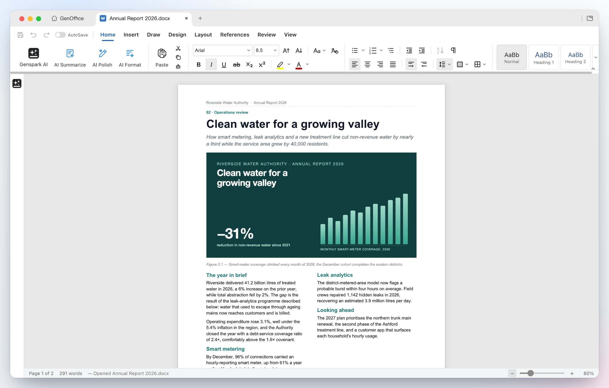</td>
<td width="50%">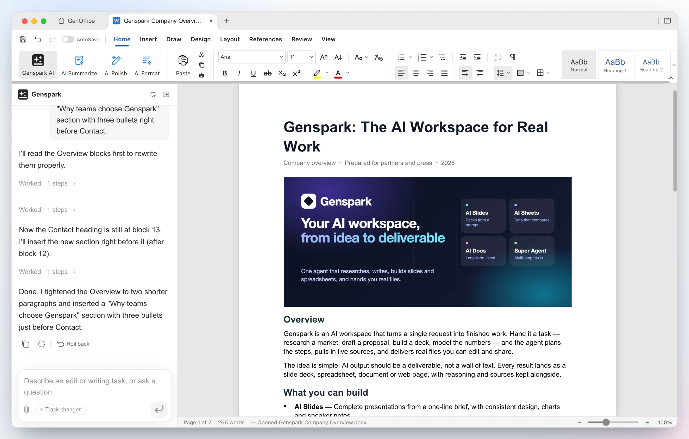</td>
</tr>
<tr>
<td><b>A fájl úgy nyílik meg, ahogy a Word rendezi</b> — kéthasábos szakaszok, szélig érő képek, árnyékolt táblázatok, élőfejek és élőlábak, tördelés a Word sormetrikái szerint. A stílusok, megjegyzések, változáskövetés, egyenletek, tintaírás és tartalomvezérlők mentéskor érintetlenül megmaradnak. A <b>Levelezés</b> lap a dokumentumot körlevélsablonná alakítja: válassz <code>.xlsx</code> vagy <code>.csv</code> címzettlistát, szúrj be valódi <code>MERGEFIELD</code>-eket, nézd meg rekordonként az előnézetet, és egyesíts egyetlen dokumentumba, vagy rekordonként külön <code>.docx</code>-be.</td>
<td><b>Kérj szerkesztést</b> — az AI beolvassa a szükséges blokkokat, átírja az Áttekintést, és új, felsorolásos szakaszt szúr be. Minden AI-lépés egy pillanatfelvétel, amelyre visszagörgethetsz; bekapcsolt <b>Változáskövetéssel</b> a módosítások Word-stílusú javaslatokként érkeznek. Kérj helyette gondolattérképet, és a válasz a teljes dokumentum interaktív diagramja lesz: összecsukható ágakkal, nagyítással és pásztázással, a csomópontra kattintva újabb kérdést tehetsz fel, a hivatkozások pedig visszaugranak arra a blokkra, amelyből származnak.</td>
</tr>
</table>

### 2 · Sheets — `.xlsx` élő képletekkel és diagramokkal, nem beillesztett számokkal

<table>
<tr>
<td width="50%">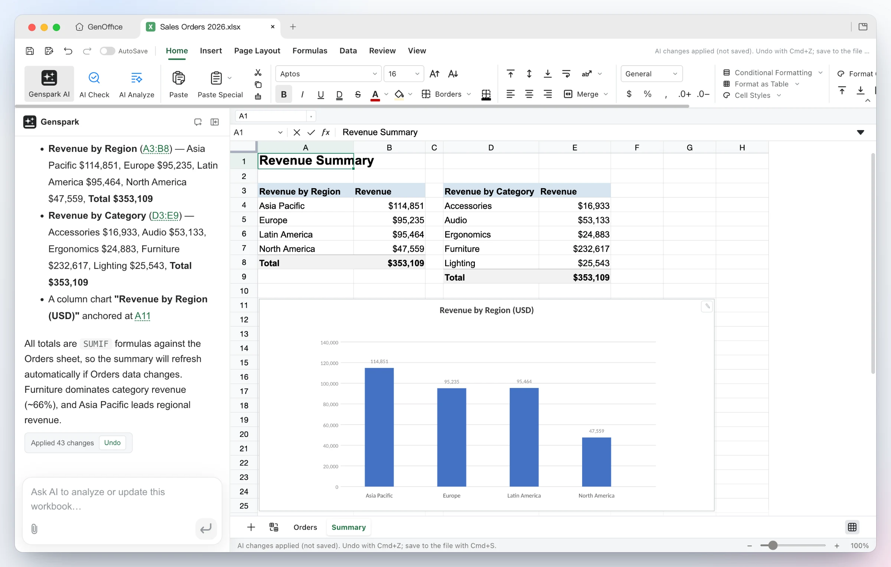</td>
<td width="50%">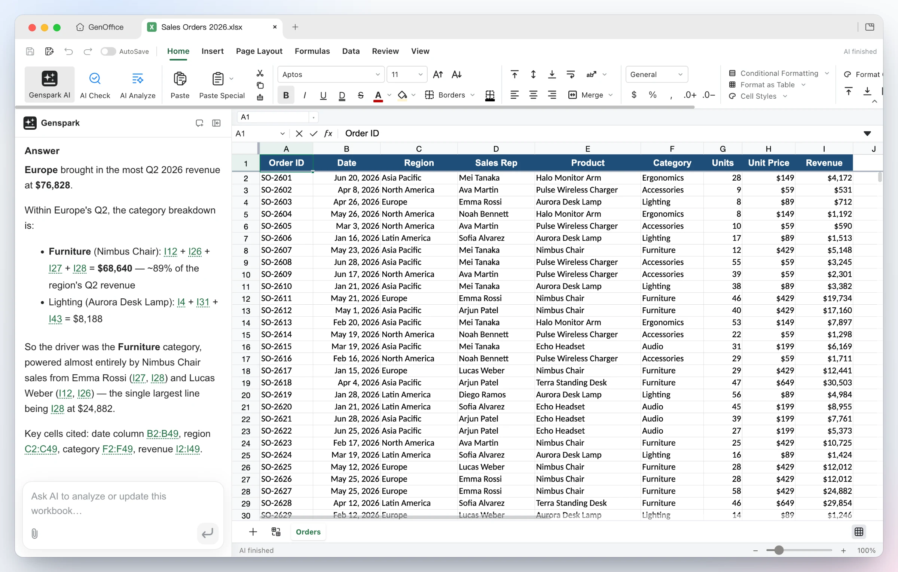</td>
</tr>
<tr>
<td><b>Építsd fel</b> — egyetlen mondatból az ügynök egy Összegzés munkalapot vesz fel valódi <code>SUMIF</code>-ekkel régiónként és kategóriánként, beszúr egy oszlopdiagramot, és mind a 43 módosítást egyetlen, egyben visszavonható kötegként alkalmazza.</td>
<td><b>Kérdezd meg</b> — a munkafüzetről feltett kérdésekre a magyarázattal együtt megkapod a pontos cellákat is, kattintható hivatkozásként. A motorháztető alatt: saját fejlesztésű Rust <code>.xlsx</code> motor, kimutatások, szeletelők, feltételes formázás, képletkövetés, valamint cellába ágyazott képek az Excel natív gazdag értékeiként (rich value) — az Excel újranyitáskor is a cellában tartja őket. A cellajegyzetek képet is hordozhatnak, amely a jegyzet felugró ablaka alatt jelenik meg.</td>
</tr>
</table>

### 3 · Slides — prompttól a kész `.pptx` bemutatóig

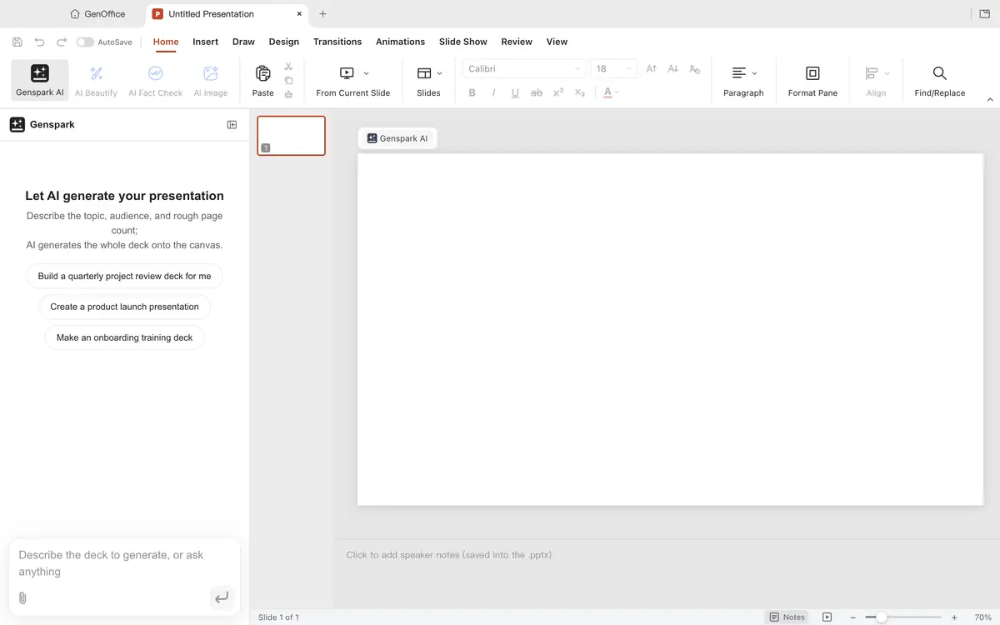

<table>
<tr>
<td width="50%">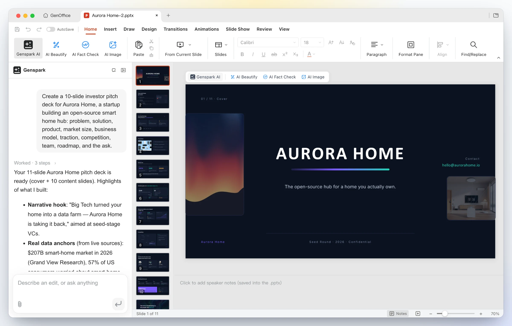</td>
<td width="50%">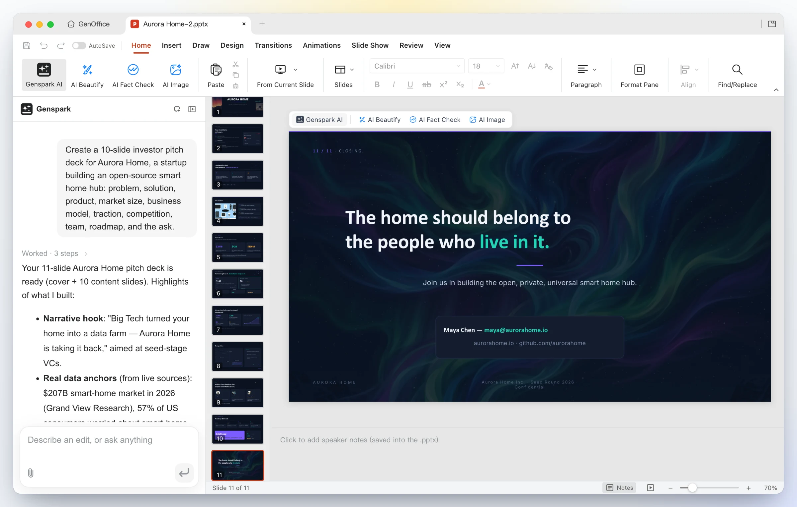</td>
</tr>
<tr>
<td><b>Egyetlen sor bemenetként</b> — „Készíts egy 10 diás befektetői pitch bemutatót az Aurora Home számára…”. A GenOffice megtervezi a történetszálat, utánajár a számoknak, és minden diát valódi <code>.pptx</code>-ként vázol fel a vásznon.</td>
<td><b>Kész bemutató kimenetként</b> — tizenegy megtervezett dia egységes tipográfiával, képi világgal és záró felhívással; szerkeszd tovább diamintákkal, elrendezésekkel, intelligens segédvonalakkal és nem roncsoló vágással, vagy kérd meg a panelt az átformázásra, átírásra és átrendezésre. Szúrj be egy <code>.glb</code> fájlt, és az valódi 3D-modell lesz: forgasd el húzással a szerkesztőben; úgy tárolódik, ahogy a PowerPoint a 3D-t tárolja, ezért a PowerPointban is 3D marad.</td>
</tr>
</table>

A **Diavetítés → Felvétel** diáról diára végigmondja a bemutatót, szüneteltetéssel és folytatással. A narráció és az automatikus továbblépés mért időzítései a <code>.pptx</code>-be mentődnek, és a PowerPoint ugyanígy játssza vissza őket.

### 4 · PDF — PDF-szöveg szerkesztése a helyén, PDF konvertálása Wordbe az eszközön

<table>
<tr>
<td width="50%">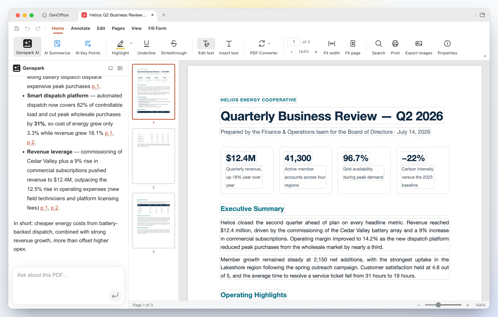</td>
<td width="50%">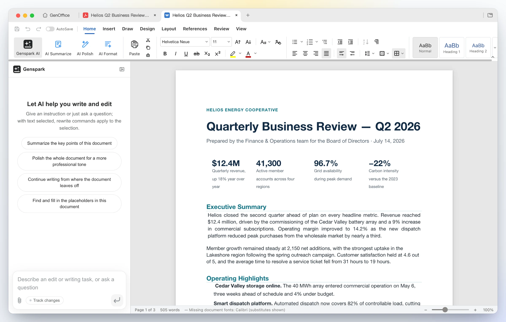</td>
</tr>
<tr>
<td><b>Szerkessz közvetlenül az oldalon</b> — a Szöveg szerkesztése mód körvonalakkal jelöli az összes szövegblokkot, hogy a szöveget a helyén írd át; a tartalomfolyam a PDFiumon keresztül íródik újra az eredeti betűtípusokkal, nem eltakaró jegyzetként. Kérdezd az AI-t egy hosszú jelentésről, és oldalhivatkozásokkal ellátott választ kapsz.</td>
<td><b>Konvertálj az eszközön</b> — a <b>PDF-konvertáló → PDF Wordbe</b> szerkeszthető <code>.docx</code>-et állít elő, amely a Docsban nyílik meg a forrás mellett, a címsorok, statisztikai sorok és bekezdések érintetlenül maradnak. Az Excel és PowerPoint célformátum ugyanígy működik; a beolvasott (szkennelt) oldalakat a rendszer OCR-je olvassa be.</td>
</tr>
</table>

### 5 · HTML — AI-alapú oldal- és UI-építő, először a tervezési brieffel

Mondd el, mire való az oldal, és kinek készül. Az AI először egy **tervezési briefet** javasol — figyelemfelkeltő nyitás, paletta, tipográfia és stílusirányok —, majd ezekhez a tokenekhez egyetlen, önálló `.html` fájlt épít.


<table>
<tr>
<td width="50%">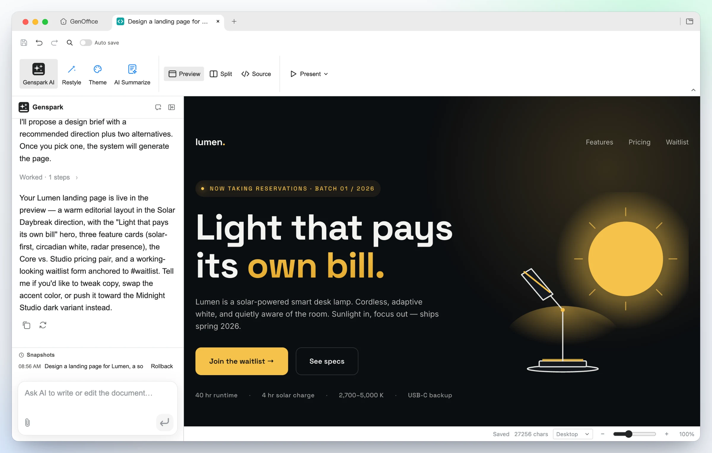</td>
<td width="50%">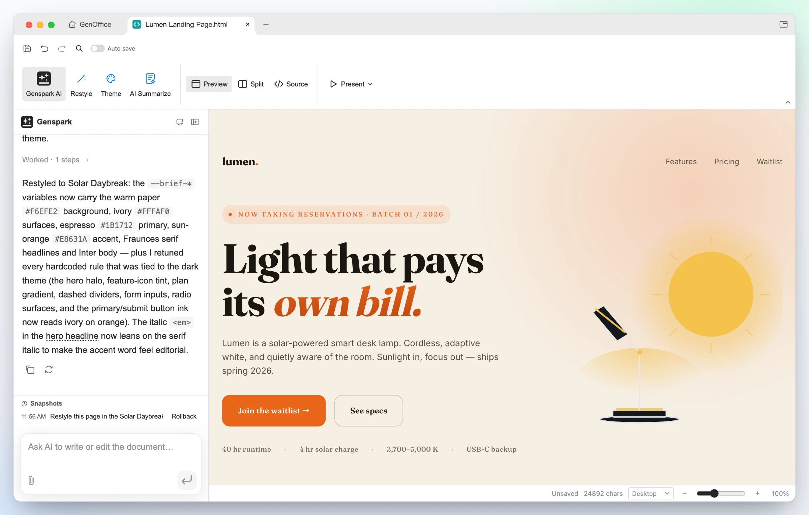</td>
</tr>
<tr>
<td><b>Egyetlen promptból generálva</b> — hatásos hero-szakasz, funkciókártyák, árazás és várólistás jelentkezési űrlap a Lumenhez, a Midnight Studio irányban megépítve. Kattints bármelyik elemre az átformálásához, kattints duplán a szöveg szerkesztéséhez, vagy válts át a CodeMirror forrásnézetre.</td>
<td><b>Ugyanaz a design, új irány</b> — egyetlen <b>Átformázás</b> kérés kicseréli a brief tokenjeit, és az oldal követi: meleg papír, talpas betűs címsorok, napnarancs kiemelőszín, semmit nem kell újraírni. Vetítsd teljes képernyőn, vagy exportáld PDF-be vagy natívan szerkeszthető Word-dokumentumba.</td>
</tr>
</table>
<table>
<tr>
<td width="50%">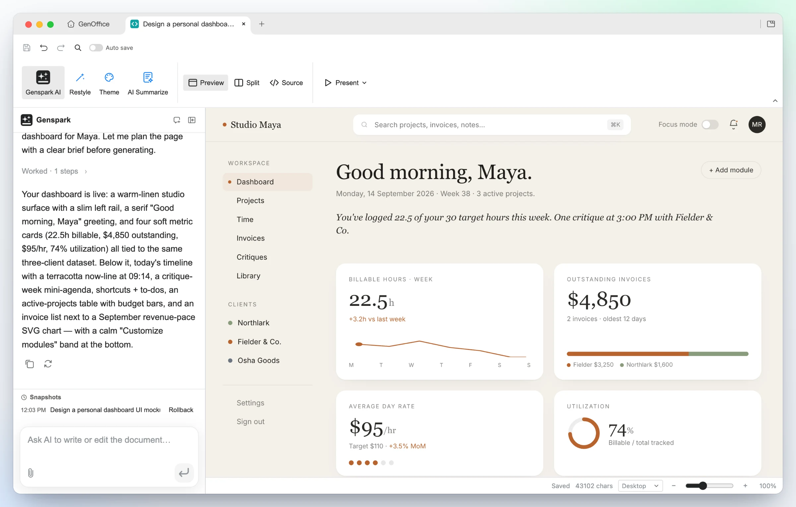</td>
<td width="50%">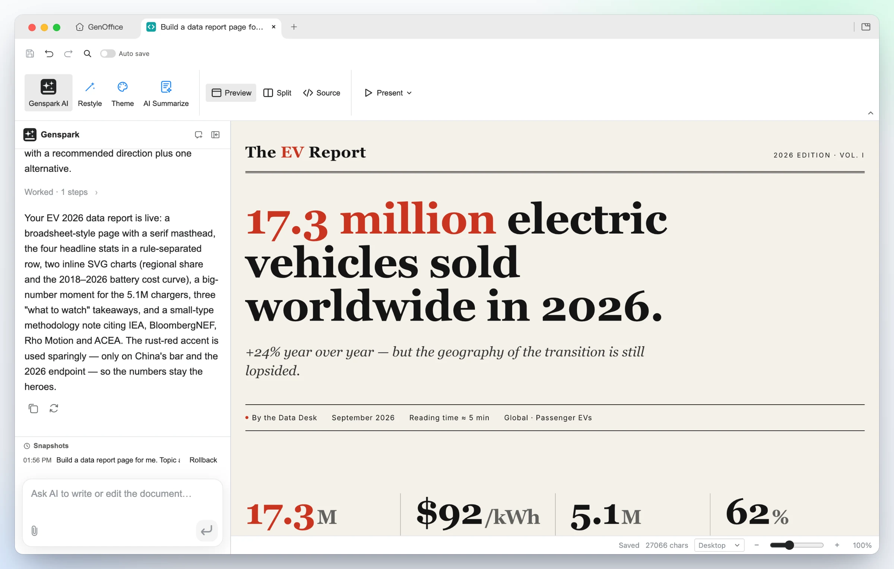</td>
</tr>
<tr>
<td><b>UI-makettek</b> — a „személyes irányítópult” kiinduló sablon egy felhasználói személyleírásból (persona) működő elrendezést formál: bal oldali sáv, üdvözlet, számlázható órák értékgörbéje, számla- és kihasználtságkártyák, mindez valódi HTML, amelyet átadhatsz egy fejlesztőnek.</td>
<td><b>Adattörténetek</b> — az „adatjelentés” kiinduló sablon szerkesztőségi, újságszerű (broadsheet) oldalt épít: talpas betűs lapcím, egyetlen főszám, vonalakkal elválasztott statisztikasor, inline SVG-diagramok és módszertani megjegyzés.</td>
</tr>
</table>

### 6 · Markdown — blokkszerkesztő egyszerű `.md` fölött, AI-kérdezéssel

<table>
<tr>
<td width="50%">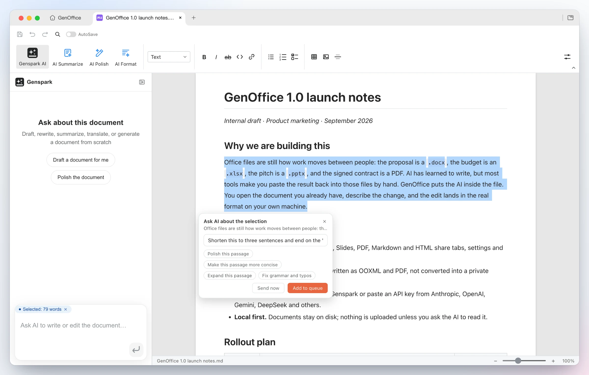</td>
<td width="50%">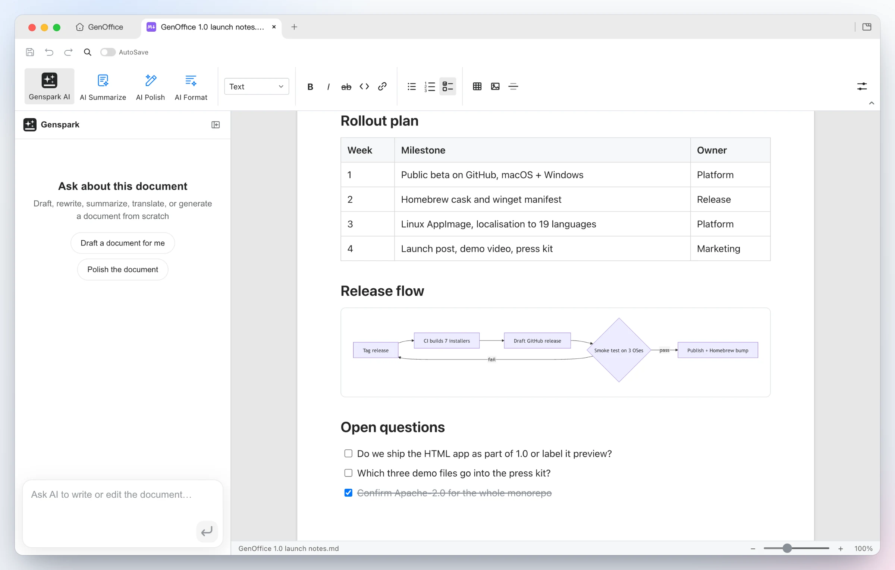</td>
</tr>
<tr>
<td><b>Kérdezd az AI-t egy kijelölésről</b> — jelölj ki bármelyik szövegrészt, és megjelenik egy <b>AI kérdezése</b> chip: írj be egy utasítást, vagy válassz egy javaslatot, küldd el azonnal, vagy tegyél sorba több, szövegrészhez kötött szerkesztést, és futtasd őket egy menetben. Ugyanez a funkció minden alkalmazásban megtalálható.</td>
<td><b>Megjelenítve, egyszerű Markdownként mentve</b> — címsorok, listák, táblázatok, képek, kódblokkok és Mermaid diagramok egy Tiptap blokkszerkesztőben, visszaírva egyszerű <code>.md</code>-ként, teljesen helyi <b>Markdown → Word</b> exporttal.</td>
</tr>
</table>

**Összekapcsolt jegyzetek, ahogy az Obsidian teszi.** A `[[wiki links]]`-re kattintva az adott jegyzethez ugrasz, a `[[` begépelése jegyzetnév-kiegészítést kínál, a `![[…]]` pedig beágyaz egy jegyzetet vagy képet a szövegbe. A **Visszahivatkozások** panel felsorolja az összes jegyzetet, amely a megnyitottra mutat, a **Gráf** nézet pedig feltérképezi a teljes jegyzettár (vault) hivatkozásait.

### 7 · Keresés — találd meg a kérdésedre válaszoló fájlt, TypeSafe Jevvel

A munkamappád minden fájlja helyben indexelve van: nevek, mappák, valamint a Word-, Excel-, PowerPoint-, PDF-, Markdown- és HTML-fájlok kinyert szövege, egy CJK-érzékeny tokenizálású, teljes szövegű SQLite-indexben. Kapcsold be a **Jev keresési átrendezést**, és a legjobb 20 helyi találatot a [TypeSafe Jev](https://typesafe.ai/blog/introducing-system-one-models-and-jev) értékeli, a System One modell, amely szöveg generálása helyett dokumentumonként egyetlen kalibrált relevanciapontszámot ad vissza egyetlen hívásban. A lista e pontszám alapján rendeződik újra; ha a hívás sikertelen, vagy időtúllépés lép fel, a helyi sorrend marad érvényben.


<table>
<tr>
<td width="50%">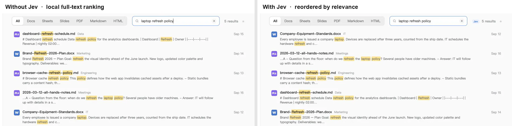</td>
<td width="50%">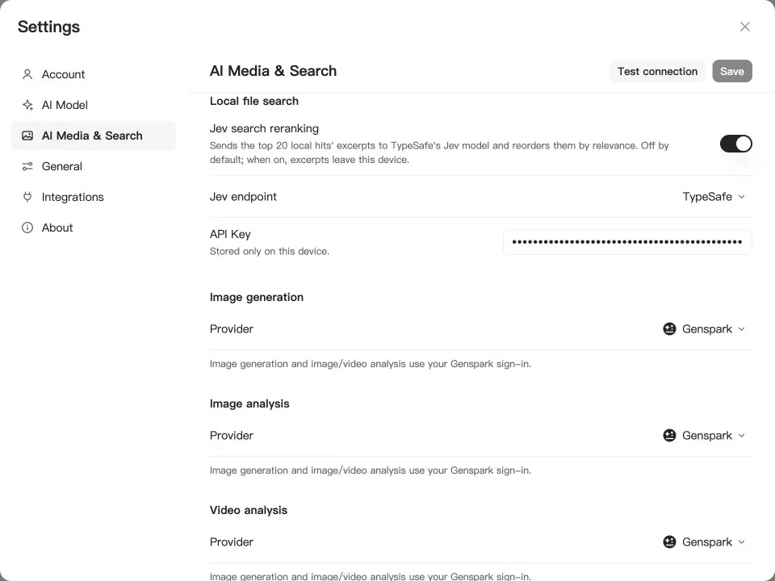</td>
</tr>
<tr>
<td><b>Ugyanazok a szavak, más válaszok</b> — a „laptop frissítési szabályzat” szó szerint egyezik egy böngésző-gyorsítótár frissítési szabályzattal, egy márkafrissítési tervvel és egy irányítópult-frissítési ütemezéssel, így a teljes szöveges rangsorolás ezeket teszi előre. A Jev elolvassa a részleteket, és az eszközszabványok dokumentumát — amely kimondja a hároméves csereciklust — a lista tetejére helyezi. A találatok száma melletti <b>Jev</b> jelvény jelzi, ha a sorrend a modelltől származik.</td>
<td><b>Alapból kikapcsolva, egyetlen kapcsolóval bekapcsolható</b> — Beállítások → AI média és keresés → Helyi fájlkeresés. Válaszd az OpenRoutert vagy a közvetlen TypeSafe-elérést, illessz be egy kulcsot, nyomd meg a Kapcsolat tesztelése gombot. Csak bekapcsolt állapotban hagyják el a gépet a legjobb találatok részletei; maga az index soha.</td>
</tr>
</table>

### 8 · AI kérdezése — a csillagozott fájljaid, forrásokkal megválaszolva

Csillagozd meg azokat a fájlokat, amelyekkel dolgozol, és a kezdőképernyő **AI kérdezése** funkciója tudásbázisként kezeli őket. Tegyél fel egy kérdést természetes nyelven; az ügynök megkeresi a csillagozott fájlokat, elolvassa a szükségeseket, és minden állítás után hivatkozással válaszol. Kattints egy hivatkozásra, és a fájl a megfelelő alkalmazásban nyílik meg. Csatolj fájlokat a kérdéshez húzással, beillesztéssel vagy a **+** menüből — a képek vizuális bemenetként jutnak el a modellhez —, és minden kérdés saját beszélgetésként őrződik meg: válthatsz közöttük, indíthatsz újat, törölhetsz egyet, a lista túléli az újraindítást.


Az AI kérdezése ugyanazt a helyi, teljes szövegű indexet keresi, mint a
[Keresés](#7--search--find-the-file-that-answers-the-question-with-typesafe-jev),
és oldalanként olvassa a fájlokat, így a modell csak a találatokat és a kért szakaszokat látja, az általad választott szolgáltatón keresztül. Emellett meghívhatja a beépített
`genoffice` CLI-t is, hogy teljes fájlokat építsen; mindegyik fájl kártyaként jelenik meg a válasz alatt, és egy kattintással megnyílik.

### 9 · CLI — a kódoló ügynököded vezérli a GenOffice-t, a saját gépeden

A GenOffice egy `genoffice` parancssort és egy ügynök-képességet mellékel. Telepítsd a képességet, és a Claude Code, Codex, Cursor, Gemini CLI, GitHub Copilot, OpenCode vagy
Windsurf valódi Office-fájlokat tud létrehozni, konvertálni, olvasni és szerkeszteni ugyanazokkal a motorokkal, mint az alkalmazások, ablak megnyitása nélkül.

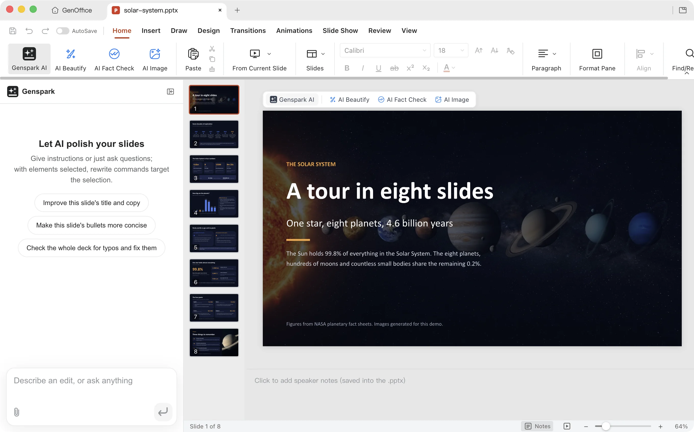

<table>
<tr>
<td width="50%">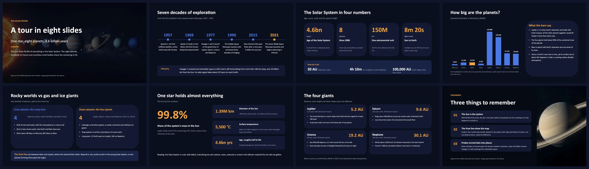</td>
<td width="50%">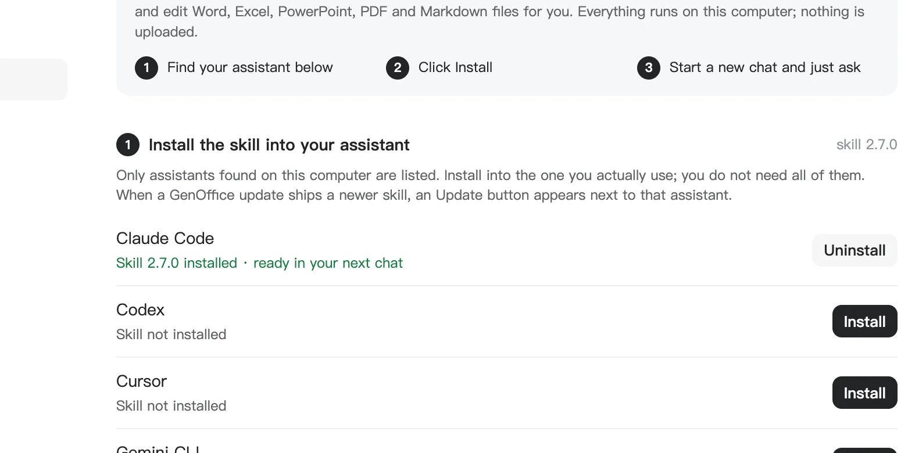</td>
</tr>
<tr>
<td><b>Egy prompt az ügynöködhöz</b> — „Készíts egy nyolc diás bemutatót a Naprendszerről.” Az ügynök elolvassa a képességet, megír egy stíluslapot, egy vázlatot és diánként egy oldalleírást, legenerálja a két fotót a <code>genoffice image</code> paranccsal, és hagyja, hogy a <code>genoffice slides check</code> elutasítson mindent, ami túlnyúlik vagy átfedésben van, mielőtt a <code>genoffice create</code> összeállítja a <code>.pptx</code>-et, és a <code>slides render</code> diánként egy PNG-t ad vissza megtekintésre.</td>
<td><b>Telepítsd egyszer, a Beállítások → Integrációk menüből</b> — a GenOffice felsorolja azokat a kódoló ügynököket, amelyeket ezen a számítógépen talál, és minden kiválasztottba beírja a képességet. Vagy töltsd le a képességet zip-ként, vagy futtasd az <code>npx skills add genspark-ai/genoffice</code> parancsot. A parancsok és a teljes munkafolyamat a <a href="#command-line-and-agent-skill">Parancssor és ügynök-képesség</a> részben található.</td>
</tr>
</table>

### 10 · MCP — ugyanazok az eszközök a Model Context Protocol felett

Minden `genoffice` parancs MCP-eszköz is egyben. A Claude Code, Claude Desktop,
Cursor és bármely más MCP-kliens maga indíthatja a `genoffice mcp`-t, telepítendő képesség és megnyitott ablak nélkül, és 29 eszközt kap, az op-referenciákkal együtt erőforrásként. Az alkalmazáson belüli második, HTTP-s kiszolgáló lehetővé teszi, hogy egy ügynök Word-dokumentumot építsen egy látható szerkesztőlapon, miközben te nézed.

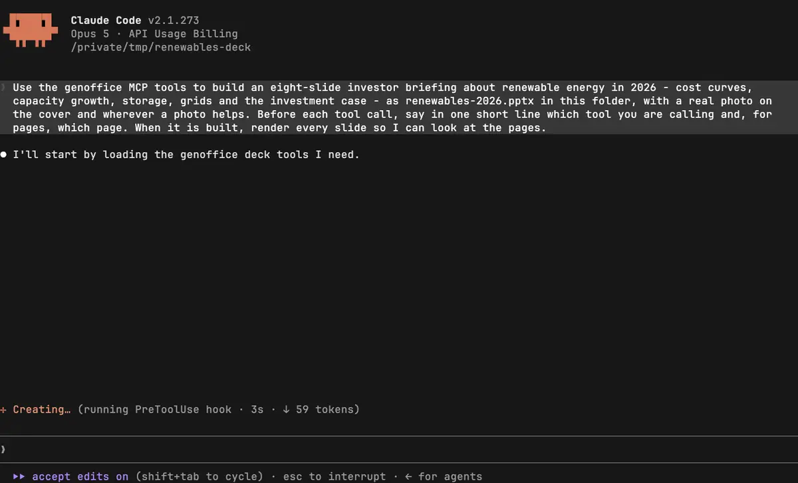

<table>
<tr>
<td width="50%">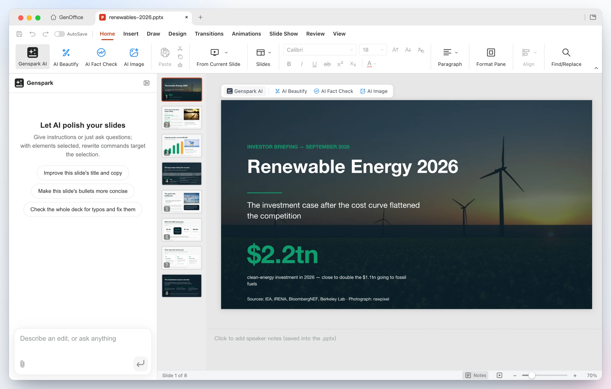</td>
<td width="50%">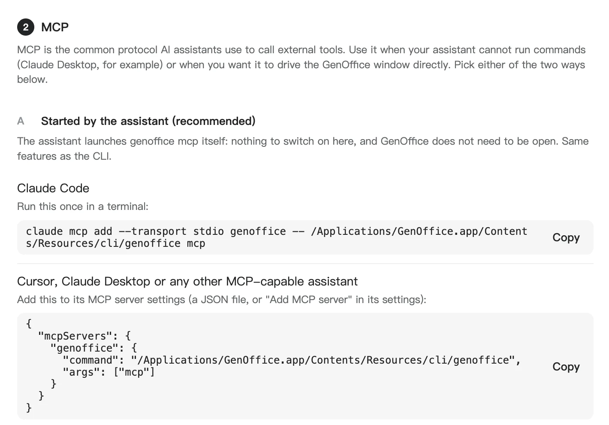</td>
</tr>
<tr>
<td><b>Egy prompt, 38 eszközhívás, shell nélkül</b> — „Készíts egy nyolc diás befektetői áttekintést a megújuló energiáról 2026-ban, valódi fotóval a borítón és mindenütt, ahol egy fotó segít.” Az ügynök a számokat és fotókat a <code>search</code>-szel húzza be, megkérdezi a <code>media</code>-t, hogy minden jelölt kép valódi fotó-e, meghívja a <code>deck_start</code>-ot stíluslappal és vázlattal, majd a <code>deck_page</code>-et diánként egyszer; minden oldalt a vázlat és a paletta alapján ellenőriz, mielőtt megtartaná, a <code>deck_build</code> összeállítja a <code>.pptx</code>-et, a <code>slides_audit</code> túlfolyást keres, a <code>slides_render</code> diánként egy PNG-t ad vissza képtartalomként, amelyet a modell meg tud nézni, és a <code>deck_replace</code> kijavítja a három oldalt, amely nem tetszett neki.</td>
<td><b>Csatlakoztass egyszer, a Beállítások → Integrációk menüből</b> — másold ki a <code>claude mcp add</code> sort a Claude Code-hoz, vagy a JSON blokkot a Cursorba, Claude Desktopba vagy bármely más MCP-kliensbe. A B opció bekapcsolja a helyi HTTP-kiszolgálót a látható Word-szerkesztőhöz. Mindkettő leírása a <a href="#mcp-server">MCP-kiszolgáló</a> részben található.</td>
</tr>
</table>

### 11 · Régi fájlok — a 2000-es évek `.doc`, `.xls` és `.ppt` fájljai is megnyílnak

Egy Word 97–2003 `.doc`, egy Excel `.xls` vagy egy PowerPoint `.ppt` konvertált
`.docx`, `.xlsx` vagy `.pptx` másolatként nyílik meg, amely a saját gépeden készül; az eredeti fájl soha nem módosul. A képek, táblázatok, képletek, számformátumok, kitöltések és
az elrendezés átkerülnek. Hogy az egyes formátumoknál mi marad meg és mi vész el, azt a [A korábbi formátumú és ODF-fájlok konvertált másolatként nyílnak meg](#legacy-and-odf-files-open-as-converted-copies) részben olvashatod.

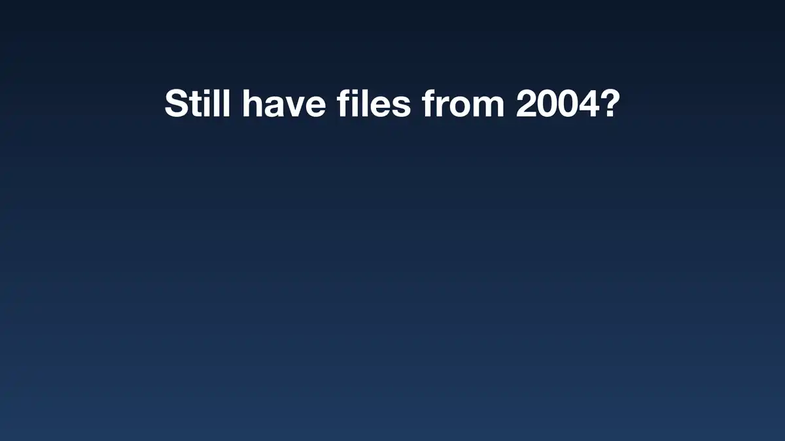

## Miért a GenOffice

- **Nyílt forráskód**, Apache-2.0, nyíltan fejlesztve a GitHubon.
- **Nálad fut.** Natív alkalmazások macOS-re, Windowsra és Linuxra; a fájljaid a saját lemezeden maradnak, és minden szerkesztés, mentés és átalakítás a te gépeden történik.
- **Valódi Office-fájlok.** Natív `.docx`, `.xlsx` és `.pptx`, bájtpontosan: a fájl azon részei, amelyeket nem érintettél, pontosan úgy másolódnak át, ahogy voltak.
- **Olyan AI, amely magát a dokumentumot szerkeszti.** Változáskövetés a Docsban, élő képletek és diagramok a Sheetsben, a diák közvetlenül a vászonra kerülnek – és minden AI-lépés egy pillanatkép, amelyre visszagörgethetsz.
- **Saját modell, saját kulcs.** Jelentkezz be a Gensparkkal, vagy hozz saját kulcsot a Claude-hoz, az OpenAI-hoz, a Geminihez, a DeepSeekhez és sok máshoz – a helyi kiszolgálókat és bármilyen OpenAI-kompatibilis végpontot is beleértve.
- **Rendesen megoldott PDF.** Szerkeszd a szöveget közvetlenül az oldalon, és konvertáld a PDF-et Word-, Excel- vagy PowerPoint-formátumba az eszközön, szkennelt lapoknál a rendszer OCR-jével.
- **Markdown és HTML is**, ugyanazzal az AI-panellel és helyi Word-exporttal.
- **Olyan keresés, amely a választ találja meg, nem a kulcsszót.** Teljes szöveges keresés a mappáidban lévő összes dokumentumban, helyben indexelve, igény szerint a TypeSafe Jev, a System One értékelő modellje általi átrendezéssel.
- **Kérdezz az AI-tól a fájljaidról.** Csillagozd meg a fontos fájlokat, és tegyél fel kérdéseket természetes nyelven; minden válasz megnevezi a forrásfájlt, amely egy kattintással megnyitható.
- **Képességek.** Előre elkészített képességek vagy a saját `SKILL.md`-ed, csatolva bármely AI-panel **+** menüjéből.
- **Szkriptelhető.** Egy `genoffice` parancssori eszköz, egy ügynök-képesség és egy MCP-kiszolgáló a Claude Code, a Claude Desktop, a Codex, a Cursor és más ügynökök szolgálatába állít minden motort – ez is helyben, a gépeden.
- **Ingyenes**, magánszemélyeknek és csapatoknak egyaránt.

## AI-háttérrendszerek

**Jelentkezz be a Gensparkkal**, és nincs mit beállítani: a modellhívások a Genspark-proxyn keresztül mennek (Claude, GPT és Gemini modellcsaládok), az ügynökök pedig webes és képkeresést, képgenerálást, valamint kép-, hang- és videóelemzést kapnak.

**Vagy hozz saját kulcsot.** A Beállítások → AI alatt a Claude, az OpenAI, a Gemini, a DeepSeek, a Kimi, a GLM, a Qwen, a Doubao, a MiniMax, a Grok, a Mistral, az OpenRouter, a Requesty, az Opper, a Cheaper Inference, az Atlas Cloud, a SiliconFlow, a PPIO, a Command Code és az OpenCode Zen/Go szerepel a listán, valamint egy egyéni szolgáltatói hely bármilyen OpenAI-kompatibilis végponthoz (alap URL + kulcs), a helyi modellkiszolgálókat is beleértve. A keresés és a média az **AI média és keresés** alatt funkciónként külön szolgáltatóval rendelkezik: webes keresésre a Serper, a Serply, a SearchApi, a Tavily, a Parallel, a Keenable, az Exa vagy a Firecrawl, képgenerálásra és kép-/videóelemzésre az OpenAI, a Gemini, a Doubao/Seedream, a GLM, a Grok, a Qwen, a MiniMax, a Stability, a FLUX vagy bármilyen OpenAI-kompatibilis képvégpont, képelemzésre pedig a DeepSeek V4.1 Flash.

A **TypeSafe Jev** átrendezi a kezdőképernyő fájlkeresését. Az **AI média és keresés → Helyi fájlkeresés** beállításnál kapcsold be a Jev keresési átrendezését, és válassz végpontot: [OpenRouter](https://openrouter.ai/typesafe) (modell: `typesafe/jev-1.13`) vagy a TypeSafe saját API-ja. A kulcs kizárólag ezen az eszközön tárolódik. Alapértelmezetten ki van kapcsolva; bekapcsoláskor a legjobb 20 helyi találat részletei mennek el értékelésre, és semmi más nem hagyja el a gépet.

A **Parallel** fiók nélkül is működik: az ingyenes Search MCP-je (korlátozott hívásszámú) akkor az alapértelmezett webes keresés, ha se Genspark-bejelentkezés, se keresési kulcs nincs beállítva, és a DuckDuckGo-oldalak kaparásos (scraping) keresése előtt fut. A Webes keresés alatt válaszd a Parallelt, és adj meg egy [Parallel](https://platform.parallel.ai/) kulcsot, ha helyette a Search API-t szeretnéd használni. A Keenable is kulcs nélkül működik; a kulcs csak a hívási korlátokat emeli meg.

A teljes csomag világos, sötét és rendszer szerinti témákkal érkezik. A témák csak a képernyőn látottakat változtatják meg: az exportálások, a nyomtatások és a mentett fájlok mindig a dokumentum saját színeit őrzik.

## Képességek

Egy képesség egy `SKILL.md`, amely elmondja az AI-nak, hogyan oldjon meg egy adott feladatot jól: heti jelentés, NDA, óraterv. A GenOffice egy készletet szállít belőlük, és fogadja a sajátjaidat is, ugyanabban a formátumban, amelyet a kódoló ügynökök használnak.

- **Beállítások → Képességek.** **Telepíts** egy ajánlott képességet, vagy **Importálj** egy mappát, egy zipfájlt vagy egyetlen `SKILL.md`-t. Importáláskor semmi nem fut le. Az **Összes** lap egy helyen sorolja fel a teljes ajánlott katalógust, az alkalmazás nyelvét követő leírásokkal.
- **Csevegésben.** Nyisd meg a **+** menüt bármely AI-panel beviteli mezője mellett, válaszd a **Képességek** pontot, pipálj be egyet, és küldd el. A képesség csak azt az üzenetet kíséri.

---

## Parancssor és ügynök-képesség

Amit az alkalmazások egy fájllal tudnak, azt a `genoffice` parancssor is elvégzi terminálból:
megvizsgál, konvertál, létrehoz, olvas és szerkeszt Word-, Excel-, PowerPoint-,
PDF-, Markdown- és HTML-fájlokat, ugyanazokra a motorokra épülve, grafikus felület nélkül.
A GenOffice-szal együtt települ, nincs szüksége saját futtatókörnyezetre, és egyetlen
dokumentumot sem küld el sehova. A beépített **ügynök-képességgel** párosítva a kódoló
ügynök olyan dokumentummunkássá válik, amely Markdown-közelítések helyett valódi
Office-fájlokat állít elő.

**Működik vele:** Claude Code, Codex, Cursor, Gemini CLI, GitHub Copilot,
OpenCode és Windsurf azonnal, további beállítás nélkül, valamint bármely más ügynök, amelyik
képességeket tud olvasni, és – az [MCP-kiszolgálón](#mcp-server) keresztül – a Claude Desktop
meg minden MCP-kliens.

### A képesség telepítése

| Hogyan                                         | Mi történik                                                                                                                                                                                 |
| ---------------------------------------------- | ------------------------------------------------------------------------------------------------------------------------------------------------------------------------------------------- |
| **Beállítások → Integrációk** az alkalmazásban | Felsorolja a gépen megtalált ügynököket; egy kattintás beírja a képességet mindbe, amelyiket választod. **Frissítés** gomb jelenik meg, ha egy új GenOffice-kiadás frissebb képességet hoz. |
| **Letöltés zipként** ugyanazon az oldalon      | Olyan felépítés, amelyet a claude.ai, a Claude asztali alkalmazásai és más asszisztensek feltöltött képességként elfogadnak.                                                                |
| `npx skills add genspark-ai/genoffice`         | Ebből a tárolóból telepít bármely képesség-kompatibilis ügynökbe.                                                                                                                           |

Ezután indíts új csevegést, és kérj egy dokumentumot. A képesség megtanítja az ügynöknek,
mikor nyúljon a `genoffice`-hoz, hogyan olvasson be egy fájlt a szerkesztés előtt, és
hogyan ellenőrizze a saját munkáját.

### Gyorsindítás a terminálból

```bash
genoffice --version
genoffice info report.docx --json                  # headings and blocks; or sheets, slides, pages
genoffice convert report.md --to pdf               # md/html/docx/xlsx/pptx → pdf, pdf → docx/xlsx/pptx/md/html, odt/ods/odp → docx/xlsx/pptx, doc/dot → docx, ppt → pptx, …
genoffice create --type docx --from notes.md --out notes.docx
genoffice create --type xlsx --from table.json --out sales.xlsx   # "=SUM(B2:B9)" cells stay live formulas
genoffice docs read report.docx --range 0-9 --json # then `docs apply --ops edits.json` edits in place
genoffice docs compare original.docx revised.docx --out redline.docx   # the differences as tracked Word revisions
genoffice render report.docx --out shots/          # one PNG per page, to look at what you made
genoffice open sales.xlsx                          # hand the result to the editor
```

Minden parancs egy egysoros összefoglalót ír ki, `--json` esetén pedig egyetlen
JSON-objektumot ad vissza. A szerkesztések atomiak: egy elutasított op érintetlenül hagyja
a fájlt, és megoldási útmutatást adó hibaüzenettel tér vissza. A `genoffice help` felsorolja az aktuális
parancskészletet; a teljes referencia a [packages/cli/README.md](../../packages/cli/README.md) fájlban található.

### Mit futtat az ügynök valójában

A [demó](#demo) Naprendszer-bemutatója egyetlen promptból készült el a Claude Code-ban.
A háttérben az ügynök a képesség szakaszos munkafolyamatát követte, és a CLI minden
szakaszt ellenőrzött, mielőtt a következő elindult volna:

```bash
genoffice capabilities --json                        # which cloud tools GenOffice has configured
genoffice guide slides design                        # the deck workflow and layout library
genoffice image "the eight planets in a row …" --aspect 16:9 --out deck/assets/cover.jpg
genoffice slides check deck/outline.json --json      # 8 pages, no findings
genoffice slides check deck/pages/01.json --json     # builds one slide, audits overflow and overlap
…                                                    # one page file per slide, fixed until each check is clean
genoffice create --type pptx --spec deck/pages --outline deck/outline.json --out deck/solar-system.pptx --json
genoffice slides render deck/solar-system.pptx --out deck/shots --json
genoffice slides audit deck/solar-system.pptx --json    # 8 slides, no layout issues
genoffice slides replace deck/solar-system.pptx --slide 4 --spec deck/pages/05.json --json
genoffice open deck/solar-system.pptx
```

A `genoffice`-on belül nem történik modellhívás: a gondolkodást az ügynök végzi,
az építést és az ellenőrzést a CLI, az eredmény pedig közönséges `.pptx`-ként nyílik meg
a GenOffice-ban vagy a PowerPointban.

### MCP-kiszolgáló

Ugyanezek a parancsok [Model Context Protocol](https://modelcontextprotocol.io)-eszközként is
elérhetők, olyan asszisztenseknek, amelyek nem tudnak terminált futtatni, vagy amelyeknek
inkább nem adnál egyet. Két út vezet hozzá, mindkettőhöz másolásra kész kódrészletek
tartoznak a **Beállítások → Integrációk → MCP** panelen:

| Mód                                | Mi ez                                                                                                                                                                                                                                                                                                                                                                                                                                                                                                                                          |
| ---------------------------------- | ---------------------------------------------------------------------------------------------------------------------------------------------------------------------------------------------------------------------------------------------------------------------------------------------------------------------------------------------------------------------------------------------------------------------------------------------------------------------------------------------------------------------------------------------- |
| **A · `genoffice mcp`** (ajánlott) | Egy stdio-kiszolgáló, amelyet az asszisztens maga indít el; a GenOffice-nak nem kell nyitva lennie. Parancsonként egy eszköz (`info`, `convert`, `create_docx`, `create_xlsx`, `create_pptx`, `create_pdf`, `docs_read` / `docs_apply` / `docs_check`, `sheet_*`, `slides_*`, `render`, `guide`, `search`, `image`, `media`, `open`), plusz a szakaszos bemutatófolyamat: `deck_start` → `deck_page` → `deck_build` → `deck_replace`. Az opok, a specifikációk és a Markdown inline adódik át, így egy fájlrendszer nélküli kliens is működik. |
| **B · Helyi HTTP-kiszolgáló**      | A GenOffice alkalmazáson belül fut, a `http://127.0.0.1:3093/mcp` címen (Streamable HTTP, örökölt SSE-vel). Az eszközei egy látható Word-szerkesztő lapot vezérelnek: `create_session`, `insert_content`, `replace_blocks`, `apply_ops`, `read_document`, `save_session` – és közben nézheted, ahogy a dokumentum formát ölt. Alapból kikapcsolva; ugyanabban a beállítási panelen kapcsolhatod be.                                                                                                                                            |
| **C · `genoffice mcp --http`**     | A stdio-eszközkészlet Streamable HTTP-kiszolgálóként, más gépeken futó klienseknek: konténer, sandbox vagy a hálózatodon lévő megosztott gép. A fájlok a hívásokkal együtt utaznak: a `PUT /files/<name>` feltölt egyet és URL-t ad vissza, minden `file` paraméter elfogad http(s)-URL-t, és minden fájlt író eszköz letöltési URL-ként adja vissza, kicsi méret esetén a bájtokat is, MCP-erőforrásként. A `--host 0.0.0.0` megnyitja a hálózat felé, a `--token` védi.                                                                      |

```bash
# Claude Code
claude mcp add --transport stdio genoffice -- genoffice mcp
```

```jsonc
// Cursor, Claude Desktop or any other MCP client
{ "mcpServers": { "genoffice": { "command": "genoffice", "args": ["mcp"] } } }
```

```bash
# On the machine that has GenOffice (private network; add --token for a shared box)
genoffice mcp --http 3093 --host 0.0.0.0 --token "$GENOFFICE_MCP_TOKEN"

# From the client: upload, then use the URL wherever a tool takes a file
curl -T report.docx -H "Authorization: Bearer $GENOFFICE_MCP_TOKEN" http://server:3093/files/
#   → { "url": "http://server:3093/files/<id>/report.docx", ... }
#   docs_read({ "file": "http://server:3093/files/<id>/report.docx" })
#   docs_apply(...) → output_url, downloadable with curl -o
```

HTTP-en keresztül minden munkamenet saját privát munkamappát kap, a relatív útvonalak és a
bemutatómappák ezen belül oldódnak fel, az `open` nem érhető el, és ha a
`GENOFFICE_ALLOWED_ROOTS` nincs beállítva, az eszközök nem léphetnek ki a kiszolgáló saját
fájltárolójából. A `render`, a PDF-be konvertáló `convert` és a `create_pdf` továbbra is
rejtett GenOffice-folyamatot indít, ezért egy grafikus felület nélküli gépnek telepített
alkalmazásra és virtuális kijelzőre (`xvfb-run`) van szüksége.

Az itt szereplő `genoffice` az alkalmazásban szállított CLI (macOS-en:
`/Applications/GenOffice.app/Contents/Resources/cli/genoffice`; a beállítási panel kiírja
a pontos elérési utat a telepítésedhez). A kiszolgáló saját munkafolyamat-utasításokkal
érkezik, és az op-referenciákat `genoffice://guide/*` erőforrásokként teszi elérhetővé,
így képesség nem szükséges; a képesség és az MCP-kiszolgáló együtt is megfér, az
asszisztens pedig választ közülük egyet. A felhőalapú funkciók (`search`, `image`, `media`)
továbbra is a GenOffice-ban beállított szolgáltatón mennek keresztül; minden más helyben fut,
a `GENOFFICE_ALLOWED_ROOTS` pedig minden eszközt az általad felsorolt mappákra korlátoz.

A [demó](#demo) megújulóenergia-bemutatója megmutatja, hogyan néz ki protokollszinten
egyetlen prompt a Claude Code-ban, ha mellé csak a `genoffice` MCP-kiszolgáló van
csatlakoztatva:

```text
capabilities · guide(slides, spec) · guide(slides, design)
search(query) ×4                         → IEA, BNEF and IRENA figures for the slides
search(query, images) ×7 · media(url, ask) ×7
                                         → candidate photos, each one checked to be a real photograph
deck_start(dir, style, outline)          → outline checked: 8 pages to write
deck_page(dir, 0, page) … deck_page(dir, 7, page)
                                         → each page checked against the outline and the palette; one page sent again
deck_build(dir, out)                     → renewables-2026.pptx, no image failures
slides_audit(file) · slides_render(file, out)
                                         → no layout findings; 8 PNGs come back as image content
deck_replace(dir, n, page) ×3 · slides_render(file, out)
                                         → three pages fixed after looking at the renders
```

Harmincnyolc hívás, nagyjából tizenhárom perc, és az asszisztens egyetlen shellt sem használt:
a számadatok, a fotók, az útmutatók, az ellenőrzések és a renderelések mind
MCP-eszközeredményként utaztak. Csak a `search` és a `media` hagyta el a gépet –
a GenOffice-ban beállított szolgáltató felé.

## Letöltés

| Platform                             | Követelmények                                         | Letöltés                                                                                      |
| ------------------------------------ | ----------------------------------------------------- | --------------------------------------------------------------------------------------------- |
| **macOS** — Apple Silicon (arm64)    | macOS 11+                                             | [Legfrissebb `.dmg` (arm64)](https://github.com/genspark-ai/genoffice/releases/latest)        |
| **macOS** — Intel (x64)              | macOS 11+                                             | [Legfrissebb `.dmg` (x64)](https://github.com/genspark-ai/genoffice/releases/latest)          |
| **Windows** (x64, a legtöbb gépen)   | Windows 10+, Intel/AMD                                | [Legfrissebb `-x64.exe` telepítő](https://github.com/genspark-ai/genoffice/releases/latest)   |
| **Windows** on Arm (ARM64)           | Windows 11 on Arm (Snapdragon X és hasonlók)          | [Legfrissebb `-arm64.exe` telepítő](https://github.com/genspark-ai/genoffice/releases/latest) |
| **Linux** — Debian / Ubuntu          | x86_64, glibc 2.34+ (Ubuntu 22.04 vagy újabb)         | [Legfrissebb `.deb`](https://github.com/genspark-ai/genoffice/releases/latest)                |
| **Linux** — Fedora / RHEL / openSUSE | x86_64, glibc 2.34+ (Fedora 35+, RHEL 9+, Leap 15.6+) | [Legfrissebb `.rpm`](https://github.com/genspark-ai/genoffice/releases/latest)                |
| **Linux** — egyéb disztribúciók      | x86_64, glibc 2.34+, FUSE 2                           | [Legfrissebb `.AppImage`](https://github.com/genspark-ai/genoffice/releases/latest)           |

Minden build a `main` ágból készül; a macOS- és a Windows-telepítők alá vannak írva.
A régebbi verziók a [Kiadások](https://github.com/genspark-ai/genoffice/releases) oldalon érhetők el.

<details>
<summary><b>Telepítés Linuxon</b></summary>

A deb az apttal telepíthető — ez magával húzza a függőségeket, és felveszi a GenOffice-ot az alkalmazásmenübe:

```bash
sudo apt install ./genoffice_<version>_amd64.deb
```

Fedora / RHEL-család / openSUSE alatt az rpm-et telepítsd helyette:

```bash
sudo dnf install ./genoffice-<version>.x86_64.rpm     # Fedora / RHEL family
sudo zypper install ./genoffice-<version>.x86_64.rpm  # openSUSE
```

A deb és az rpm emellett üres sablonokat is hozzáad a KDE Plasma Dolphinjához: jobb klikk
egy mappában → az **Új létrehozása** menü felsorolja a _GenOffice Document_, a _GenOffice Spreadsheet_
és a _GenOffice Presentation_ elemeket. Ezek a `/usr/share/templates` helyen találhatók, és
a csomag eltávolításakor törlődnek.

Az AppImage helyben fut: telepítsd a FUSE 2 futtatókörnyezetet
(`sudo apt install libfuse2`; Ubuntu 24.04 alatt a csomag neve `libfuse2t64`),
tedd futtathatóvá a fájlt, majd indítsd el:

```bash
chmod +x GenOffice-<version>.AppImage
./GenOffice-<version>.AppImage
```

Chromebookon ugyanezek a csomagok a Linux-környezetben (Crostini) futnak —
a részleteket a [docs/platforms/chromeos.md](../platforms/chromeos.md) tartalmazza.

</details>

## Hogyan működik

Hét Electron-alkalmazás — a Docs, a Sheets, a Slides, a PDF, a Markdown, a HTML és a
lapfüles keretalkalmazás (shell) — egyetlen, tisztán TypeScript-csomagokból álló motorréteget használ közösen,
plusz egy Rust sidecart az `.xlsx` kezeléséhez. Az eredeti fájl mindig az igazság forrása: a
módosítások szűk körű patchekként kerülnek alkalmazásra, és minden, amit a szerkesztő nem érintett,
változatlanul átmegy a teljes körforgáson.

```
open docx ─► archive original by hash (never touched)
          ─► parse word/document.xml into a block tree, each block anchored to its original XML
          ─► Tiptap editor (manual + AI editing, dirty tracking)
save      ─► dirty blocks → OOXML fragments (referencing existing styles only)
          ─► splice into the original document.xml; untouched blocks keep their bytes
          ─► repack the zip; every other entry is copied byte-for-byte
```

A csomagonkénti körbejárás (docx/pptx motorok, `pdf2docx`, `html2docx`,
az ügynökmag és a szolgáltatók) a [CONTRIBUTING.md](../../CONTRIBUTING.md#engine-packages) fájlban található.

### A korábbi formátumú és ODF-fájlok konvertált másolatként nyílnak meg

Azok a formátumok, amelyeket a GenOffice nem tud visszaírni — a Word korábbi `.doc`/`.dot`,
a Hancom `.hwp`/`.hwpx`, az Excel 97 `.xls`, a `.tsv`, a PowerPoint korábbi `.ppt`, valamint az
OpenDocument család (`.odt`, `.ott`, `.ods`, `.ots`, `.odp`, `.otp`) — importok, nem natív fájlok.
Egy ilyen fájl megnyitásakor a program a gépeden `.docx`, `.xlsx` vagy `.pptx`
másolattá alakítja, és azt a másolatot nyitja meg; az eredetit soha többé nem olvassa és nem írja.

- A Docs és a Slides először megkérdezi, hová kerüljön a másolat (alapértelmezetten az eredeti
  mellett, `.docx`/`.pptx` fájlként), így minden későbbi Mentés oda kerül. Egy `.ppt` a diamintáival,
  az alakzatok geometriájával, a kitöltésekkel, a képekkel és a szövegformázással együtt konvertálódik,
  így a bemutató úgy néz ki, ahogy a PowerPoint mutatta; a jegyzetek, animációk, áttűnések és
  hivatkozások egyelőre nem kerülnek át.
- A Sheets a konvertált munkafüzetet rögtön megnyitja, és az első Mentést a Mentés másként felé
  irányítja, egy friss `.xlsx` fájlba. A `.csv` kivétel: ez megtartja a saját formátumát, és a Mentés az értékeket
  visszaírja a `.csv` fájlba, ahogy az Excel is teszi.
- Az átalakítás egyirányú, és eldobhat olyan funkciókat, amelyeket a forrásformátum ismer, de az
  OOXML nem. A `.doc`, a `.ppt`, a `.hwp` és az ODF-formátumok esetén erről megerősítő
  párbeszédpanel tájékoztat; az átugrásához jelöld be a „Konvertálás kérdezés nélkül a jövőben”
  jelölőnégyzetet, a Beállítások → Általános alatt pedig a „Kérdezés a korábbi fájlok konvertálása
  előtt” beállítással kapcsolható vissza.

## Fejlesztés

```bash
npm install
npm run fixtures     # generate test .docx fixtures
npm test             # engine + app unit tests (docs/sheets/slides need no display)
npm run typecheck    # tsc --noEmit across every workspace
npm run dev          # all six editors + shell against Vite dev servers
npm run dev:docs     # a single app (same pattern works per workspace)
npm run dist:mac     # package macOS dmg (regenerates third-party notices)
npm run dist:win     # package Windows nsis installer
npm run dist:linux   # package Linux AppImage + deb + rpm
```

A Sheets-alkalmazásnak az xlsx sidecarhoz emellett Rust-eszközláncra is szüksége van
(`cargo` a PATH-on); az `npm run build -w @genoffice/sheets` ezt automatikusan lefordítja.
A [CONTRIBUTING.md](../../CONTRIBUTING.md) leírja az ellenőrzéseket, amelyeken minden változtatásnak
át kell mennie, valamint azt, hogyan kerülnek be a pull requestek.

## Közösség

A GenOffice aktív fejlesztés alatt áll, és a visszajelzéseid formálják.

- **Jelents hibát vagy kérj új funkciót** a
  [GitHub Issues](https://github.com/genspark-ai/genoffice/issues) oldalon.
- **Csatlakozz a GenOffice csoportcsevegéséhez** a
  [GenTeam](https://genoffice.ai/join) oldalon, hogy a csapattal és más felhasználókkal
  beszélgethess.
- **Kövesd [@merrickbuilds](https://x.com/merrickbuilds) fiókját X-en** a kiadási
  megjegyzésekért, a demókért és az éppen készülő újdonságokért.
- **Csillagozd a repót**, ha hasznosnak találod a GenOffice-ot — ez a legjobb módja
  a projekt támogatásának.

## GYIK

<details>
<summary><b>Ingyenes a GenOffice?</b></summary>

Igen. A GenOffice ingyenes és nyílt forráskódú, Apache-2.0 licenc alatt — nincs
próbaidőszak, és magukért az alkalmazásokért sem kell fizetni.

</details>

<details>
<summary><b>Meg tudja nyitni a GenOffice a Microsoft Word-, Excel- és PowerPoint-fájlokat?</b></summary>

Igen. A GenOffice natív `.docx`, `.xlsx` és `.pptx` fájlokat nyit meg és ment.
A mentés bájtpontos: a fájl azon részei, amelyeket nem módosítottál, bájtról
bájtra íródnak vissza, így a dokumentumok a Microsoft Office-ban is
tovább működnek. A régi `.doc`/`.dot`, `.xls` és `.ppt` fájlok is megnyílnak,
konvertált `.docx`/`.xlsx`/`.pptx` másolatként — lásd: [A korábbi formátumú és
ODF-fájlok konvertált másolatként nyílnak meg](#legacy-and-odf-files-open-as-converted-copies).

</details>

<details>
<summary><b>Működik a GenOffice offline is?</b></summary>

A dokumentumszerkesztés teljesen helyi — a fájlok soha nem hagyják el a gépedet
megnyitás, szerkesztés, mentés vagy átalakítás céljából. Az AI-funkciók
(ügynökök, keresés, képeszközök) hálózati kapcsolatot igényelnek: ehhez vagy a
Genspark-bejelentkezés, vagy a saját modell-API-kulcsod kell.

</details>

<details>
<summary><b>Tud a GenOffice PDF-fájlokat szerkeszteni?</b></summary>

Igen — valódi PDF-szöveg- és képszerkesztés, amely újraírja az oldal
tartalomfolyamát az eredeti betűtípusok megtartásával, nem pedig
eltakaró jegyzeteket tesz rá.

</details>

<details>
<summary><b>Át tudja alakítani a GenOffice a PDF-et Word-, Excel- vagy PowerPoint-formátumba?</b></summary>

Igen — teljesen az eszközön: PDFium karakterszintű kinyerés és geometria alapú
elrendezéselemzés, felhőszolgáltatás és feltöltés nélkül. A beolvasott oldalakra
is ez érvényes: macOS-en és Windowson a rendszer OCR-je olvassa be őket, így
szerkeszthető szöveggé alakulnak, nem oldalképpé.

</details>

<details>
<summary><b>Használhatok saját AI-modellt vagy API-kulcsot?</b></summary>

Igen. A kulcs nélküli Genspark-bejelentkezés mellett a GenOffice támogatja a
saját kulcs használatát is: Claude, OpenAI, Gemini, DeepSeek, Kimi, GLM, Qwen,
Doubao, MiniMax, Grok, Mistral, OpenRouter, Requesty, Opper, Cheaper Inference,
Atlas Cloud és OpenCode Zen/Go, valamint bármely OpenAI-kompatibilis végpont —
ideértve a helyi modellkiszolgálókat is. A keresés, a képgenerálás és a
kép-/videóelemzés külön kulcsot használ; ezeket a Beállítások → AI média és
keresés alatt adhatod meg.

</details>

<details>
<summary><b>Ki lehet kapcsolni az AI-panelt?</b></summary>

Igen. A Beállítások → AI oldalon található az **AI-oldalsáv megjelenítése**
kapcsoló. Ha kikapcsolod, minden szerkesztő elrejti az oldalsávot, és az új
dokumentumok már nem nyitják meg maguktól. Egy kifejezett AI-művelet — egy
menüszalag-gomb, egy menüelem — továbbra is megnyitja a panelt az adott
dokumentumhoz, bezáráskor pedig ismét rejtett lesz.

</details>

<details>
<summary><b>Át tudja alakítani a GenOffice a HTML-t Word-formátumba?</b></summary>

Igen — a HTML-alkalmazás Exportálás Wordként funkciója teljesen az eszközön,
natív, szerkeszthető `.docx` fájlt készít. Az oldal a beépített Chromiumban
renderelődik le, és valódi Word-struktúrákká alakul: címsorok, bekezdések,
listák, táblázatok, kártyák, KPI-sorok, űrlapmezők és oldalháttér; csak azok a
vizuális elemek ágyazódnak be képként, amelyeknek nincs Word-megfelelőjük
(diagramok, ikonok, díszített dobozok).

</details>

<details>
<summary><b>Irányíthatom a GenOffice-ot Claude Code-ból, Codexből, Cursorból vagy szkriptből?</b></summary>

Igen. A GenOffice telepít egy `genoffice` parancssori eszközt, amely ugyanazokat
a motorokat futtatja grafikus felület nélkül: dokumentumok vizsgálata,
átalakítása, létrehozása, olvasása és szerkesztése terminálból vagy szkriptből,
`--json` kimenettel a programok számára. A mellékelt ügynök-képesség megtanítja
használni a Claude Code, Codex, Cursor, Gemini CLI, GitHub Copilot, OpenCode és
Windsurf eszközöknek; a Beállítások → Integrációk pontnál telepítheted. Lásd:
[Parancssor és ügynök-képesség](#command-line-and-agent-skill).

</details>

<details>
<summary><b>Gyűjt adatokat a GenOffice?</b></summary>

A hivatalos, csomagolt kiadások alapértelmezés szerint korlátozott körű használati
statisztikát küldenek, a jelentéstételt pedig bármikor kikapcsolhatod a
Beállítások → Általános pontnál. A statisztika soha nem küld dokumentumtartalmat,
fájlneveket, fájlútvonalakat, fiókazonosságot vagy e-mail-címeket. Az
eseményekre és az adatokra vonatkozó teljes közlést lásd: [GenOffice
adatvédelem](../../PRIVACY.md).

</details>

## Biztonság

A [SECURITY.md](../../SECURITY.md) ismerteti a folyamatok biztonsági kialakítását
(renderelő folyamat sandboxolása, IPC-érvényesítés, külső hivatkozások szabályozott
megnyitása), valamint az AI által generált tartalom fenyegetési modelljeit.

## Köszönetnyilvánítás

A GenOffice a következő nyílt forráskódú projektek nélkül nem jöhetett volna
létre:

- [Electron](https://www.electronjs.org/) — az asztali futtatókörnyezet minden
  alkalmazáshoz.
- [Univer](https://github.com/dream-num/univer) (Apache-2.0) — a táblázatkezelő
  UI-mag, amelyet a Sheets bővít ki.
- [PDFium](https://pdfium.googlesource.com/pdfium/) (BSD-3-Clause, a
  [@embedpdf/pdfium](https://github.com/embedpdf/embed-pdf-viewer) segítségével
  csomagolva) — a valódi PDF-szöveg- és képszerkesztést működtető
  tartalomfolyam-motor.
- [pdf.js](https://github.com/mozilla/pdf.js) (Apache-2.0) és
  [pdf-lib](https://github.com/Hopding/pdf-lib) (MIT) — PDF-megjelenítés és
  dokumentum-összeállítás.
- [Tiptap](https://tiptap.dev/) / [ProseMirror](https://prosemirror.net/) —
  a Docs és a Markdown blokkszerkesztői.
- [CodeMirror](https://codemirror.net/) (MIT) — a forráskód-szerkesztő a
  HTML-ben.
- [Konva](https://konvajs.org/) — vászonra renderelés a Slides és a Sheets
  diagramjaihoz.
- [HarfBuzz](https://github.com/harfbuzz/harfbuzz) (wasm) — szövegalakítási
  (text shaping) metrikák összetett írásrendszerekhez.
- [calamine](https://github.com/tafia/calamine) és
  [IronCalc](https://github.com/ironcalc/IronCalc) — a Rust xlsx sidecar
  olvasási és számítási rétegei.
- [libeot](https://github.com/umanwizard/libeot) (MPL-2.0) — a MicroType
  Express dekóder a PowerPointba ágyazott betűtípusokhoz, TypeScriptre portolva.
- [rhwp](https://github.com/edwardkim/rhwp) (MIT) — bináris `.hwp`
  dokumentumokat olvas be HWPX-formátumba a Hancom-importhoz; a
  WebAssembly-változata tartalmazza a Rust crate-eket és a Volexity hwp-extract
  portját, amelyek a harmadik felekre vonatkozó megjegyzésekben szerepelnek. A
  „한글”, „한컴”, „HWP” és „HWPX” a Hancom Inc. bejegyzett védjegyei; a GenOffice
  nem áll kapcsolatban a Hancommal.
- [React](https://react.dev/) (MIT) — minden alkalmazás UI-rétege.
- [Mermaid](https://mermaid.js.org/) (MIT) és [KaTeX](https://katex.org/)
  (MIT) — diagramok és matematikai képletek a Markdownban és a Docsban.
- [opentype.js](https://opentype.js.org/) (MIT) — betűtípus-elemzés metrikákhoz
  és glifakereséshez.
- [JSZip](https://stuk.github.io/jszip/) (MIT) és
  [fast-xml-parser](https://github.com/NaturalIntelligence/fast-xml-parser)
  (MIT) — az OOXML-tároló és az XML-rétegek.
- [Fluent UI System Icons](https://github.com/microsoft/fluentui-system-icons)
  (MIT) — az ikonkészlet a menüszalagokon.
- [electron-updater](https://www.electron.build/) (MIT) — az alkalmazáson
  belüli frissítések.
- Liberation, Carlito, Caladea és Noto CJK betűtípusok (OFL/Apache-2.0) — a
  csomagolt dokumentumbetűtípusok.

Az `npm run notices` újragenerálja a csomagolt, harmadik felekre vonatkozó
licencösszefoglalót (`tools/gen-third-party-notices.mjs`); minden futásidejű
függőség MIT/Apache-2.0/BSD-3-Clause/OFL licencű.

## Licenc

A GenOffice az [Apache License 2.0](../../LICENSE) licenc alatt érhető el, egy
kivétellel: az `ee/` könyvtár a jövőbeli vállalati moduloknak van fenntartva,
és a [GenOffice Enterprise License](../../ee/LICENSE) hatálya alá tartozik.

A GenOffice és a Genspark nevek és logók a Mainfunc, Inc. védjegyei. Az
Apache-2.0 licenc nem ad engedélyt a használatukra (lásd a 6. szakaszt); a
forkok saját márkajelzést használjanak.
