<p align="center">
  <a href="https://genoffice.ai/">
    <picture>
      <source srcset="../assets/readme/hero-dark.webp" media="(prefers-color-scheme: dark)">
      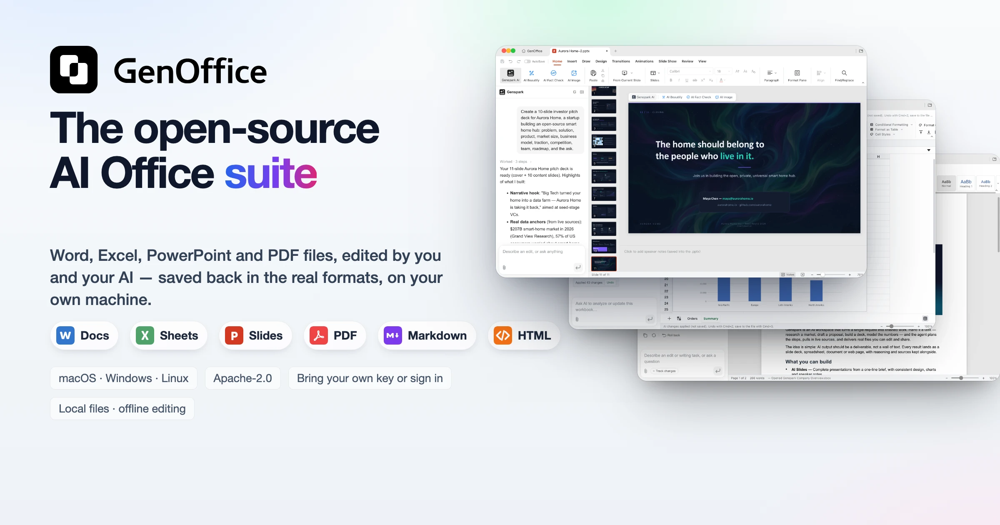
    </picture>
  </a>
</p>

<h1 align="center">GenOffice</h1>

<p align="center"><b>世界初のフル機能を備えたオープンソース AI オフィススイート。</b><br>
Word、Excel、PowerPoint、PDF ファイルを、あなたとあなたの AI が編集し、実際のファイル形式のまま保存します。</p>

<p align="center">
  <a href="../../LICENSE"></a>
  <a href="https://github.com/genspark-ai/genoffice/releases/latest"></a>
  <a href="https://github.com/genspark-ai/genoffice/releases"></a>
  <a href="https://github.com/genspark-ai/genoffice/stargazers"></a>
  <a href="https://x.com/merrickbuilds"></a>
</p>

<p align="center"><a href="../../README.md">English</a> · <a href="README.es.md">Español</a> · <a href="README.pt-BR.md">Português</a> · <a href="README.de.md">Deutsch</a> · <a href="README.fr.md">Français</a> · <a href="README.zh-CN.md">简体中文</a> · <a href="README.zh-TW.md">繁體中文</a> · <a href="README.ko.md">한국어</a> · <b>日本語</b> · <a href="README.ar.md">العربية</a> · <a href="README.ru.md">Русский</a> · <a href="README.it.md">Italiano</a> · <a href="README.nl.md">Nederlands</a> · <a href="README.pl.md">Polski</a> · <a href="README.cs.md">Čeština</a> · <a href="README.id.md">Bahasa Indonesia</a> · <a href="README.ms.md">Bahasa Melayu</a> · <a href="README.th.md">ไทย</a> · <a href="README.hi.md">हिन्दी</a> · <a href="README.he.md">עברית</a> · <a href="README.vi.md">Tiếng Việt</a> · <a href="README.tr.md">Türkçe</a> · <a href="README.hu.md">Magyar</a></p>

<p align="center">
  <a href="#download"><b>ダウンロード</b></a> ·
  <a href="#skills"><b>スキル</b></a> ·
  <a href="#command-line-and-agent-skill"><b>CLI</b></a> ·
  <a href="#mcp-server"><b>MCP</b></a> ·
  <a href="https://genoffice.ai/"><b>ウェブサイト</b></a> ·
  <a href="https://genoffice.ai/join"><b>コミュニティ</b></a> ·
  <a href="https://x.com/merrickbuilds"><b>X</b></a> ·
  <a href="../../PRIVACY.md"><b>プライバシー</b></a>
</p>

GenOffice は、macOS・Windows・Linux で動作する、Microsoft Office に代わる無料のオープンソース製品です。ネイティブの `.docx`・`.xlsx`・`.pptx` ファイルを開いて保存できるほか、PDF・Markdown・HTML の編集にも対応し、あらゆるドキュメントの隣に AI エージェントを配置します。取って付けたようなチャットボックスではなく、ファイルを読み込み、変更を加え、何をどう変更したかを正確に示してくれるエディタです。ODF ファイル（`.odt`・`.ods`・`.odp` と `.ott`/`.ots`/`.otp` の各テンプレート）は、編集可能な OOXML コピーとして開きます。旧形式の Word `.doc`/`.dot`、Excel 97 の `.xls`、PowerPoint 97–2003 の `.ppt`、Hancom ドキュメント（`.hwp`・`.hwpx`）も同様です。これらのインポートは「開くだけ」で、保存時に書き出されるのは常に OOXML であり、元の形式ではありません。

- **実際のファイル形式、バイト単位で保持。** 編集した部分だけが書き換えられます。それ以外の部分はファイル内でバイト単位そのまま保持されるため、ドキュメントは Word・Excel・PowerPoint でも問題なく動作し続けます。
- **レビューできる AI。** 編集内容は変更履歴と差分として反映され、ワンクリックで元に戻せます。スプレッドシートには貼り付けの数値ではなく、実際に機能する数式が入ります。デッキやページはキャンバス上に生成され、そのまま自由に編集できます。Docs の選択範囲や Sheets のセル範囲をモデルから隠すと、AI に見えるのは名前付きのプレースホルダーだけです。元のテキストはファイル内にそのまま残り、あとで元に戻せます。この隠し機能の対象はこのアプリの AI だけです — CLI、MCP ツール、ヘッドレス書き出しはファイルを直接読み込むため、元のテキストもそのまま見えます。
- **設計からローカル動作。** ファイルの開く・編集・保存・変換はすべてお使いのマシン上で行われます。PDF → Word / Excel / PowerPoint、Markdown → Word、HTML → Word の変換もすべてオンデバイスで実行されます。マシンの外に出るのは、選択した AI プロバイダーへの呼び出しだけです。
- **ファイルを中身で探す。** ホーム画面では、`.docx`・`.xlsx`・`.pptx`・PDF・Markdown・HTML ファイルの名前、フォルダー、全文を、ローカルの SQLite インデックスから検索できます。CJK にも対応しています。オプションで、上位のヒットを System One の判定モデル **[TypeSafe Jev](https://typesafe.ai/)** が並べ替え、質問に答えているファイルが先頭に来るようにします。
- **ファイルに質問し、出典付きで答えを得る。** ドキュメントにスターを付けておくと、ホーム画面の **Ask AI** がそれらを横断して質問に答え、主張ごとに根拠となるファイルを引用するので、開いて確かめられます。
- **キーを使うか使わないかはあなた次第。** Genspark でサインインすればキーの用意は不要です。あるいは、Claude、OpenAI、Gemini、DeepSeek、Kimi、GLM、Qwen、Doubao、MiniMax、Grok、Mistral、OpenRouter、Requesty、Opper、Cheaper Inference、Atlas Cloud、または任意の OpenAI 互換エンドポイント（ローカルサーバーを含む）向けに、自分の API キーを持ち込むこともできます。
- **スクリプト化でき、エージェントからも使える。** アプリには `genoffice` コマンドラインと、Claude Code、Codex、Cursor、Gemini CLI、GitHub Copilot、OpenCode、Windsurf 向けのスキルが同梱されているため、コーディングエージェントはウィンドウを一つも開かずに、お使いのマシン上で本物の Office ファイルを作成・変換・読み取り・編集できます。

**入手方法：** [macOS](https://github.com/genspark-ai/genoffice/releases/latest)（Apple Silicon および Intel）·
[Windows](https://github.com/genspark-ai/genoffice/releases/latest)（x64 および Arm）·
[Linux](https://github.com/genspark-ai/genoffice/releases/latest)（deb、rpm、AppImage）—
詳細と要件は[ダウンロード](#download)を参照してください。

## <a id="demo"></a>デモ

6 つのアプリ、1 つの AI パネル、TypeSafe Jev が並べ替えるファイル検索、スター付きファイルから出典付きで答える Ask AI、そしてコーディングエージェント向けのコマンドライン。すべてのスクリーンショットは macOS 上の実際のアプリで撮影したもので、AI はパネル内に表示されているプロンプトそのもので動かしています。

### 1 · Docs — `.docx` を開いて、レビューできる AI で編集

<table>
<tr>
<td width="50%">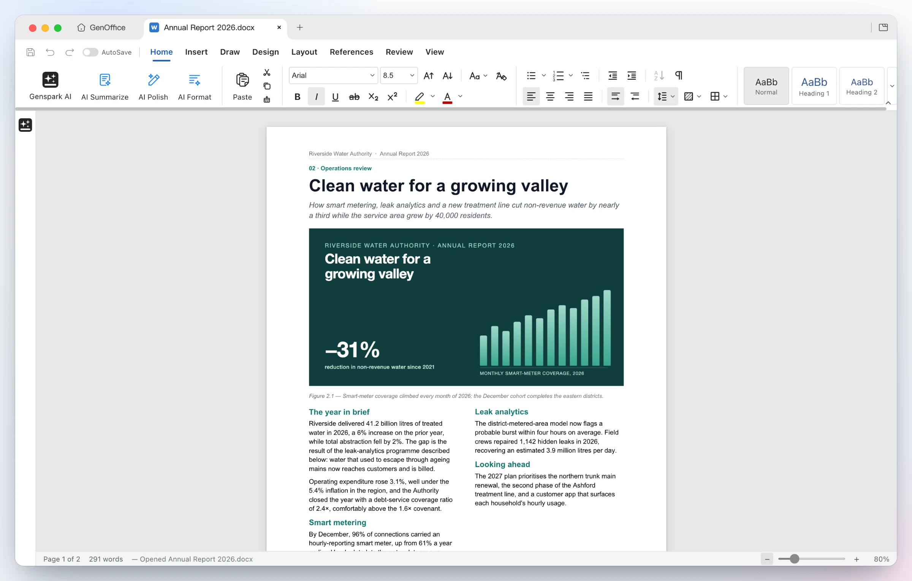</td>
<td width="50%">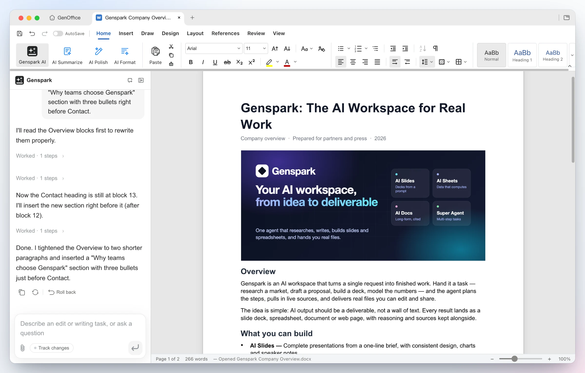</td>
</tr>
<tr>
<td><b>Word と同じレイアウトでファイルを開く</b> — 2 段組セクション、フチなし画像、網掛けの表、ヘッダーとフッター、Word の行メトリクスに基づくページ送りまで再現します。スタイル、コメント、変更履歴、数式、手書き（インク）、コンテンツ コントロールもそのまま保持されます。<b>Mailings</b> タブで、ドキュメントを差し込み印刷のテンプレートにできます：<code>.xlsx</code> か <code>.csv</code> の宛先リストを選び、本物の <code>MERGEFIELD</code> を挿入し、レコードごとにプレビューしたうえで、1 つのドキュメントにまとめて差し込むことも、レコードごとに 1 つの <code>.docx</code> を作ることもできます。</td>
<td><b>編集を依頼する</b> — AI が必要なブロックを読み取り、Overview を書き直して新しい箇条書きセクションを挿入します。AI の各ターンはロールバック可能なスナップショットとして記録され、<b>変更履歴の記録</b>を有効にすると、編集は Word 形式のリビジョンとして反映されます。代わりにマインドマップを頼めば、答えはドキュメント全体のインタラクティブな図になります：枝は折りたたむことができ、ズームやパンも可能で、ノードをクリックすればその場で続けて質問ができ、引用は出どころのブロックへジャンプして戻ります。</td>
</tr>
</table>

### 2 · Sheets — 貼り付けの数値ではなく、実際に機能する数式とグラフを備えた `.xlsx`

<table>
<tr>
<td width="50%">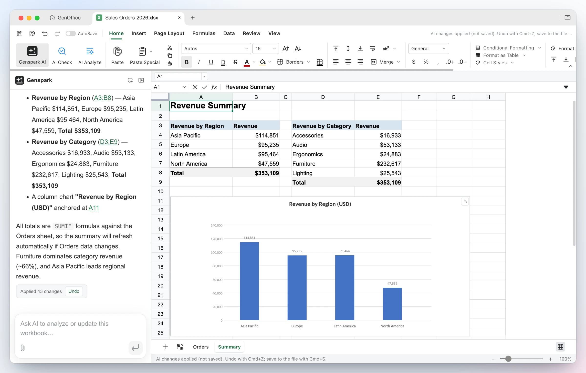</td>
<td width="50%">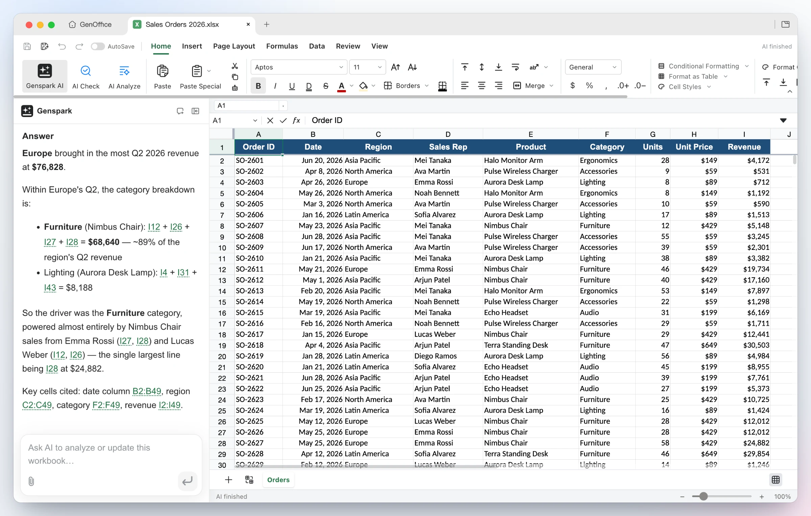</td>
</tr>
<tr>
<td><b>作ってもらう</b> — 一文の指示だけで、エージェントが地域・カテゴリ別の本物の <code>SUMIF</code> 数式を使った Summary シートを追加し、縦棒グラフを挿入し、43 件の変更をひとまとめの取り消し可能な操作として適用します。</td>
<td><b>質問する</b> — ワークブックについての質問には、根拠となる考え方と、実際に使用したセルへのクリック可能な引用付きで回答が返ってきます。内部では、自社開発の Rust 製 <code>.xlsx</code> エンジン、ピボットテーブル、スライサー、条件付き書式、数式トレース、そして Excel のネイティブなリッチ値としてセルに埋め込まれた画像が動いています — Excel で開き直しても、画像はセルの中にそのまま残っています。セルのメモには画像を添付でき、メモのポップアップの下に表示されます。</td>
</tr>
</table>

### 3 · Slides — 1 つのプロンプトから `.pptx` デッキへ

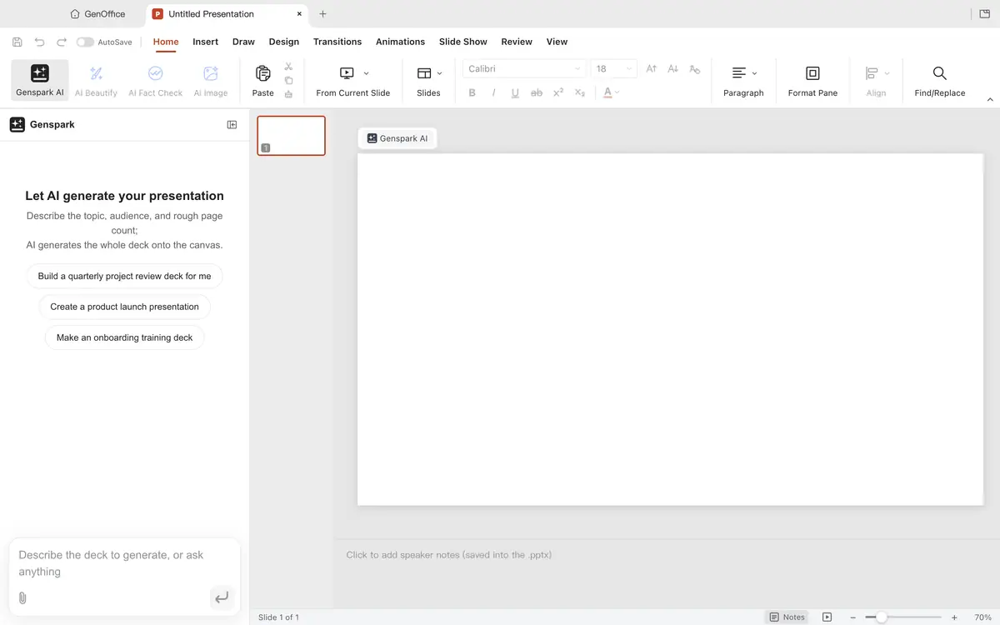

<table>
<tr>
<td width="50%">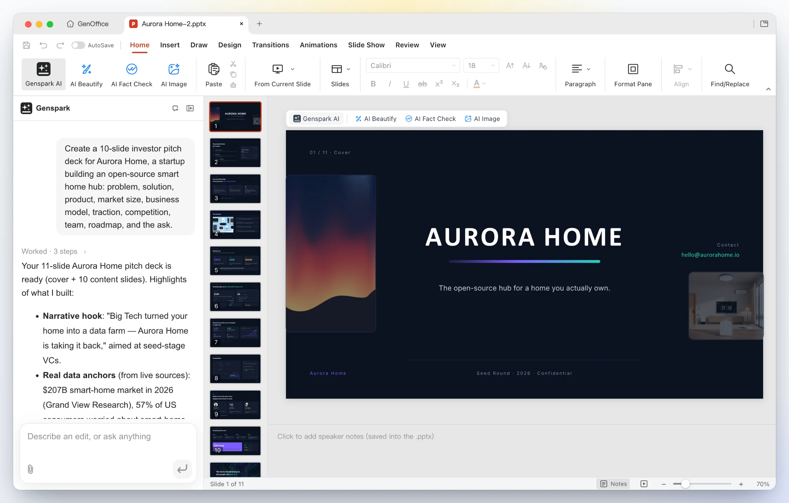</td>
<td width="50%">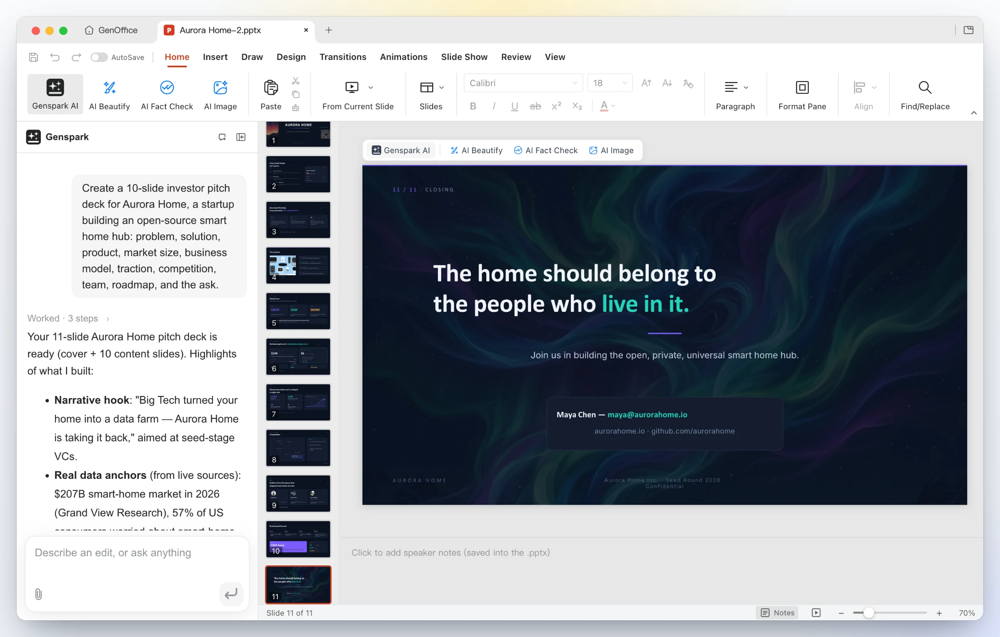</td>
</tr>
<tr>
<td><b>入力は 1 行だけ</b> — 「Aurora Home 向けの 10 枚構成の投資家向けピッチデッキを作って…」。GenOffice がストーリーラインを組み立て、数値をリサーチし、すべてのスライドを本物の <code>.pptx</code> としてキャンバスに描き出します。</td>
<td><b>完成したデッキが出てくる</b> — 統一されたタイポグラフィと画像、締めの Call to Action を備えた、デザイン済みの 11 枚のスライド。マスター、レイアウト、スマートガイド、非破壊トリミングでそのまま編集を続けることも、パネルにデザインの変更・文章の書き直し・順序の入れ替えを頼むこともできます。<code>.glb</code> を挿入すれば本物の 3D モデルになります：エディターでドラッグすれば向きを変えられ、PowerPoint が 3D を保存するのと同じ方法で保存され、PowerPoint で開いても 3D のままです。</td>
</tr>
</table>

**Slide Show → Record** で、デッキにスライドごとのナレーションを吹き込めます。途中での一時停止と再開にも対応しています。吹き込んだナレーションと、そこで計測された自動的に進むタイミングは `.pptx` に保存され、PowerPoint でも同じように再生されます。

### 4 · PDF — PDF のテキストをその場で編集し、オンデバイスで Word に変換

<table>
<tr>
<td width="50%">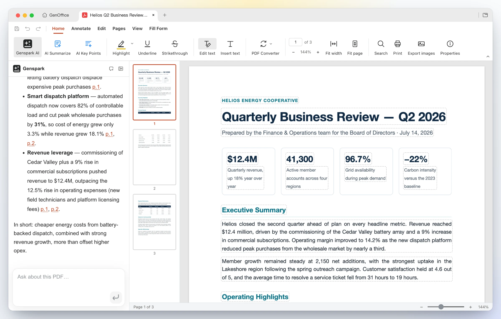</td>
<td width="50%">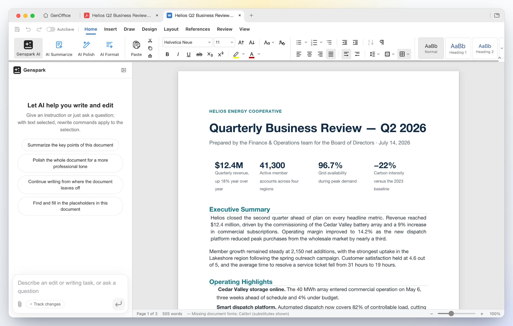</td>
</tr>
<tr>
<td><b>ページの中で直接編集</b> — テキスト編集モードは各テキストブロックを枠線で示し、その場での打ち直しができます。上から隠す注釈ではなく、PDFium を通じてコンテンツストリーム自体を元のフォントのまま書き換えます。長いレポートについて AI に尋ねれば、ページ引用付きで回答が返ってきます。</td>
<td><b>オンデバイスで変換</b> — <b>PDF コンバーター → PDF から Word</b> を使うと、見出し・統計行・段落をそのまま保った編集可能な <code>.docx</code> が生成され、元の PDF の隣の Docs で開きます。Excel や PowerPoint への変換も同様に動作し、スキャンされたページはシステムの OCR を通して処理されます。</td>
</tr>
</table>

### 5 · HTML — デザインブリーフから始める AI ページ／UI ビルダー

ページの目的と対象読者を伝えるだけです。AI はまず**デザインブリーフ**（フック、カラーパレット、タイポグラフィ、スタイルの方向性）を提案し、そのトークンに沿って単一の自己完結型 `.html` ファイルを組み立てます。

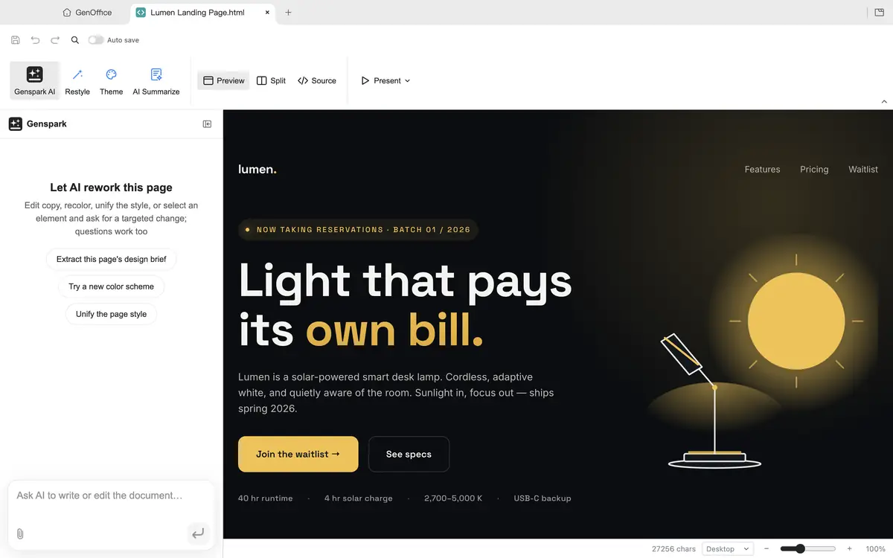

<table>
<tr>
<td width="50%">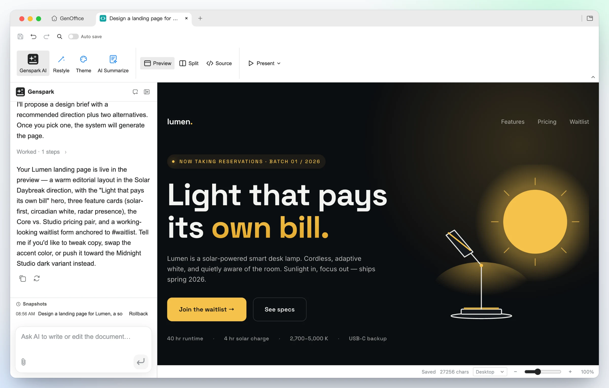</td>
<td width="50%">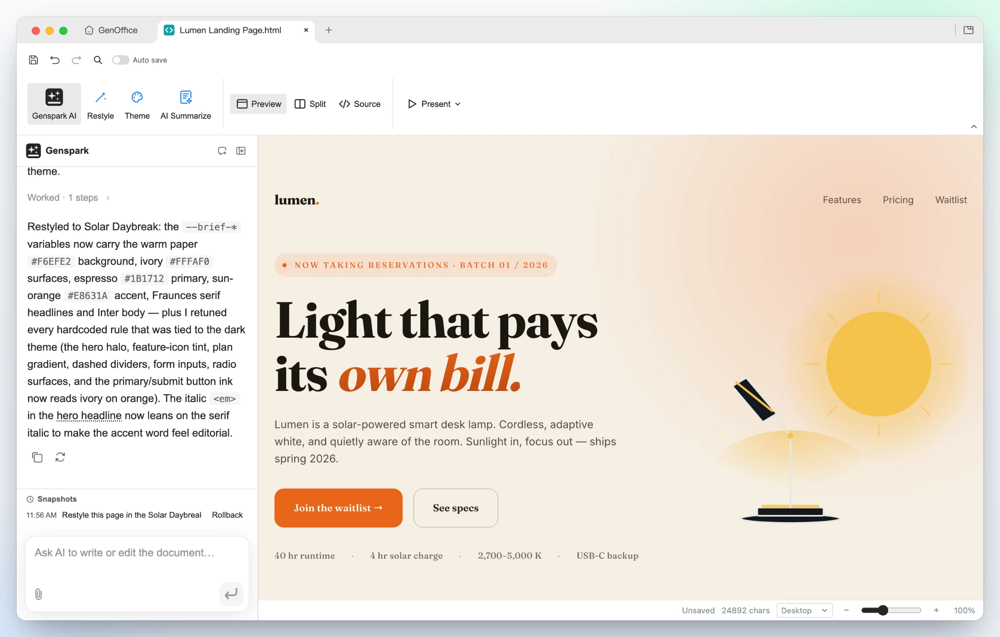</td>
</tr>
<tr>
<td><b>1 つのプロンプトから生成</b> — Lumen 向けに、大胆なヒーロー、機能カード、価格表、ウェイトリストフォームを Midnight Studio の方向性で構築しています。任意の要素をクリックしてリスタイルしたり、ダブルクリックでテキストを編集したり、CodeMirror のソースビューに切り替えたりできます。</td>
<td><b>同じデザインで方向性だけ変える</b> — <b>リスタイル</b>を 1 回リクエストするだけでブリーフのトークンが入れ替わり、ページ全体が追従します：暖かみのある紙の質感、エディトリアルなセリフ体、太陽のようなオレンジのアクセント。文章は書き直されません。フルスクリーンで発表したり、PDF や編集可能なネイティブ Word ドキュメントとして書き出したりもできます。</td>
</tr>
</table>
<table>
<tr>
<td width="50%">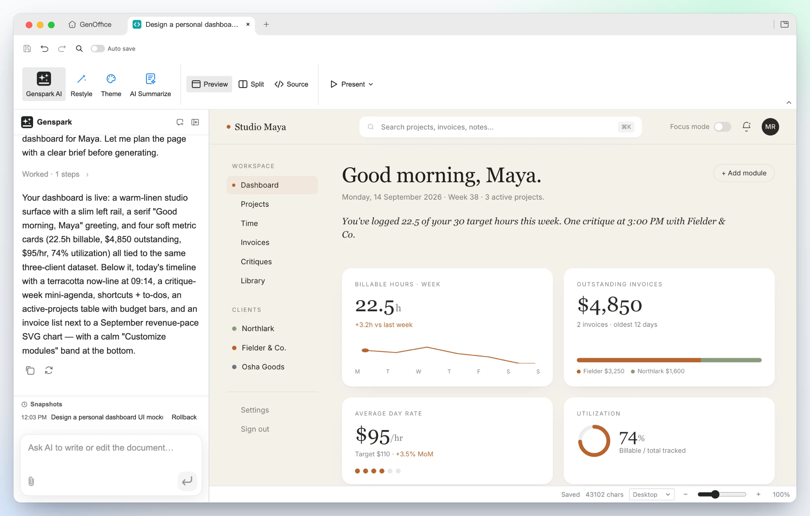</td>
<td width="50%">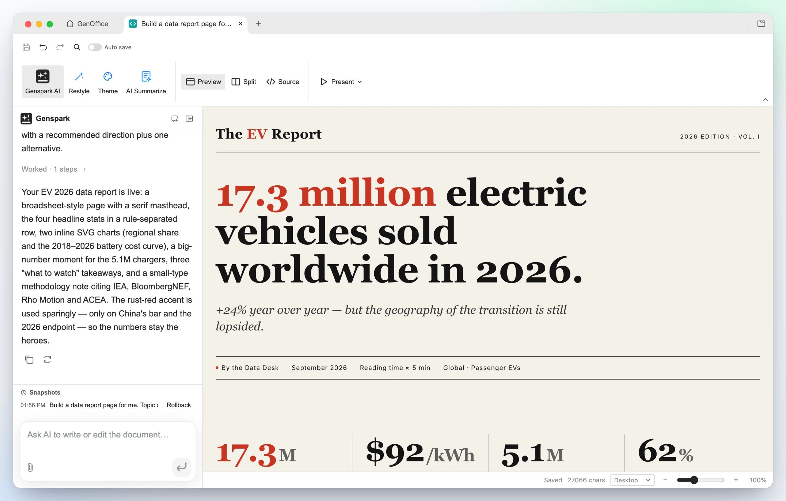</td>
</tr>
<tr>
<td><b>UI モックアップ</b> — 「personal dashboard」のスターターは、ペルソナをそのまま動くレイアウトに変換します：左側のレール、挨拶文、課金可能時間のスパークライン、請求書と稼働率のカード。すべて開発者に渡せる本物の HTML です。</td>
<td><b>データストーリー</b> — 「data report」のスターターは、エディトリアルなブロードシートを組み立てます：セリフ体のマストヘッド、1 つの見出し数字、区切り線付きの統計行、インライン SVG チャート、手法についての注記まで揃っています。</td>
</tr>
</table>

### 6 · Markdown — プレーンな `.md` を対象にした、Ask AI 付きブロックエディタ

<table>
<tr>
<td width="50%">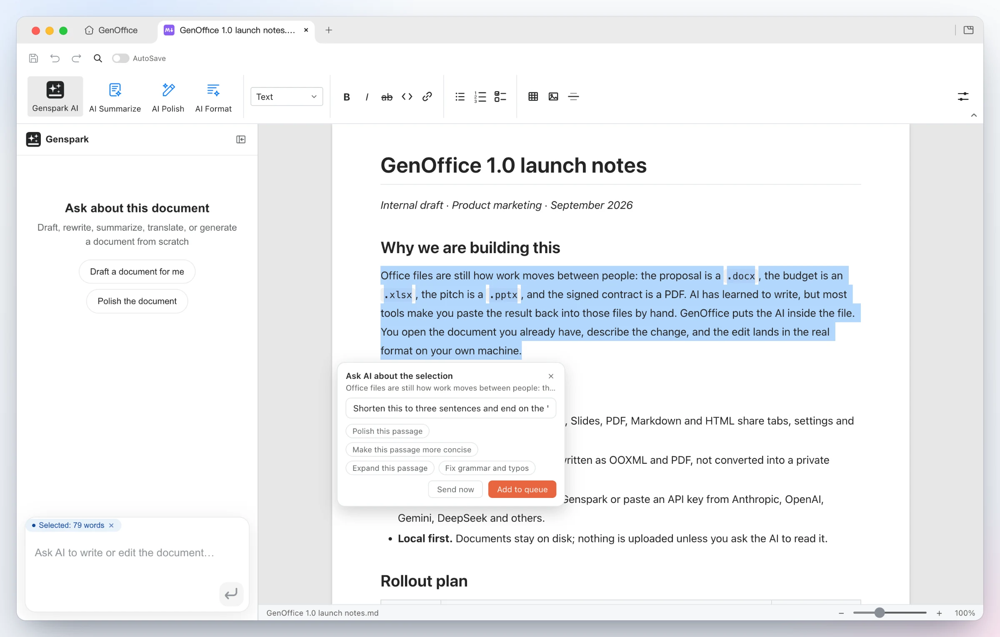</td>
<td width="50%">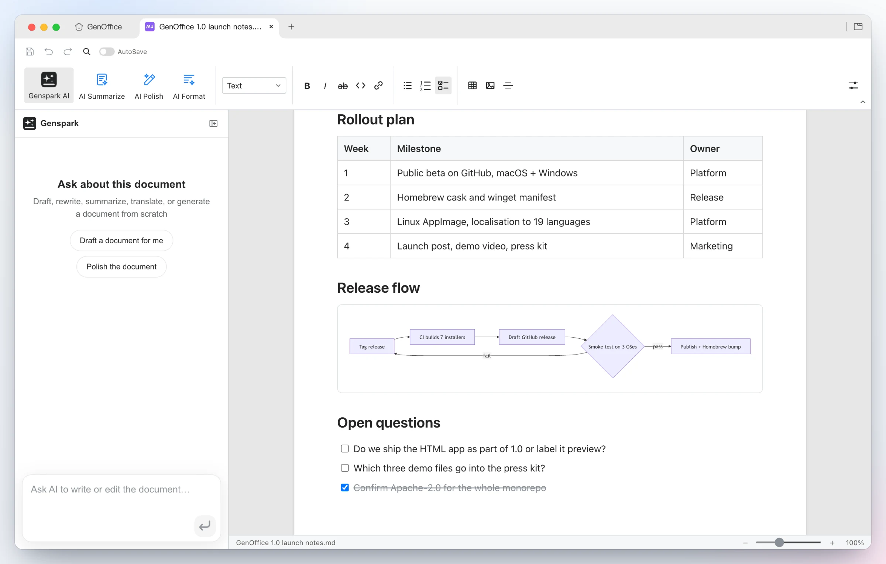</td>
</tr>
<tr>
<td><b>選択範囲について Ask AI</b> — どの文章を選択しても <b>Ask AI</b> チップが表示されます。指示を入力するか提案を選び、その場で送信するか、複数の編集をキューに入れて一括で実行することもできます。同じ操作はどのアプリでも使えます。</td>
<td><b>表示はリッチに、保存はプレーンな Markdown</b> — 見出し、リスト、表、画像、コードブロック、Mermaid 図を Tiptap ベースのブロックエディタで扱いながら、保存時はプレーンな <code>.md</code> として書き戻されます。<b>Markdown → Word</b> の書き出しも完全にローカルで行われます。</td>
</tr>
</table>

**Obsidian 流のリンク付きノート。** `[[wiki links]]` はクリックするとリンク先のノートへジャンプし、`[[` と入力するとノート名が補完され、`![[…]]` はノートや画像をインラインで埋め込みます。**Backlinks** パネルには、開いているノートを指しているすべてのノートが一覧表示され、**Graph** ビューはボールト全体のリンクを地図のように描き出します。

### <a id="7--search--find-the-file-that-answers-the-question-with-typesafe-jev"></a>7 · 検索 — 質問に答えているファイルを、TypeSafe Jev で見つける

作業フォルダー内のすべてのファイルはオンデバイスでインデックス化されます。対象は名前、フォルダー、そして Word・Excel・PowerPoint・PDF・Markdown・HTML ファイルから抽出したテキストで、CJK に対応したトークン化を行う SQLite の全文インデックスに格納されます。**Jev search reranking** をオンにすると、ローカルの上位 20 件のヒットを [TypeSafe Jev](https://typesafe.ai/blog/introducing-system-one-models-and-jev) が判定します。Jev は System One モデルで、テキストを生成する代わりに、1 回の呼び出しでドキュメントごとに較正済みの関連度スコアを 1 つ返します。一覧はそのスコアで並べ替えられ、呼び出しが失敗またはタイムアウトした場合は、ローカルの順序がそのまま使われます。


<table>
<tr>
<td width="50%"></td>
<td width="50%"></td>
</tr>
<tr>
<td><b>同じ言葉、違う答え</b> — 「laptop refresh policy」は、ブラウザーキャッシュの更新ポリシー、ブランド刷新計画、ダッシュボード更新スケジュールに一語一句一致するため、全文検索の順位付けではそれらが先に来ます。Jev は抜粋を読み、3 年の交換サイクルを定めている機器標準のドキュメントを先頭に移します。件数の横の <b>Jev</b> バッジは、その順序がモデルによるものであることを示します。</td>
<td><b>デフォルトはオフ、スイッチ 1 つでオン</b> — 設定 → AI メディア＆検索 → ローカルファイル検索。OpenRouter か TypeSafe 直接接続かを選び、キーを貼り付けて、Test connection を押します。スイッチがオンのときに限り、上位ヒットの抜粋がデバイスの外に出ます。インデックス自体が外に出ることはありません。</td>
</tr>
</table>

### 8 · Ask AI — スター付きファイルに質問し、出典付きで答えを得る

よく使うファイルにスターを付けると、ホーム画面の **Ask AI** がそれらをナレッジベースとして扱います。普段の言葉で質問すれば、エージェントがスター付きファイルを検索し、必要なものを読み、主張ごとに引用を付けて答えます。引用をクリックすると、そのファイルが対応するアプリで開きます。ドラッグ、貼り付け、または **+** メニューから質問にファイルを添付でき（画像は視覚入力としてモデルに渡されます）、質問はそれぞれ独立した会話として保存されます。会話を切り替える、新しく始める、削除する、いずれも可能で、一覧は再起動後も残ります。


Ask AI は[検索](#7--search--find-the-file-that-answers-the-question-with-typesafe-jev)と同じオンデバイスの全文インデックスを検索し、ファイルをページ単位で読むため、モデルに見えるのはヒットした箇所と自分で要求した文章だけで、それも選択したプロバイダー経由です。内蔵の `genoffice` CLI を呼び出してファイルそのものを作ることもでき、作られたファイルは回答の下に成果物カードとして表示され、クリックすれば開きます。

### 9 · CLI — コーディングエージェントが、あなたのマシン上で GenOffice を操作

GenOffice には `genoffice` コマンドラインとエージェントスキルが同梱されています。スキルをインストールすれば、Claude Code、Codex、Cursor、Gemini CLI、GitHub Copilot、OpenCode、Windsurf が、アプリと同じエンジンを通じて本物の Office ファイルを作成・変換・読み取り・編集できます。ウィンドウを開く必要はありません。

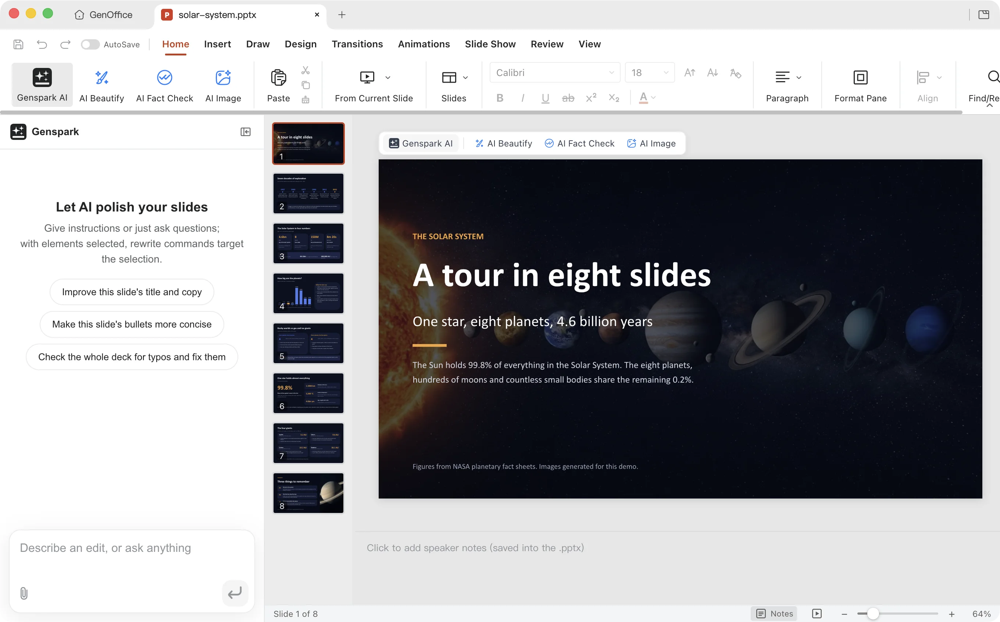

<table>
<tr>
<td width="50%">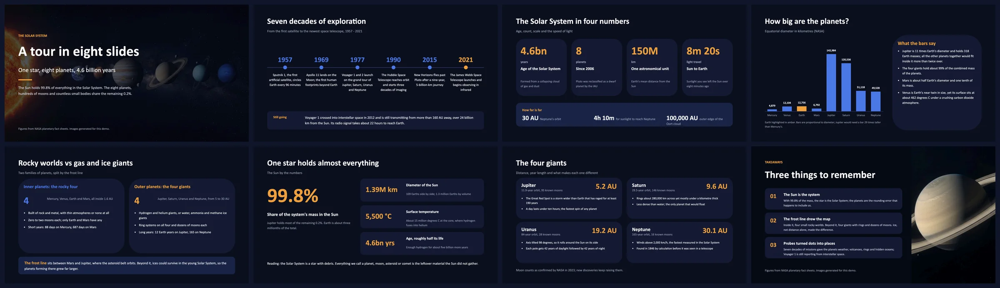</td>
<td width="50%">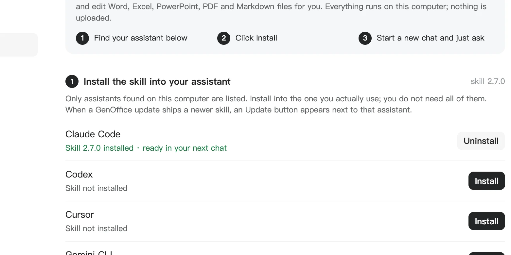</td>
</tr>
<tr>
<td><b>エージェントへのプロンプトは 1 つ</b> — 「太陽系についての 8 枚構成のデッキを作って」。エージェントはスキルを読み、スタイルシート、アウトライン、スライドごとのページ仕様を書き、<code>genoffice image</code> で 2 枚の写真を生成し、<code>genoffice slides check</code> にはみ出しや重なりのある要素を弾かせてから、<code>genoffice create</code> で <code>.pptx</code> を組み立て、<code>slides render</code> でスライドごとの PNG を受け取って確認します。</td>
<td><b>インストールは設定 → 連携から 1 回だけ</b> — GenOffice がこのコンピューター上で見つかったコーディングエージェントを一覧し、選んだそれぞれにスキルを書き込みます。スキルを zip としてダウンロードするか、<code>npx skills add genspark-ai/genoffice</code> を実行しても構いません。コマンドとワークフローの全体は <a href="#command-line-and-agent-skill">コマンドラインとエージェントスキル</a> にあります。</td>
</tr>
</table>

### 10 · MCP — Model Context Protocol を通じて同じツールを提供

`genoffice` のすべてのコマンドは MCP ツールでもあります。Claude Code、Claude
Desktop、Cursor、その他任意の MCP クライアントは、スキルのインストールも
ウィンドウを開く必要もなく、自分自身で `genoffice mcp` を起動して、29 個の
ツールとリソースとして提供される操作リファレンスを得られます。アプリ内蔵の
もう 1 つの HTTP サーバーを使えば、エージェントが目に見えるエディタータブで
Word ドキュメントを組み立てる様子を見守ることもできます。

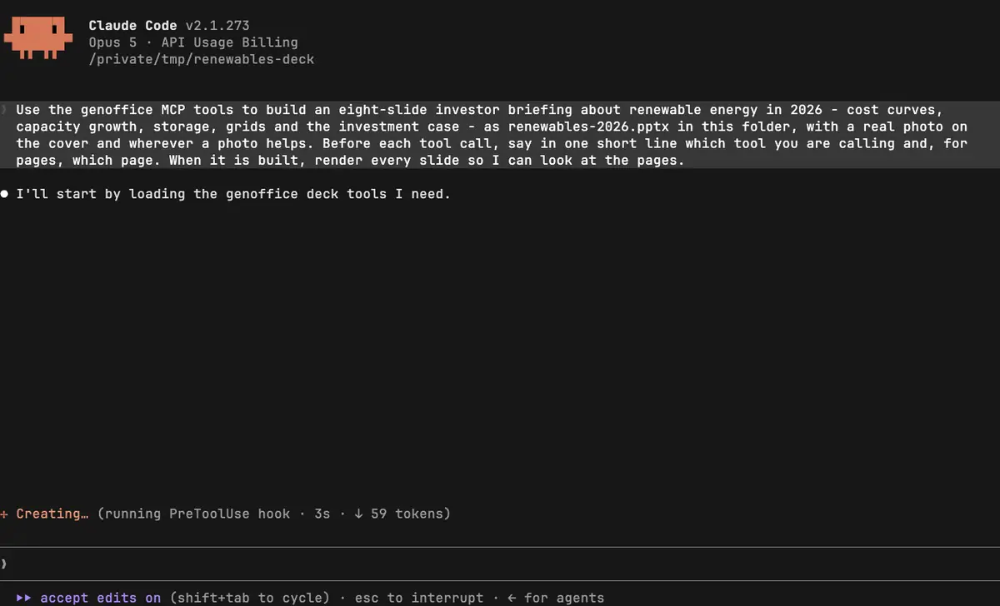

<table>
<tr>
<td width="50%">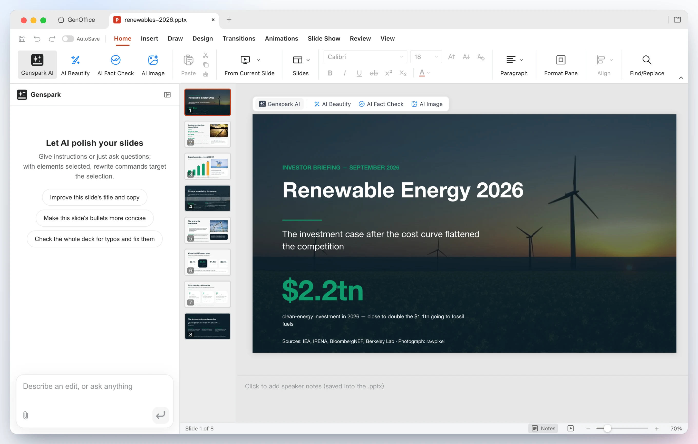</td>
<td width="50%">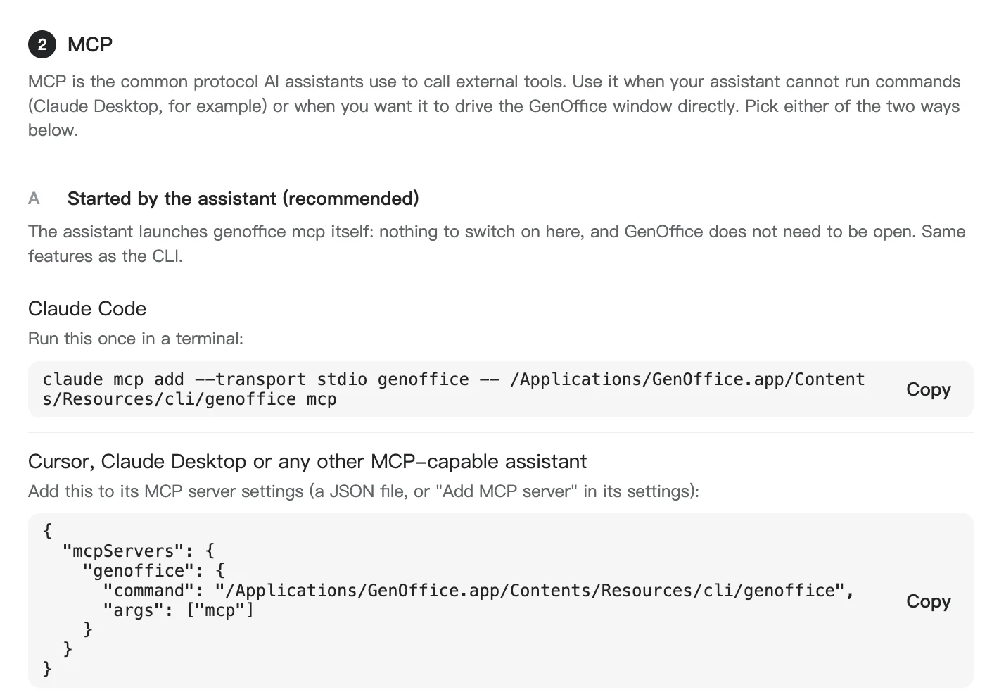</td>
</tr>
<tr>
<td><b>プロンプト 1 つ、ツール呼び出し 38 回、ターミナルなし</b> — 「2026 年の再生可能エネルギーについての 8 枚構成の投資家向けブリーフィングを、表紙とその他写真が役立つ場所に実写を入れて作って」。エージェントは <code>search</code> で図版と写真を集め、<code>media</code> で候補の写真それぞれが実写かどうかを確認したうえで、スタイルシートとアウトラインを添えて <code>deck_start</code> を呼び出し、続けてスライドごとに <code>deck_page</code> を呼び出します。各ページはアウトラインとパレットに沿っているか検査に通ってから保持され、<code>deck_build</code> が <code>.pptx</code> を組み立て、<code>slides_audit</code> がはみ出しを探し、<code>slides_render</code> がモデルが確認できる画像コンテンツとしてスライドごとの PNG を返し、最後に <code>deck_replace</code> が気に入らなかった 3 ページを修正します。</td>
<td><b>設定 → 連携から 1 回接続するだけ</b> — Claude Code 用の <code>claude mcp add</code> コマンドをコピーするか、JSON ブロックを Cursor・Claude Desktop・その他の MCP クライアントに貼り付けます。オプション B は、目に見える Word エディターのためのローカル HTTP サーバーを有効にします。どちらも <a href="#mcp-server">MCP サーバー</a> で説明しています。</td>
</tr>
</table>

### 11 · 旧形式ファイル — 2000 年代の `.doc`、`.xls`、`.ppt` も開けます

Word 97–2003 の `.doc`、Excel の `.xls`、PowerPoint の `.ppt` は、お使いのマシン上で変換された `.docx`、`.xlsx`、`.pptx` のコピーとして開きます。元のファイルは変更されません。画像、表、数式、表示形式、塗りつぶし、レイアウトが引き継がれます。各形式で何が保持され、何が失われるかは[旧形式と ODF のファイルは変換されたコピーとして開く](#legacy-and-odf-files-open-as-converted-copies)にまとめています。

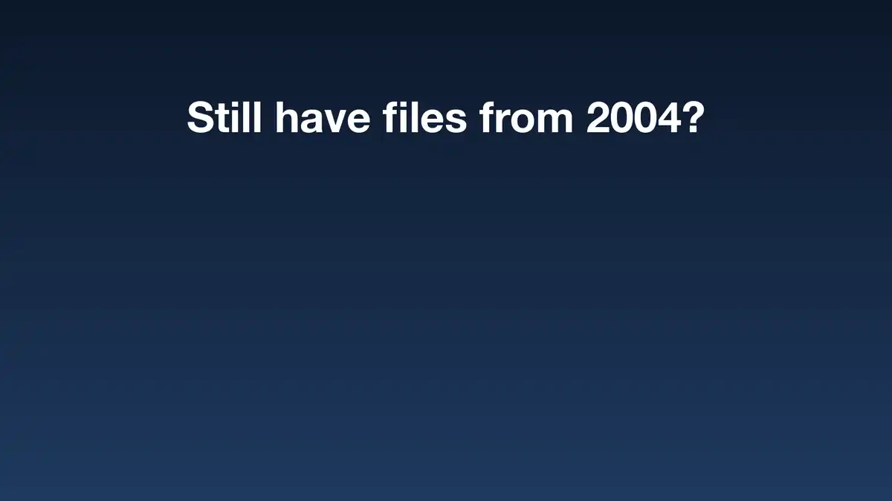

## GenOffice を選ぶ理由

- **オープンソース**。Apache-2.0 ライセンスで、GitHub 上で公開開発。
- **自分のマシンで動く。** macOS・Windows・Linux 向けのネイティブアプリ。ファイル
  はディスク上に残り、編集・保存・変換もすべて自分のマシンで行われる。
- **本物の Office ファイル。** ネイティブの `.docx`・`.xlsx`・`.pptx`、バイト単位
  で保持：触れていない部分はそのままコピーされる。
- **ドキュメント自体を編集する AI。** Docs では変更履歴、Sheets では実際に機能す
  る数式とグラフ、スライドはキャンバス上に描画され、AI の操作ごとに巻き戻せるス
  ナップショットが残る。
- **自分のモデル、自分のキー。** Genspark でログイン、または Claude・OpenAI・
  Gemini・DeepSeek などのキーを持ち込める。ローカルサーバーや任意の OpenAI 互換
  エンドポイントにも対応。
- **PDF もしっかり対応。** ページ内でテキストをその場で編集し、オンデバイスで
  PDF を Word・Excel・PowerPoint に変換。スキャンにはシステム OCR を使用。
- **Markdown と HTML にも対応**。同じ AI パネルを使い、ローカルで Word に書き出せ
  る。
- **キーワードではなく、答えを見つける検索。** フォルダー内のすべてのドキュメントを
  対象にした全文検索。インデックスはオンデバイスで作られ、オプションで System One
  の判定モデル TypeSafe Jev による並べ替えも使える。
- **ファイルを横断する Ask AI。** 大事なファイルにスターを付けて、普段の言葉で質問
  できる。すべての回答に出典のファイルが引用され、ワンクリックで開ける。
- **スキル。** 同梱の既製スキル、または自作の `SKILL.md` を、どの AI パネルでも **+** メニューから添付できます。
- **スクリプト化できる。** `genoffice` コマンドライン、エージェントスキル、MCP
  サーバーにより、すべてのエンジンを Claude Code・Claude Desktop・Codex・Cursor
  などのエージェントから使える。もちろんオンデバイスのまま。
- **無料**。個人でもチームでも利用できる。

## ブラウザーで使う

デスクトップアプリは HTTP で自身を提供することもできます。`genoffice --web-server`
で起動し、ブラウザーのタブで `http://127.0.0.1:8931/` を開いてください。6 つの
エディターはデスクトップウィンドウが読み込むのと同じバンドルで、WebSocket 経由で
同じエンジンとやり取りします。スタート画面からファイルを開いて保存でき、
レンダリングも同じパイプラインを通ります。

- サービスは常にアクセストークンを要求します。起動時に表示される
  `?token=…` 付き URL をブラウザーで開くと Cookie が渡されます。共有するのは
  裸のポートではなくこの URL にしてください。`--web-port` と `--web-host` で
  配置を変えられ（LAN 向けに `0.0.0.0` をバインドし、別の端末で表示された
  URL を開きます）、`--web-token` で任意のトークンを指定できます。
- スクリプト向けに CLI を wraps した小さなヘッドレス API もあります:
  `curl --data-binary @report.docx 'http://127.0.0.1:8931/api/convert?to=pdf&name=report.docx&token=PRINTED_AT_STARTUP' > report.pdf`。
  `POST /api/info` は文書構造の概要を返します。
- ローカルファイルのドラッグ＆ドロップとネイティブ印刷はデスクトップ専用です。

## AI バックエンド

**Genspark でサインイン**すれば、設定は一切不要です。モデル呼び出しは Genspark のプロキシ
（Claude、GPT、Gemini 系列）を経由し、エージェントは Web・画像検索、画像生成、画像／音声／
動画の解析機能も利用できます。

**あるいは自分のキーを持ち込む。** 設定 → AI には Claude、OpenAI、Gemini、DeepSeek、Kimi、
GLM、Qwen、Doubao、MiniMax、Grok、Mistral、OpenRouter、Requesty、Opper、Cheaper Inference、Atlas Cloud、SiliconFlow、PPIO、Command Code、OpenCode Zen/Go が並び、さらに任意
の OpenAI 互換エンドポイント（ベース URL + キー、ローカルモデルサーバーを含む）を登録できる
カスタム枠も用意されています。検索とメディア関連は **AI メディア＆検索** の下で機能ごとに個
別のプロバイダーを設定できます：Web 検索には Serper、Serply、SearchApi、Tavily、Parallel、Keenable、Exa、
Firecrawl のいずれかが使えます。画像生成と画像／動画解析には OpenAI、Gemini、Doubao/Seedream、GLM、
Grok、Qwen、MiniMax、Stability、FLUX、または任意の OpenAI 互換の画像エンドポイントが使え、
画像解析には DeepSeek V4.1 Flash も使えます。

**TypeSafe Jev** は、ホーム画面のファイル検索を並べ替えます。**AI メディア＆検索 →
ローカルファイル検索** で Jev search reranking をオンにし、エンドポイントを選びます：
[OpenRouter](https://openrouter.ai/typesafe)（モデル `typesafe/jev-1.13`）か、TypeSafe
自身の API です。キーはこのデバイスにのみ保存されます。デフォルトはオフで、オンにすると
ローカルの上位 20 件のヒットの抜粋が判定のために送信され、それ以外は何もマシンの外に
出ません。

**Parallel** はアカウントなしで使えます。Genspark へのログインも検索用のキーも設定されて
いない場合は、無料の Search MCP（レート制限あり）がデフォルトの Web 検索になり、
DuckDuckGo のスクレイピングより先に実行されます。Search API を使うには、Web 検索で
Parallel を選び、[Parallel](https://platform.parallel.ai/) のキーを入力してください。
Keenable もキーなしで使え、キーを設定してもレート制限が緩和されるだけです。

スイート全体でライト・ダーク・システムのテーマに対応しています。テーマが変わるのは画面表示
だけで、書き出し・印刷・保存されたファイルは常にドキュメント本来の色を保持します。

## <a id="skills"></a>スキル

スキルは `SKILL.md` 一枚で、週報、NDA、授業計画など、ひとつの仕事のやり方を AI に教えます。
GenOffice には既製スキルが同梱され、コーディングエージェントと同じ形式で自作のものも取り込めます。

- **設定 → スキル。** おすすめスキルを**インストール**するか、フォルダー、zip、または単一の `SKILL.md` を**インポート**します。インポート時に何かが実行されることはありません。 **すべて**タブには推奨カタログ全体が一覧で表示され、説明はアプリの言語で表示されます。
- **チャットで。** どの AI パネルでも入力欄の横の **+** メニューを開き、**スキル**を選んでチェックを入れて送信します。スキルはそのメッセージにだけ添付されます。

---

## <a id="command-line-and-agent-skill"></a>コマンドラインとエージェントスキル

アプリがファイルに対してできることはすべて、`genoffice` コマンドラインからターミナルで行えます。
Word、Excel、PowerPoint、PDF、Markdown、HTML の検査・変換・作成・読み取り・編集を、同じエンジンで
ヘッドレスに実行します。GenOffice と一緒にインストールされ、独自のランタイムは不要で、ドキュメント
をどこかへ送信することもありません。同梱の**エージェントスキル**と組み合わせれば、コーディング
エージェントは Markdown による代用品ではなく、本物の Office ファイルを生み出すドキュメント作業者に
なります。

**対応エージェント：** Claude Code、Codex、Cursor、Gemini CLI、GitHub Copilot、OpenCode、Windsurf
はそのまま使え、スキルを読めるその他のエージェント、さらに [MCP サーバー](#mcp-server) を通じて
Claude Desktop とあらゆる MCP クライアントでも動作します。

### スキルをインストールする

| 方法                                    | 動作                                                                                                                                                                                       |
| --------------------------------------- | ------------------------------------------------------------------------------------------------------------------------------------------------------------------------------------------ |
| アプリの **設定 → 連携**                | このコンピューター上で見つかったエージェントを一覧し、ワンクリックで選んだそれぞれにスキルを書き込みます。GenOffice のリリースに新しいスキルが含まれていると**更新**ボタンが表示されます。 |
| 同じページの **zip としてダウンロード** | claude.ai、Claude デスクトップアプリ、その他のアシスタントがアップロード用スキルとして受け付ける構成です。                                                                                 |
| `npx skills add genspark-ai/genoffice`  | このリポジトリから、スキルに対応する任意のエージェントにインストールします。                                                                                                               |

その後、新しいチャットを始めてドキュメントを依頼してください。スキルは、いつ `genoffice` を使うべきか、
編集前にファイルをどう読むか、自分の成果物をどう確認するかをエージェントに教えます。

### ターミナルからのクイックスタート

```bash
genoffice --version
genoffice info report.docx --json                  # headings and blocks; or sheets, slides, pages
genoffice convert report.md --to pdf               # md/html/docx/xlsx/pptx → pdf, pdf → docx/xlsx/pptx/md/html, odt/ods/odp → docx/xlsx/pptx, doc/dot → docx, ppt → pptx, …
genoffice create --type docx --from notes.md --out notes.docx
genoffice create --type xlsx --from table.json --out sales.xlsx   # "=SUM(B2:B9)" cells stay live formulas
genoffice docs read report.docx --range 0-9 --json # then `docs apply --ops edits.json` edits in place
genoffice docs compare original.docx revised.docx --out redline.docx   # the differences as tracked Word revisions
genoffice render report.docx --out shots/          # one PNG per page, to look at what you made
genoffice open sales.xlsx                          # hand the result to the editor
```

各コマンドは 1 行の要約を出力し、`--json` を付けると単一の JSON オブジェクトを返します。編集はアト
ミックです。拒否された操作はファイルに一切触れず、対処方法を示したエラーとして返ってきます。
`genoffice help` で現在のコマンド一覧を確認でき、完全なリファレンスは
[packages/cli/README.md](../../packages/cli/README.md) にあります。

### エージェントが実際に実行しているもの

[デモ](#demo)の太陽系デッキは、Claude Code へのプロンプト 1 つで作られました。その裏では、エージェントが
スキルの段階的なワークフローに従い、CLI が各段階を次に進む前に検査していました。

```bash
genoffice capabilities --json                        # which cloud tools GenOffice has configured
genoffice guide slides design                        # the deck workflow and layout library
genoffice image "the eight planets in a row …" --aspect 16:9 --out deck/assets/cover.jpg
genoffice slides check deck/outline.json --json      # 8 pages, no findings
genoffice slides check deck/pages/01.json --json     # builds one slide, audits overflow and overlap
…                                                    # one page file per slide, fixed until each check is clean
genoffice create --type pptx --spec deck/pages --outline deck/outline.json --out deck/solar-system.pptx --json
genoffice slides render deck/solar-system.pptx --out deck/shots --json
genoffice slides audit deck/solar-system.pptx --json    # 8 slides, no layout issues
genoffice slides replace deck/solar-system.pptx --slide 4 --spec deck/pages/05.json --json
genoffice open deck/solar-system.pptx
```

`genoffice` の内部でモデル呼び出しは一切行われません。考えるのはエージェント、組み立てと検査は CLI
が担い、結果は通常の `.pptx` として GenOffice や PowerPoint で開けます。

### <a id="mcp-server"></a>MCP サーバー

同じコマンド群は [Model Context Protocol](https://modelcontextprotocol.io) の
ツールとしても利用できます。ターミナルを実行できない、あるいはターミナルを
渡したくないアシスタント向けの方法です。接続方法は 2 つあり、どちらも
**設定 → 連携 → MCP** にすぐコピーできるスニペット付きで用意されています：

| 方法                            | 内容                                                                                                                                                                                                                                                                                                                                                                                                                                                                                                                                              |
| ------------------------------- | ------------------------------------------------------------------------------------------------------------------------------------------------------------------------------------------------------------------------------------------------------------------------------------------------------------------------------------------------------------------------------------------------------------------------------------------------------------------------------------------------------------------------------------------------- |
| **A · `genoffice mcp`**（推奨） | アシスタント自身が起動する stdio サーバーで、GenOffice を起動しておく必要はありません。コマンドごとに 1 つのツール（`info`、`convert`、`create_docx`、`create_xlsx`、`create_pptx`、`create_pdf`、`docs_read` / `docs_apply` / `docs_check`、`sheet_*`、`slides_*`、`render`、`guide`、`search`、`image`、`media`、`open`）に加えて、段階的なデッキフロー `deck_start` → `deck_page` → `deck_build` → `deck_replace` があります。Ops、スペック、Markdown はすべてインラインで渡されるため、ファイルシステムを持たないクライアントでも動作します。 |
| **B · ローカル HTTP サーバー**  | GenOffice アプリ内部で `http://127.0.0.1:3093/mcp`（Streamable HTTP、レガシー SSE 対応）として動作します。そのツールは目に見える Word エディタータブを操作します：`create_session`、`insert_content`、`replace_blocks`、`apply_ops`、`read_document`、`save_session`。ドキュメントが形になっていく様子をその場で見られます。デフォルトはオフで、同じ設定パネルで有効にできます。                                                                                                                                                                  |
| **C · `genoffice mcp --http`**  | stdio と同じツール一式を、別のマシン上のクライアント（コンテナ、サンドボックス、ネットワーク上の共有マシン）向けに Streamable HTTP サーバーとして提供します。ファイルは呼び出しと一緒に行き来します：`PUT /files/<name>` でアップロードすると URL が返り、すべての `file` パラメーターは http(s) の URL を受け付け、ファイルを書き出すツールはダウンロード URL に加えて、小さい場合はそのバイト列を MCP リソースとして返します。`--host 0.0.0.0` でネットワークに公開し、`--token` で保護します。                                                 |

```bash
# Claude Code
claude mcp add --transport stdio genoffice -- genoffice mcp
```

```jsonc
// Cursor, Claude Desktop or any other MCP client
{ "mcpServers": { "genoffice": { "command": "genoffice", "args": ["mcp"] } } }
```

```bash
# On the machine that has GenOffice (private network; add --token for a shared box)
genoffice mcp --http 3093 --host 0.0.0.0 --token "$GENOFFICE_MCP_TOKEN"

# From the client: upload, then use the URL wherever a tool takes a file
curl -T report.docx -H "Authorization: Bearer $GENOFFICE_MCP_TOKEN" http://server:3093/files/
#   → { "url": "http://server:3093/files/<id>/report.docx", ... }
#   docs_read({ "file": "http://server:3093/files/<id>/report.docx" })
#   docs_apply(...) → output_url, downloadable with curl -o
```

HTTP 経由では、セッションごとに専用の作業フォルダーが割り当てられ、相対パスとデッキ
フォルダーはその中で解決されます。`open` は提供されず、`GENOFFICE_ALLOWED_ROOTS` が
未設定の場合、ツールはサーバー自身のファイルストアの外に出られません。`render`、PDF
への `convert`、`create_pdf` は引き続き非表示の GenOffice プロセスを起動するため、
ヘッドレスなホストにはアプリのインストールと仮想ディスプレイ（`xvfb-run`）が必要です。

ここでの `genoffice` は、アプリに同梱されているあの CLI そのものです
（macOS では `/Applications/GenOffice.app/Contents/Resources/cli/genoffice`。
設定パネルに、実際のインストール先の正確なパスが表示されます）。このサーバー
は独自のワークフロー手順を備えており、操作リファレンスを `genoffice://guide/*`
リソースとして公開するため、スキルは不要です。スキルと MCP サーバーは共存
でき、どちらを使うかはアシスタントが選びます。クラウド機能（`search`、
`image`、`media`）は引き続き GenOffice で設定したプロバイダーを経由し、それ
以外はすべてローカルで動作し、`GENOFFICE_ALLOWED_ROOTS` によりすべてのツール
が指定したフォルダに限定されます。

[デモ](#demo)の再生可能エネルギーデッキは、`genoffice` MCP サーバーだけを接続した
Claude Code へのプロンプト 1 つが、プロトコルの側からはどう見えるかを示した
ものです：

```text
capabilities · guide(slides, spec) · guide(slides, design)
search(query) ×4                         → IEA, BNEF and IRENA figures for the slides
search(query, images) ×7 · media(url, ask) ×7
                                         → candidate photos, each one checked to be a real photograph
deck_start(dir, style, outline)          → outline checked: 8 pages to write
deck_page(dir, 0, page) … deck_page(dir, 7, page)
                                         → each page checked against the outline and the palette; one page sent again
deck_build(dir, out)                     → renewables-2026.pptx, no image failures
slides_audit(file) · slides_render(file, out)
                                         → no layout findings; 8 PNGs come back as image content
deck_replace(dir, n, page) ×3 · slides_render(file, out)
                                         → three pages fixed after looking at the renders
```

38 回の呼び出し、約 13 分間、そしてアシスタントは一度もターミナルに触れませんでした。図版、写真、ガイド、検査、レンダリングの結果はすべて MCP ツールの結果としてやり取りされました。マシンの外に出たのは `search` と `media` だけで、GenOffice に設定されたプロバイダーへ送られました。

## <a id="download"></a>ダウンロード

| プラットフォーム                           | 要件                                                                   | ダウンロード                                                                                   |
| ------------------------------------------ | ---------------------------------------------------------------------- | ---------------------------------------------------------------------------------------------- |
| **macOS** — Apple Silicon（arm64）         | macOS 11 以降                                                          | [最新の `.dmg`（arm64）](https://github.com/genspark-ai/genoffice/releases/latest)             |
| **macOS** — Intel（x64）                   | macOS 11 以降                                                          | [最新の `.dmg`（x64）](https://github.com/genspark-ai/genoffice/releases/latest)               |
| **Windows**（x64、大半の PC）              | Windows 10 以降、Intel/AMD                                             | [最新の `-x64.exe` インストーラー](https://github.com/genspark-ai/genoffice/releases/latest)   |
| **Windows** on Arm（ARM64）                | Windows 11 on Arm（Snapdragon X など）                                 | [最新の `-arm64.exe` インストーラー](https://github.com/genspark-ai/genoffice/releases/latest) |
| **Linux** — Debian / Ubuntu                | x86_64、glibc 2.34 以降（Ubuntu 22.04 以降）                           | [最新の `.deb`](https://github.com/genspark-ai/genoffice/releases/latest)                      |
| **Linux** — Fedora / RHEL / openSUSE       | x86_64、glibc 2.34 以降（Fedora 35 以降、RHEL 9 以降、Leap 15.6 以降） | [最新の `.rpm`](https://github.com/genspark-ai/genoffice/releases/latest)                      |
| **Linux** — その他のディストリビューション | x86_64、glibc 2.34 以降、FUSE 2                                        | [最新の `.AppImage`](https://github.com/genspark-ai/genoffice/releases/latest)                 |

すべてのビルドは `main` ブランチから生成され、macOS・Windows のインストーラーには署名が付いて
います。以前のバージョンは [Releases](https://github.com/genspark-ai/genoffice/releases) ページにあります。

<details>
<summary><b>Linux へのインストール</b></summary>

deb は apt でインストールできます — 依存関係も自動的に取得され、GenOffice がアプリケーション
メニューに追加されます。

```bash
sudo apt install ./genoffice_<version>_amd64.deb
```

Fedora / RHEL 系 / openSUSE では、代わりに rpm をインストールしてください。

```bash
sudo dnf install ./genoffice-<version>.x86_64.rpm     # Fedora / RHEL family
sudo zypper install ./genoffice-<version>.x86_64.rpm  # openSUSE
```

deb と rpm は、KDE Plasma の Dolphin 向けに空のテンプレートも追加します。フォルダー内で
右クリック → **新規作成** に _GenOffice Document_、_GenOffice Spreadsheet_、
_GenOffice Presentation_ が並びます。テンプレートは `/usr/share/templates` に置かれ、
パッケージと一緒に削除されます。

AppImage はそのまま実行できます：FUSE 2 ランタイムをインストールし
（`sudo apt install libfuse2`。Ubuntu 24.04 ではパッケージ名が `libfuse2t64` です）、ファイル
に実行権限を付けてから実行してください。

```bash
chmod +x GenOffice-<version>.AppImage
./GenOffice-<version>.AppImage
```

Chromebook では、同じパッケージが Linux 環境（Crostini）の中で動きます。詳細は [docs/platforms/chromeos.md](../platforms/chromeos.md) を参照。

</details>

## 内部の仕組み

Docs、Sheets、Slides、PDF、Markdown、HTML、そしてタブ管理を行うシェルという 7 つの Electron
アプリが、純粋な TypeScript パッケージによる 1 つのエンジン層と、`.xlsx` 用の Rust サイド
カーを共有しています。常に元ファイルが正となり、編集は最小限のパッチとして適用されるため、
エディタが触れなかった部分は往復の間もそのまま保持されます。

```
open docx ─► archive original by hash (never touched)
          ─► parse word/document.xml into a block tree, each block anchored to its original XML
          ─► Tiptap editor (manual + AI editing, dirty tracking)
save      ─► dirty blocks → OOXML fragments (referencing existing styles only)
          ─► splice into the original document.xml; untouched blocks keep their bytes
          ─► repack the zip; every other entry is copied byte-for-byte
```

パッケージ単位の詳しい解説（docx/pptx エンジン、`pdf2docx`、`html2docx`、エージェントコアと
プロバイダー）は [CONTRIBUTING.md](../../CONTRIBUTING.md#engine-packages) にあります。

### <a id="legacy-and-odf-files-open-as-converted-copies"></a>旧形式と ODF のファイルは変換されたコピーとして開く

GenOffice が書き戻せない形式 — 旧形式の Word `.doc`/`.dot`、Hancom の `.hwp`/`.hwpx`、
Excel 97 の `.xls`、`.tsv`、旧形式の PowerPoint `.ppt`、そして OpenDocument ファミリー
（`.odt`、`.ott`、`.ods`、`.ots`、`.odp`、`.otp`）— は、ネイティブファイルではなく
インポートとして扱われます。これらを開くと、お使いのマシン上で `.docx`、`.xlsx`、`.pptx`
のコピーに変換され、そのコピーが開きます。元のファイルが再び読み込まれることも、
書き込まれることもありません。

- Docs と Slides は、最初にコピーの保存先を尋ねます（デフォルトは元のファイルと同じ場所の
  `.docx`/`.pptx`）。以降の保存はすべてそこに書き込まれます。`.ppt` はマスター、図形の
  ジオメトリ、塗りつぶし、画像、文字書式ごと変換されるため、デッキは PowerPoint で表示
  されていたとおりに見えます。ノート、アニメーション、画面切り替え、ハイパーリンクは
  まだ引き継がれません。
- Sheets は変換済みのワークブックをすぐに開き、最初の保存を「名前を付けて保存」に回して
  新しい `.xlsx` に書き出します。`.csv` は例外です。形式はそのままで、Excel と同じく
  保存時には値が `.csv` に書き戻されます。
- 変換は一方向で、元の形式にあって OOXML にない機能は失われることがあります。`.doc`、
  `.ppt`、`.hwp`、ODF 形式では、その旨を伝える確認ダイアログが表示されます。
  「Convert without asking next time」にチェックを入れると次回から省略でき、設定 → 一般の
  「Ask before converting legacy files」で再び表示されるようになります。

## 開発

```bash
npm install
npm run fixtures     # generate test .docx fixtures
npm test             # engine + app unit tests (docs/sheets/slides need no display)
npm run typecheck    # tsc --noEmit across every workspace
npm run dev          # all six editors + shell against Vite dev servers
npm run dev:docs     # a single app (same pattern works per workspace)
npm run dist:mac     # package macOS dmg (regenerates third-party notices)
npm run dist:win     # package Windows nsis installer
npm run dist:linux   # package Linux AppImage + deb + rpm
```

sheets アプリでは、xlsx サイドカー用に Rust ツールチェーン（PATH 上に `cargo`）も別途必要
です。`npm run build -w @genoffice/sheets` を実行すれば自動的にビルドされます。すべての変更
が満たすべきチェック内容や、プルリクエストの取り込み方については
[CONTRIBUTING.md](../../CONTRIBUTING.md) を参照してください。

## コミュニティ

GenOffice は活発に開発が続いており、みなさんのフィードバックがその方向性を形づくっています。

- **バグの報告や機能のリクエスト**は
  [GitHub Issues](https://github.com/genspark-ai/genoffice/issues) で受け付けています。
- **GenOffice のグループチャット**に
  [GenTeam](https://genoffice.ai/join) から参加すると、開発チームや他のユーザーと直接話せます。
- **X で [@merrickbuilds](https://x.com/merrickbuilds) をフォロー**すると、リリースノート、
  デモ、次に開発しているものの情報が届きます。
- GenOffice が役に立ったら**リポジトリにスターを付けてください** — プロジェクトを支援する
  一番簡単な方法です。

## よくある質問

<details>
<summary><b>GenOffice は無料ですか？</b></summary>

はい。GenOffice は Apache-2.0 ライセンスのもとで無料かつオープンソースで提供されています —
試用期間もアプリ自体の有料プランもありません。

</details>

<details>
<summary><b>GenOffice で Microsoft の Word、Excel、PowerPoint ファイルを開けますか？</b></summary>

はい。GenOffice はネイティブの `.docx`、`.xlsx`、`.pptx` ファイルを開いて保存できます。保存
はバイト単位で保持されるため、触れなかった部分はそのまま書き戻され、ドキュメントは Microsoft
Office でも問題なく動作し続けます。旧形式の `.doc`/`.dot`、`.xls`、`.ppt` ファイルも、
変換された `.docx`/`.xlsx`/`.pptx` のコピーとして開けます —
[旧形式と ODF のファイルは変換されたコピーとして開く](#legacy-and-odf-files-open-as-converted-copies)を参照してください。

</details>

<details>
<summary><b>GenOffice はオフラインで使えますか？</b></summary>

ドキュメントの編集は完全にローカルで行われます — ファイルは開く・編集・保存・変換のどの場面
でもマシンの外に出ることはありません。AI 機能（エージェント、検索、画像ツール）を使うには
ネットワーク接続が必要で、Genspark でのサインインか、自分のモデル API キーのいずれかが必要
です。

</details>

<details>
<summary><b>GenOffice で PDF ファイルを編集できますか？</b></summary>

はい — 上から隠す注釈ではなく、ページのコンテンツストリーム自体を元のフォントを保ったまま
書き換える、本物の PDF テキスト・画像編集に対応しています。

</details>

<details>
<summary><b>GenOffice で PDF を Word、Excel、PowerPoint に変換できますか？</b></summary>

はい — すべてオンデバイスで行われます：PDFium による文字レベルの抽出と、形状に基づくレイア
ウト解析を使い、クラウドサービスやアップロードは一切発生しません。スキャンされたページにも
対応しており、macOS と Windows ではシステムの OCR が読み取るため、ページ画像ではなく編集可能
なテキストに変換されます。

</details>

<details>
<summary><b>自分の AI モデルや API キーを使えますか？</b></summary>

はい。キー不要の Genspark サインインに加えて、GenOffice は Claude、OpenAI、Gemini、
DeepSeek、Kimi、GLM、Qwen、Doubao、MiniMax、Grok、Mistral、OpenRouter、Requesty、Opper、Cheaper Inference、Atlas Cloud、OpenCode Zen/Go 向け
に自分のキーを持ち込むことができ、任意の OpenAI 互換エンドポイント（ローカルモデルサーバー
を含む）にも対応しています。検索、画像生成、画像／動画解析は、設定 → AI メディア＆検索でそ
れぞれ別のキーを設定します。

</details>

<details>
<summary><b>AI パネルをオフにできますか？</b></summary>

はい。設定 → AI には **Show the AI sidebar**（AI サイドバーを表示）のスイッチがあります。
オフにすると、すべてのエディターでサイドバーが隠れ、新しいドキュメントで自動的に開くことも
なくなります。リボンのボタンやメニュー項目といった明示的な AI 操作では、そのドキュメントには
パネルが開きますが、閉じればまた非表示に戻ります。

</details>

<details>
<summary><b>GenOffice で HTML を Word に変換できますか？</b></summary>

はい — HTML アプリの「Word として書き出す」を使うと、完全にオンデバイスでネイティブかつ編
集可能な `.docx` が生成されます。ページは内蔵の Chromium でレンダリングされたうえで、見出
し、段落、リスト、表、カード、KPI 行、フォームフィールド、ページ背景といった本物の Word 構
造に落とし込まれます。Word に対応する表現がないビジュアル（チャート、アイコン、装飾ボックス
など）だけが画像として埋め込まれます。

</details>

<details>
<summary><b>Claude Code、Codex、Cursor、またはスクリプトから GenOffice を操作できますか？</b></summary>

はい。GenOffice は、同じエンジンをヘッドレスで実行する `genoffice` コマンドラインをインストール
します。ターミナルやスクリプトからドキュメントの検査・変換・作成・読み取り・編集ができ、プログラ
ム向けに `--json` 出力も用意されています。同梱のエージェントスキルは Claude Code、Codex、Cursor、
Gemini CLI、GitHub Copilot、OpenCode、Windsurf にその使い方を教えます。インストールは
**設定 → 連携** から行えます。詳しくは
[コマンドラインとエージェントスキル](#command-line-and-agent-skill) を参照してください。

</details>

<details>
<summary><b>GenOffice はデータを収集しますか？</b></summary>

公式のパッケージ版ビルドは、デフォルトで限定的な利用状況の分析データを送信しますが、設定 →
一般からいつでも送信を無効にできます。分析データにドキュメントの内容、ファイル名、ファイル
パス、アカウント情報、メールアドレスが含まれることはありません。収集されるイベントとデータ
の詳細は [GenOffice のプライバシー](../../PRIVACY.md)を参照してください。

</details>

## セキュリティ

プロセスのセキュリティ方針（レンダラーのサンドボックス化、IPC バリデーション、外部リンクの
ゲーティング）と、AI が生成したコンテンツに対する脅威モデルについては
[SECURITY.md](../../SECURITY.md) を参照してください。

## クレジット

GenOffice は、以下のオープンソースプロジェクトなしには実現できませんでした。

- [Electron](https://www.electronjs.org/) — すべてのアプリのデスクトップランタイム。
- [Univer](https://github.com/dream-num/univer)（Apache-2.0）— Sheets が拡張しているスプレッ
  ドシート UI のコア。
- [PDFium](https://pdfium.googlesource.com/pdfium/)（BSD-3-Clause、
  [@embedpdf/pdfium](https://github.com/embedpdf/embed-pdf-viewer) 経由でバンドル）— 本物の
  PDF テキスト・画像編集を支えるコンテンツストリームエンジン。
- [pdf.js](https://github.com/mozilla/pdf.js)（Apache-2.0）と
  [pdf-lib](https://github.com/Hopding/pdf-lib)（MIT）— PDF のレンダリングとドキュメント組み
  立て。
- [Tiptap](https://tiptap.dev/) / [ProseMirror](https://prosemirror.net/) — Docs と Markdown
  のブロックエディタ。
- [CodeMirror](https://codemirror.net/)（MIT）— HTML アプリのソースエディタ。
- [Konva](https://konvajs.org/) — Slides と Sheets のグラフのキャンバスレンダリング。
- [HarfBuzz](https://github.com/harfbuzz/harfbuzz)（wasm）— 複雑な文字体系のテキストシェイピ
  ング計測。
- [calamine](https://github.com/tafia/calamine) と
  [IronCalc](https://github.com/ironcalc/IronCalc) — Rust 製 xlsx サイドカーの読み取り層と計
  算層。
- [libeot](https://github.com/umanwizard/libeot)（MPL-2.0）— 埋め込み
  PowerPoint フォント用の MicroType Express デコーダーを TypeScript に
  移植したもの。
- [rhwp](https://github.com/edwardkim/rhwp)（MIT）— Hancom インポートのために、バイナリの
  `.hwp` ドキュメントを HWPX として読み込みます。その WebAssembly ビルドには、サード
  パーティ通知に記載されている Rust クレートと Volexity hwp-extract の移植版が含まれます。
  「한글」「한컴」「HWP」「HWPX」は Hancom Inc. の登録商標であり、GenOffice は Hancom とは
  提携関係にありません。
- [React](https://react.dev/)（MIT）— すべてのアプリの UI レイヤー。
- [Mermaid](https://mermaid.js.org/)（MIT）と [KaTeX](https://katex.org/)
  （MIT）— Markdown と Docs における図と数式。
- [opentype.js](https://opentype.js.org/)（MIT）— メトリクス取得とグリフ
  検索のためのフォント解析。
- [JSZip](https://stuk.github.io/jszip/)（MIT）と
  [fast-xml-parser](https://github.com/NaturalIntelligence/fast-xml-parser)
  （MIT）— OOXML コンテナと XML レイヤー。
- [Fluent UI System Icons](https://github.com/microsoft/fluentui-system-icons)
  （MIT）— 各リボンで使われているアイコンセット。
- [electron-updater](https://www.electron.build/)（MIT）— アプリ内
  アップデート。
- Liberation、Carlito、Caladea、Noto CJK フォント（OFL/Apache-2.0）— バンドルされているドキュ
  メント用フォント。

`npm run notices` を実行すると、バンドルされているサードパーティライセンスの概要
（`tools/gen-third-party-notices.mjs`）が再生成されます。すべてのランタイム依存関係は
MIT/Apache-2.0/BSD-3-Clause/OFL のいずれかです。

## ライセンス

GenOffice は [Apache License 2.0](../../LICENSE) のもとでライセンスされていますが、1 つ例外
があります：`ee/` ディレクトリは将来のエンタープライズモジュール用に予約されており、
[GenOffice Enterprise License](../../ee/LICENSE) が適用されます。

GenOffice および Genspark の名称とロゴは Mainfunc, Inc. の商標です。Apache-2.0 ライセンスは
これらの使用を許諾するものではありません（セクション 6 を参照）。フォークする場合は、独自の
ブランディングを使用してください。
