<p align="center">
  <a href="https://genoffice.ai/">
    <picture>
      <source srcset="../assets/readme/hero-dark.webp" media="(prefers-color-scheme: dark)">
      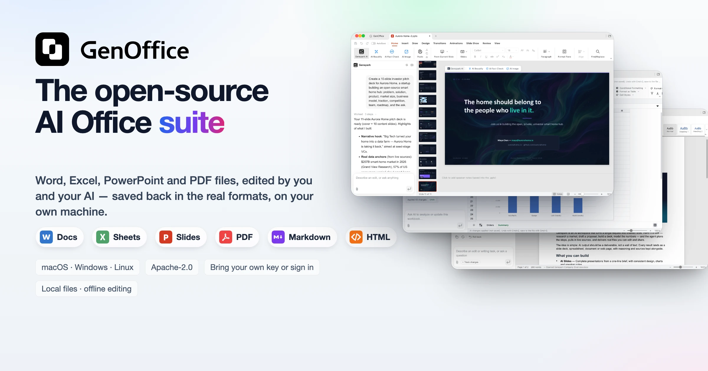
    </picture>
  </a>
</p>

<h1 align="center">GenOffice</h1>

<p align="center"><b>Rangkaian Office AI sumber terbuka pertama di dunia yang paling lengkap ciri.</b><br>
Fail Word, Excel, PowerPoint dan PDF, disunting oleh anda dan AI anda, disimpan semula dalam format sebenar.</p>

<p align="center">
  <a href="../../LICENSE"></a>
  <a href="https://github.com/genspark-ai/genoffice/releases/latest"></a>
  <a href="https://github.com/genspark-ai/genoffice/releases"></a>
  <a href="https://github.com/genspark-ai/genoffice/stargazers"></a>
  <a href="https://x.com/merrickbuilds"></a>
</p>

<p align="center"><a href="../../README.md">English</a> · <a href="README.es.md">Español</a> · <a href="README.pt-BR.md">Português</a> · <a href="README.de.md">Deutsch</a> · <a href="README.fr.md">Français</a> · <a href="README.zh-CN.md">简体中文</a> · <a href="README.zh-TW.md">繁體中文</a> · <a href="README.ko.md">한국어</a> · <a href="README.ja.md">日本語</a> · <a href="README.ar.md">العربية</a> · <a href="README.ru.md">Русский</a> · <a href="README.it.md">Italiano</a> · <a href="README.nl.md">Nederlands</a> · <a href="README.pl.md">Polski</a> · <a href="README.cs.md">Čeština</a> · <a href="README.id.md">Bahasa Indonesia</a> · <b>Bahasa Melayu</b> · <a href="README.th.md">ไทย</a> · <a href="README.hi.md">हिन्दी</a> · <a href="README.he.md">עברית</a> · <a href="README.vi.md">Tiếng Việt</a> · <a href="README.tr.md">Türkçe</a> · <a href="README.hu.md">Magyar</a></p>

<p align="center">
  <a href="#download"><b>Muat Turun</b></a> ·
  <a href="#skills"><b>Skill</b></a> ·
  <a href="#command-line-and-agent-skill"><b>CLI</b></a> ·
  <a href="#mcp-server"><b>MCP</b></a> ·
  <a href="https://genoffice.ai/"><b>Laman Web</b></a> ·
  <a href="https://genoffice.ai/join"><b>Komuniti</b></a> ·
  <a href="https://x.com/merrickbuilds"><b>X</b></a> ·
  <a href="../../PRIVACY.md"><b>Privasi</b></a>
</p>

GenOffice ialah alternatif percuma dan sumber terbuka kepada Microsoft Office
untuk macOS, Windows dan Linux. Ia membuka dan menyimpan fail asli `.docx`,
`.xlsx` dan `.pptx`, menyunting PDF, Markdown dan HTML, serta meletakkan agen
AI di sebelah setiap dokumen — bukan sekadar kotak sembang yang ditampal di
tepi, tetapi editor yang membaca fail, membuat perubahan itu, dan menunjukkan
kepada anda dengan tepat apa yang disentuhnya. Fail ODF (`.odt`, `.ods`,
`.odp` dan templat `.ott`/`.ots`/`.otp`) dibuka sebagai salinan OOXML yang
boleh disunting, begitu juga fail Word lama `.doc`/`.dot`, Excel 97 `.xls`
dan PowerPoint 97–2003 `.ppt` serta dokumen Hancom (`.hwp`, `.hwpx`);
pengimportan hanya untuk membuka — penyimpanan menulis OOXML, tidak pernah
format sumber.

- **Format sebenar, terpelihara bit demi bit.** Hanya bahagian yang anda
  sunting akan ditulis semula. Selebihnya dalam fail terus terpelihara
  bit demi bit, jadi dokumen anda kekal berfungsi dalam Word, Excel dan
  PowerPoint.
- **AI yang boleh anda semak.** Suntingan tiba sebagai perubahan yang dijejak
  (tracked changes) dan diff dengan rollback satu klik. Hamparan mendapat
  formula langsung, bukan nombor yang ditampal. Deck dan halaman dijana terus
  pada kanvas dan kekal boleh disunting sepenuhnya. Sembunyikan pilihan dalam
  Docs atau julat sel dalam Sheets daripada model dan AI hanya melihat
  pemegang tempat yang dinamakan; perkataan asal kekal dalam fail dan kembali
  semula. Penyembunyian ini meliputi AI dalam aplikasi ini sahaja — CLI, alat
  MCP dan eksport headless membaca fail secara terus dan masih melihat
  perkataan-perkataan ini.
- **Setempat mengikut reka bentuk.** Fail dibuka, disunting, disimpan dan
  ditukar terus pada mesin anda. PDF → Word / Excel / PowerPoint, Markdown →
  Word dan HTML → Word semuanya berjalan di peranti sendiri. Hanya panggilan
  AI yang keluar dari mesin, kepada pembekal pilihan anda.
- **Cari fail berdasarkan kandungannya.** Skrin utama mencari nama, folder
  dan teks penuh fail `.docx`, `.xlsx`, `.pptx`, PDF, Markdown dan HTML anda
  daripada indeks SQLite setempat, termasuk CJK. Secara pilihan, hasil
  teratas disusun semula kedudukannya oleh
  **[TypeSafe Jev](https://typesafe.ai/)**, model pertimbangan System One,
  supaya fail yang menjawab soalan anda muncul dahulu.
- **Tanya fail anda, berserta sumber.** Bintangkan satu set dokumen dan
  **Ask AI** pada skrin utama menjawab soalan merentasi kesemuanya, sambil
  merujuk fail di sebalik setiap dakwaan supaya anda boleh membukanya dan
  menyemak.
- **Kunci anda sendiri atau tiada langsung.** Log masuk dengan Genspark dan
  anda tidak perlu sebarang kunci, atau bawa kunci anda sendiri untuk Claude,
  OpenAI, Gemini, DeepSeek, Kimi, GLM, Qwen, Doubao, MiniMax, Grok, Mistral,
  OpenRouter, Requesty, Opper, Cheaper Inference, Atlas Cloud, atau mana-mana
  titik akhir yang serasi dengan OpenAI, termasuk pelayan setempat.
- **Boleh dijalankan melalui skrip dan sedia untuk agen.** Aplikasi ini
  disertakan dengan baris arahan `genoffice` dan skill untuk Claude Code,
  Codex, Cursor, Gemini CLI, GitHub Copilot, OpenCode dan Windsurf, jadi agen
  pengekodan boleh mencipta, menukar, membaca dan menyunting fail Office
  sebenar pada mesin anda tanpa membuka sebarang tetingkap.

**Dapatkan:** [macOS](https://github.com/genspark-ai/genoffice/releases/latest) (Apple Silicon dan Intel) ·
[Windows](https://github.com/genspark-ai/genoffice/releases/latest) (x64 dan Arm) ·
[Linux](https://github.com/genspark-ai/genoffice/releases/latest) (deb, rpm, AppImage) —
butiran dan keperluan dalam [Muat Turun](#download).

## Demo

Enam aplikasi, satu panel AI, carian fail yang disusun semula kedudukannya
oleh TypeSafe Jev, Ask AI yang menjawab daripada fail berbintang anda
berserta sumber, dan satu baris arahan untuk agen pengekodan anda.
Setiap tangkapan skrin ialah aplikasi sebenar pada macOS, dengan AI dipandu
oleh gesaan yang boleh anda baca dalam panel.

### 1 · Docs — buka dan sunting `.docx` dengan AI yang boleh anda semak

<table>
<tr>
<td width="50%">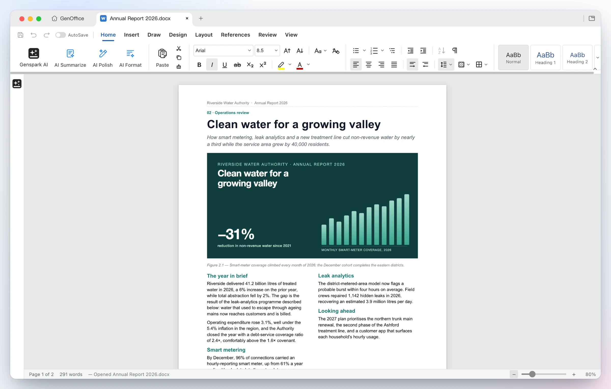</td>
<td width="50%">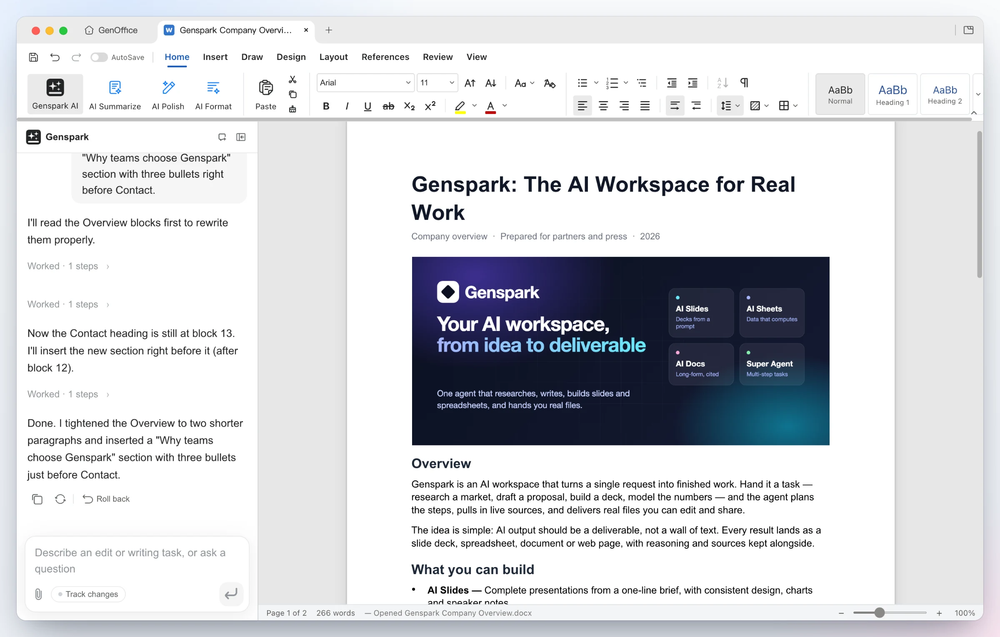</td>
</tr>
<tr>
<td><b>Membuka fail sepertimana Word menyusun aturnya</b> — bahagian dua lajur, imej sepenuh muka, jadual berlorek, pengepala dan pengaki, penomboran halaman berdasarkan metrik baris Word. Gaya, komen, perubahan yang dijejak, persamaan, tulisan dakwat dan kawalan kandungan (content controls) kekal utuh selepas pergi-balik. Tab <b>Mailings</b> menjadikan dokumen itu templat gabungan (merge template): pilih senarai penerima <code>.xlsx</code> atau <code>.csv</code>, sisipkan <code>MERGEFIELD</code> sebenar, pratonton rekod demi rekod, dan gabungkan kepada satu dokumen atau satu <code>.docx</code> bagi setiap rekod.</td>
<td><b>Minta suntingan itu</b> — AI membaca blok yang diperlukannya, menulis semula bahagian Overview dan menyisipkan bahagian berbulet baharu. Setiap pusingan AI ialah snapshot yang boleh anda rollback; dengan <b>Track changes</b> dihidupkan, suntingan tiba sebagai semakan bergaya Word. Minta peta minda sebagai gantinya dan jawapannya ialah rajah interaktif untuk keseluruhan dokumen: cawangan yang boleh dilipat, zum dan anjakan, klik pada nod mengajukan soalan susulan, dan rujukan melompat kembali ke blok asalnya.</td>
</tr>
</table>

### 2 · Sheets — `.xlsx` dengan formula dan carta langsung, bukan nombor yang ditampal

<table>
<tr>
<td width="50%">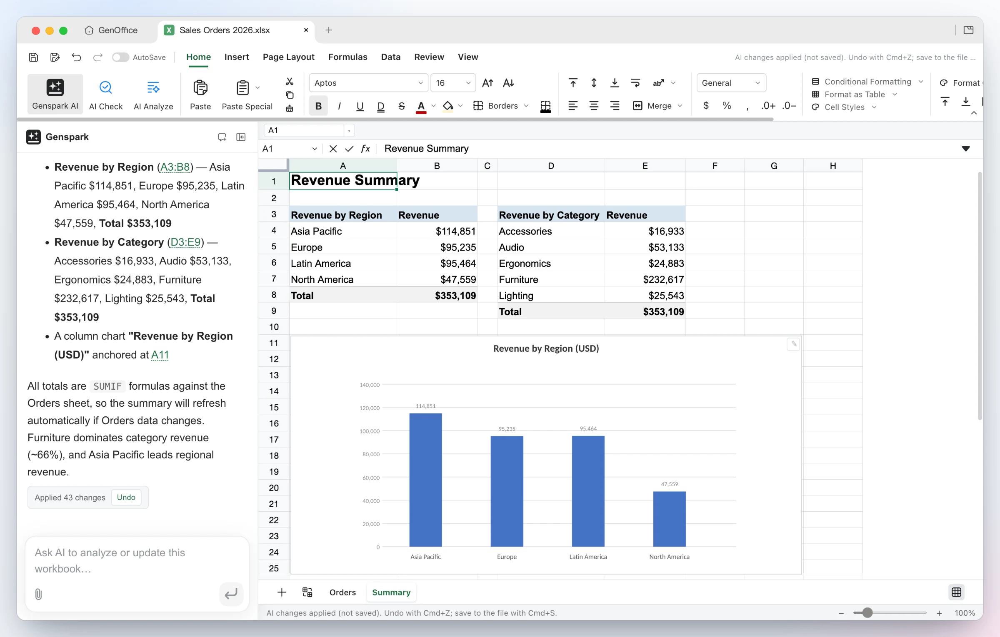</td>
<td width="50%">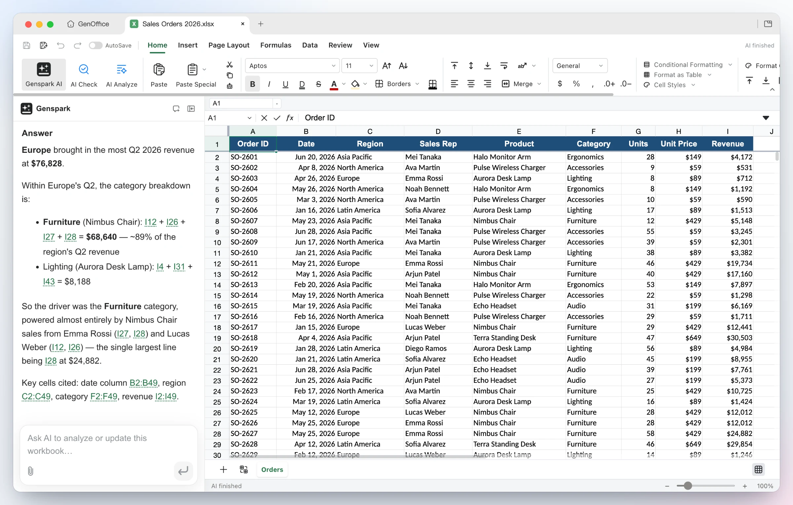</td>
</tr>
<tr>
<td><b>Bina ia</b> — daripada satu ayat, agen menambah helaian Summary dengan <code>SUMIF</code> sebenar mengikut wilayah dan kategori, menyisipkan carta lajur, dan melaksanakan 43 perubahan itu sebagai satu kelompok yang boleh dibuat asal.</td>
<td><b>Tanya ia</b> — soalan tentang buku kerja itu dijawab dengan penaakulan serta sel sebenar yang digunakan sebagai rujukan yang boleh diklik. Di sebaliknya: enjin <code>.xlsx</code> Rust buatan sendiri, jadual pangsi, penghiris, pemformatan bersyarat, penyusuran formula, dan gambar yang dibenamkan dalam sel sebagai rich value native Excel — Excel membukanya semula dan ia masih berada dalam sel itu. Nota sel boleh membawa gambar, yang dipaparkan di bawah popup nota.</td>
</tr>
</table>

### 3 · Slides — daripada gesaan kepada deck `.pptx`

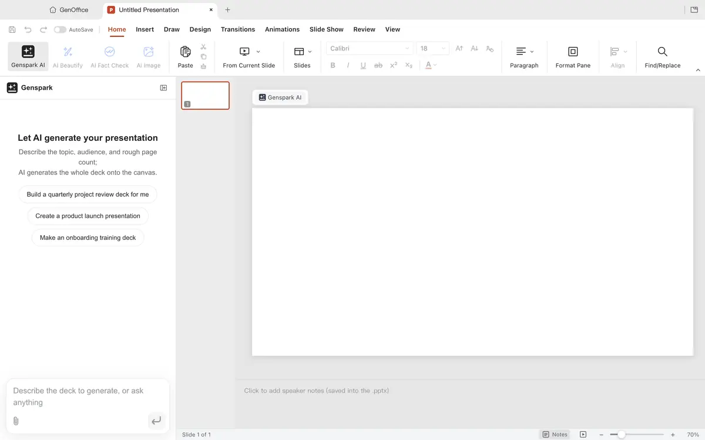

<table>
<tr>
<td width="50%">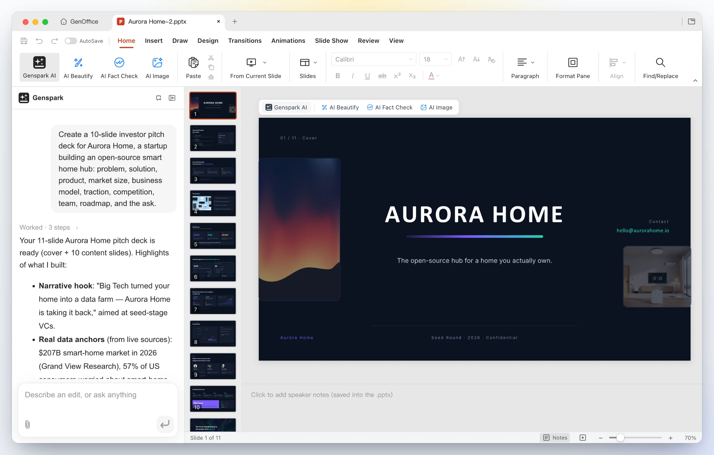</td>
<td width="50%">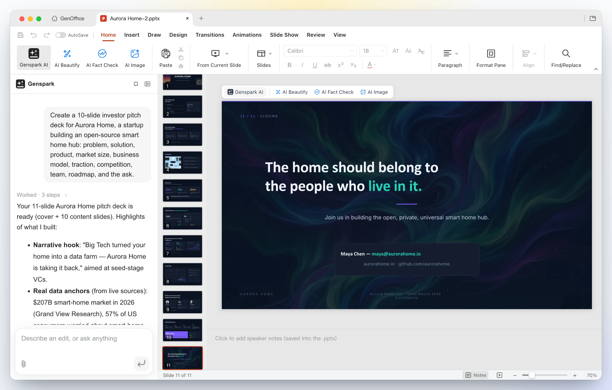</td>
</tr>
<tr>
<td><b>Satu baris masuk</b> — "Create a 10-slide investor pitch deck for Aurora Home…". GenOffice merancang jalan cerita, menyelidik angka-angka itu, dan merangka setiap slaid terus pada kanvas sebagai <code>.pptx</code> sebenar.</td>
<td><b>Deck siap keluar</b> — sebelas slaid yang direka dengan tipografi, imej yang konsisten dan seruan tindakan penutup; teruskan menyunting dengan induk (masters), susun atur, garis pandu pintar dan pemangkasan tidak merosakkan, atau minta panel menggayakan semula, menulis semula dan menyusun semula. Sisipkan <code>.glb</code> dan ia menjadi model 3D sebenar: putarkannya dengan menyeret dalam editor, disimpan dengan cara PowerPoint menyimpan 3D, dan masih 3D dalam PowerPoint.</td>
</tr>
</table>

**Slide Show → Record** merakamkan narasi bagi deck itu slaid demi slaid,
dengan jeda dan sambung semula. Narasi itu serta masa peralihan automatik
yang diukurnya disimpan ke dalam `.pptx`, dan PowerPoint memainkannya semula
dengan cara yang sama.

### 4 · PDF — sunting teks PDF di tempatnya, tukar PDF ke Word di peranti sendiri

<table>
<tr>
<td width="50%">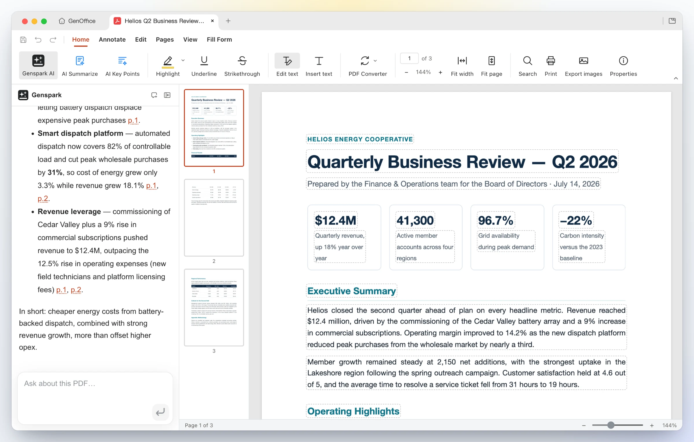</td>
<td width="50%">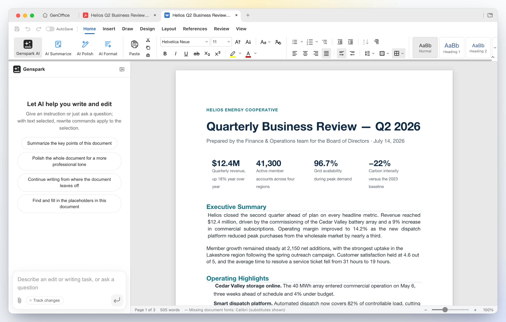</td>
</tr>
<tr>
<td><b>Sunting di dalam halaman</b> — mod Edit text menggariskan setiap blok teks untuk ditaip semula di tempatnya; strim kandungan ditulis semula melalui PDFium dengan fon asal, bukan anotasi yang sekadar menutup. Tanya AI tentang laporan panjang dan dapatkan jawapan dengan rujukan halaman.</td>
<td><b>Tukar di peranti sendiri</b> — <b>PDF Converter → PDF to Word</b> menghasilkan <code>.docx</code> yang boleh disunting dan dibuka dalam Docs di sebelah sumbernya, dengan tajuk, baris statistik dan perenggan yang utuh. Sasaran Excel dan PowerPoint berfungsi dengan cara yang sama; halaman yang diimbas melalui OCR sistem.</td>
</tr>
</table>

### 5 · HTML — pembina halaman dan UI berbantukan AI, ringkasan reka bentuk dahulu

Nyatakan tujuan halaman itu dan untuk siapa ia dibina. AI mencadangkan
**ringkasan reka bentuk** dahulu — hook, palet warna, tipografi dan arah
gaya — sebelum membina satu fail `.html` mandiri berdasarkan token-token itu.

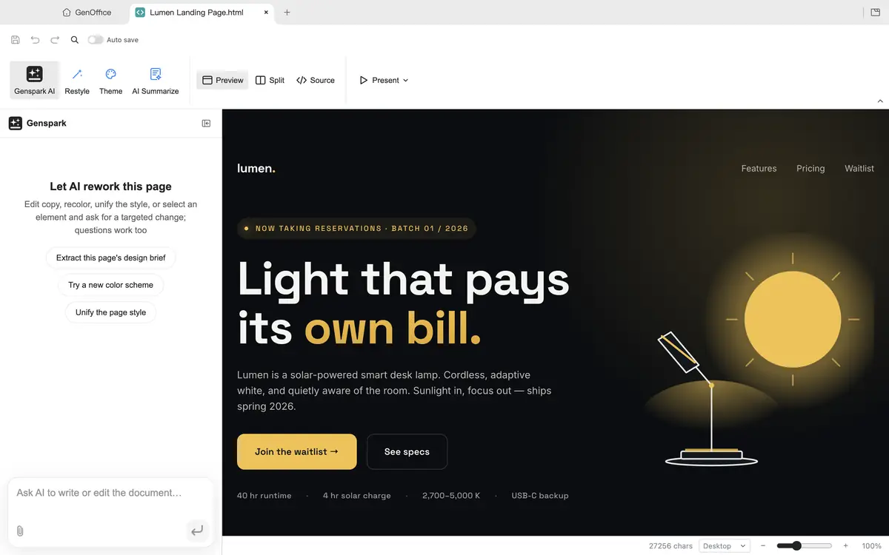

<table>
<tr>
<td width="50%">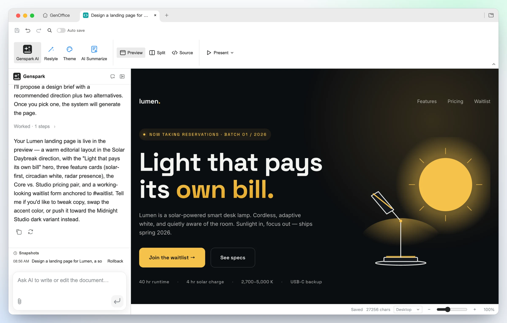</td>
<td width="50%">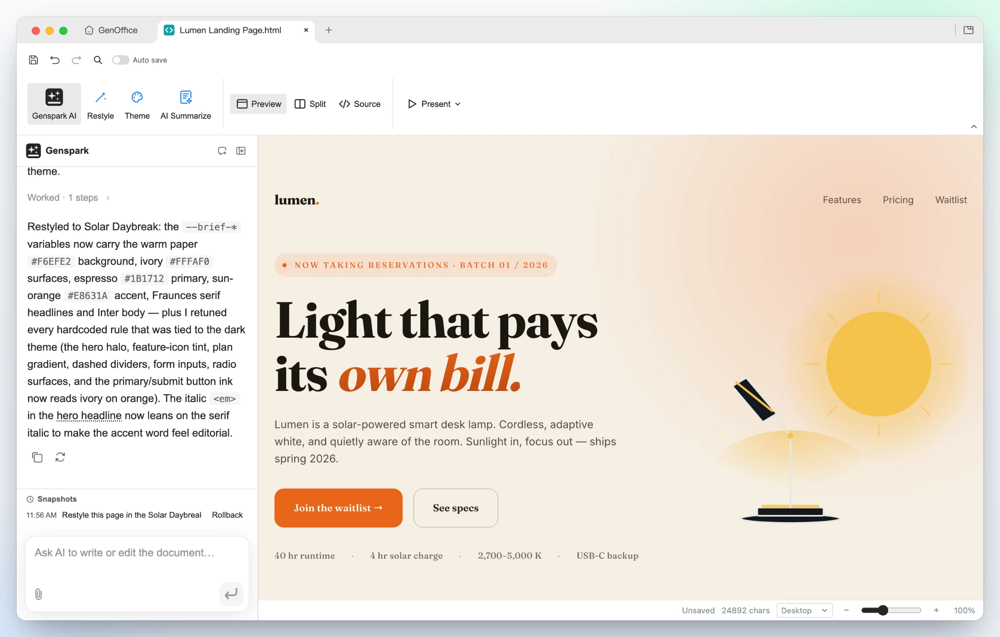</td>
</tr>
<tr>
<td><b>Dijana daripada satu gesaan</b> — hero yang berani, kad ciri, harga dan borang senarai tunggu untuk Lumen, dibina dalam arah Midnight Studio. Klik mana-mana elemen untuk menggayakannya semula, dwiklik untuk menyunting teks, atau tukar ke paparan sumber CodeMirror.</td>
<td><b>Reka bentuk sama, arah baharu</b> — satu permintaan <b>Restyle</b> menukar token-token ringkasan itu dan halaman itu ikut serta: kertas hangat, serif editorial, aksen jingga matahari, tanpa apa-apa ditulis semula. Persembahkan skrin penuh, atau eksport sebagai PDF atau dokumen Word asli yang boleh disunting.</td>
</tr>
</table>
<table>
<tr>
<td width="50%">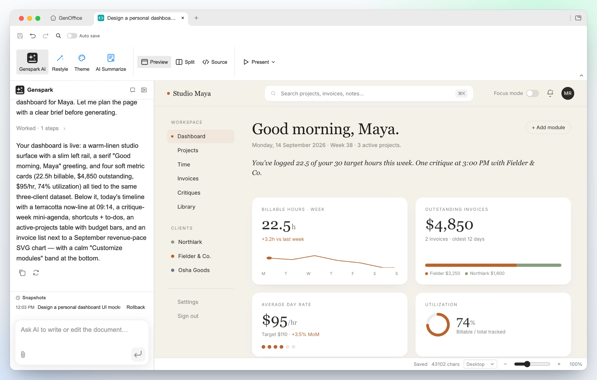</td>
<td width="50%">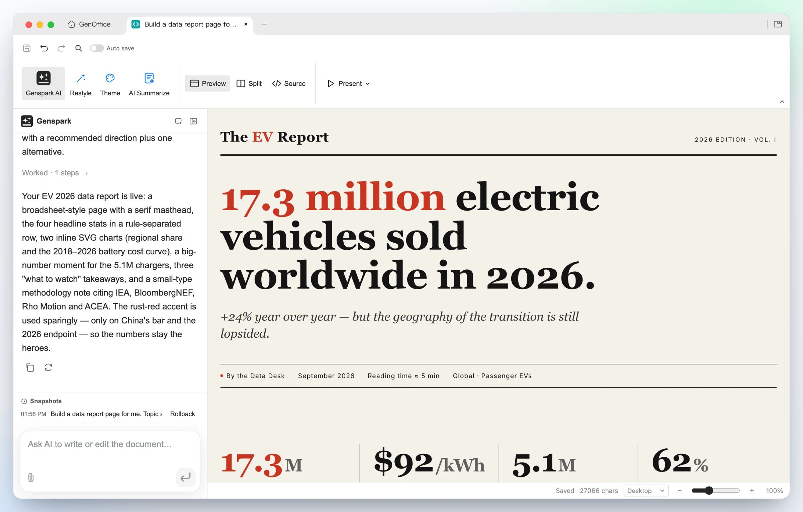</td>
</tr>
<tr>
<td><b>Reka bentuk UI</b> — permulaan "papan pemuka peribadi" mengubah satu persona kepada susun atur yang berfungsi: rel kiri, sapaan, sparkline jam bercaj, kad invois dan penggunaan, semuanya HTML sebenar yang boleh anda serahkan kepada pembangun.</td>
<td><b>Cerita data</b> — permulaan "laporan data" membina akhbar besar bergaya editorial: kepala akhbar serif, satu angka utama, baris statistik dipisahkan garisan, carta SVG sebaris dan nota metodologi.</td>
</tr>
</table>

### 6 · Markdown — editor blok di atas `.md` biasa, dengan Ask AI

<table>
<tr>
<td width="50%">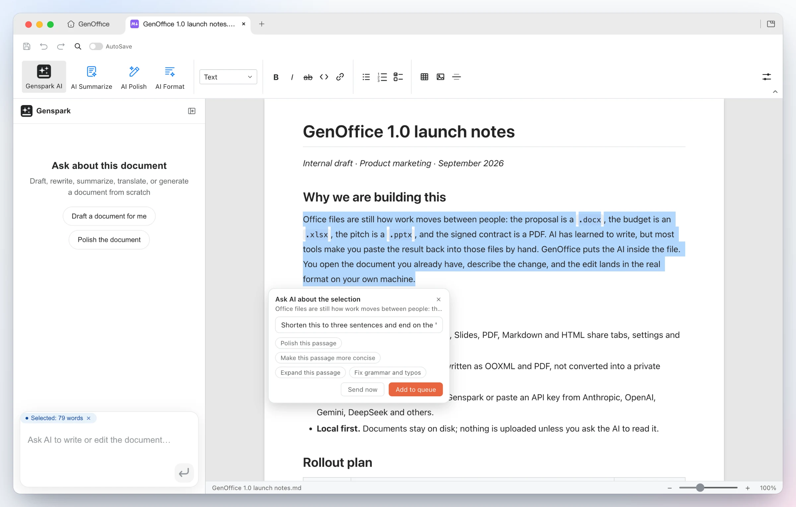</td>
<td width="50%">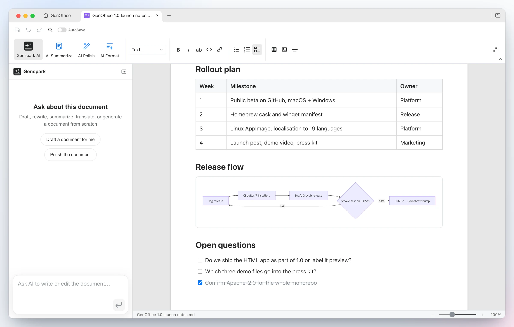</td>
</tr>
<tr>
<td><b>Tanya AI tentang pilihan teks</b> — pilih mana-mana ayat dan cip <b>Ask AI</b> akan muncul: taip arahan atau pilih cadangan, hantar serta-merta, atau baris beberapa suntingan berlabuh dan jalankan dalam satu pusingan. Kemasukan yang sama wujud dalam setiap aplikasi.</td>
<td><b>Dipaparkan, disimpan sebagai Markdown biasa</b> — tajuk, senarai, jadual, imej, blok kod dan gambar rajah Mermaid dalam editor blok Tiptap, ditulis semula sebagai <code>.md</code> biasa, dengan eksport <b>Markdown → Word</b> yang sepenuhnya setempat.</td>
</tr>
</table>

**Nota berpaut, seperti cara Obsidian melakukannya.** `[[wiki links]]` boleh
diklik untuk melompat ke nota yang dinamakannya, menaip `[[` menawarkan
pelengkap nama nota, dan `![[…]]` membenamkan nota atau gambar secara
sebaris. Panel **Backlinks** menyenaraikan setiap nota yang menunjuk kepada
nota yang sedang dibuka, dan paparan **Graph** memetakan pautan seluruh vault.

### <a id="7--search--find-the-file-that-answers-the-question-with-typesafe-jev"></a>7 · Carian — cari fail yang menjawab soalan, dengan TypeSafe Jev

Setiap fail dalam folder kerja anda diindeks di peranti sendiri: nama, folder
dan teks yang diekstrak daripada fail Word, Excel, PowerPoint, PDF, Markdown
dan HTML, dalam indeks teks penuh SQLite dengan pentokenan yang peka CJK.
Hidupkan **Jev search reranking** dan 20 hasil setempat teratas dinilai oleh
[TypeSafe Jev](https://typesafe.ai/blog/introducing-system-one-models-and-jev),
model System One yang memulangkan satu skor kerelevanan terkalibrasi bagi
setiap dokumen dalam satu panggilan dan bukannya menjana teks. Senarai itu
disusun semula mengikut skor tersebut; jika panggilan gagal atau tamat masa,
susunan setempat dikekalkan.


<table>
<tr>
<td width="50%"></td>
<td width="50%"></td>
</tr>
<tr>
<td><b>Perkataan sama, jawapan berbeza</b> — "laptop refresh policy" sepadan perkataan demi perkataan dengan dasar penyegaran cache pelayar, pelan penyegaran jenama dan jadual penyegaran papan pemuka, jadi pemeringkatan teks penuh meletakkannya di hadapan. Jev membaca petikan dan mengalihkan dokumen piawaian peralatan, iaitu dokumen yang menyatakan kitaran penggantian tiga tahun, ke tempat teratas. Lencana <b>Jev</b> di sebelah kiraan hasil menunjukkan bila susunan itu datang daripada model.</td>
<td><b>Dimatikan secara lalai, satu suis untuk menghidupkannya</b> — Settings → AI Media & Search → Local file search. Pilih OpenRouter atau TypeSafe secara terus, tampal kunci, tekan Test connection. Hanya apabila suis itu dihidupkan barulah petikan hasil teratas keluar dari peranti; indeks itu sendiri tidak pernah keluar.</td>
</tr>
</table>

### 8 · Ask AI — fail berbintang anda, dijawab berserta sumber

Bintangkan fail yang anda gunakan dan **Ask AI** pada skrin utama
menganggapnya sebagai pangkalan pengetahuan. Ajukan soalan dalam bahasa
biasa; agen mencari dalam fail berbintang, membaca fail yang diperlukannya
dan menjawab dengan rujukan selepas setiap dakwaan. Klik satu rujukan dan
fail itu dibuka dalam aplikasi yang betul. Lampirkan fail pada soalan dengan
menyeret, menampal atau daripada menu **+** — imej dihantar kepada model
sebagai input visual — dan setiap soalan disimpan sebagai perbualannya
sendiri: beralih antara perbualan, mulakan yang baharu, padam satu, dan
senarai itu kekal selepas aplikasi dimulakan semula.


Ask AI mencari dalam indeks teks penuh di peranti yang sama seperti
[Carian](#7--search--find-the-file-that-answers-the-question-with-typesafe-jev)
dan membaca fail halaman demi halaman, jadi model hanya melihat hasil carian
dan petikan yang dimintanya, melalui pembekal pilihan anda. Ia juga boleh
memanggil CLI `genoffice` terbina dalam untuk membina fail terus; setiap satu
muncul sebagai kad artifak di bawah jawapan, dan satu klik membukanya.

### 9 · CLI — agen pengekodan anda memandu GenOffice, pada mesin anda

GenOffice disertakan dengan baris arahan `genoffice` dan skill agen. Pasang
skill itu dan Claude Code, Codex, Cursor, Gemini CLI, GitHub Copilot, OpenCode
atau Windsurf boleh mencipta, menukar, membaca dan menyunting fail Office
sebenar melalui enjin yang sama seperti aplikasi, tanpa membuka sebarang
tetingkap.

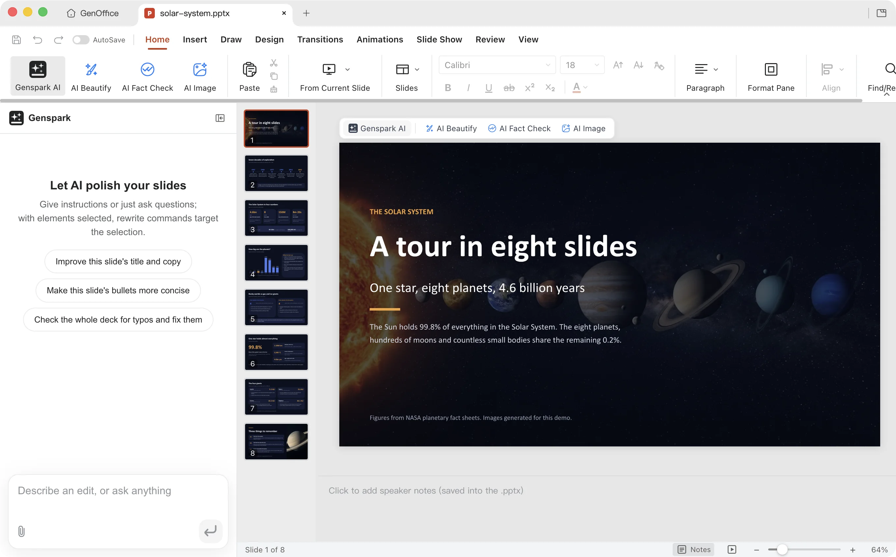

<table>
<tr>
<td width="50%">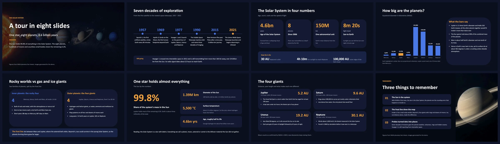</td>
<td width="50%">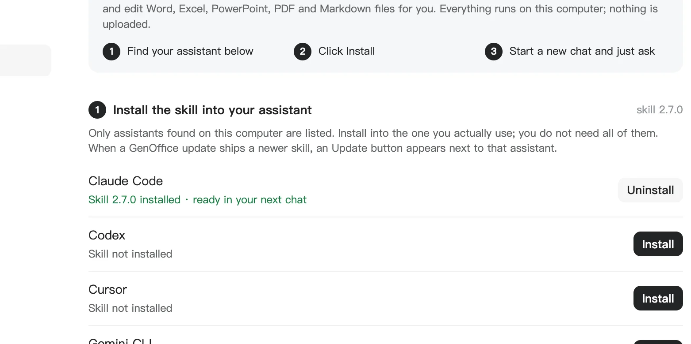</td>
</tr>
<tr>
<td><b>Satu gesaan kepada agen anda</b> — "Build an eight-slide deck about the Solar System." Agen membaca skill, menulis helaian gaya, rangka dan satu spesifikasi halaman bagi setiap slaid, menjana dua foto dengan <code>genoffice image</code>, dan membiarkan <code>genoffice slides check</code> menolak apa-apa yang melimpah atau bertindih sebelum <code>genoffice create</code> memasang <code>.pptx</code> dan <code>slides render</code> memulangkan satu PNG bagi setiap slaid untuk dilihat.</td>
<td><b>Pasang sekali, daripada Tetapan → Integrasi</b> — GenOffice menyenaraikan agen pengekodan yang ditemuinya pada komputer ini dan menulis skill ke dalam setiap satu yang anda pilih. Atau muat turun skill sebagai zip, atau jalankan <code>npx skills add genspark-ai/genoffice</code>. Arahan dan aliran kerja penuh ada dalam <a href="#command-line-and-agent-skill">Baris arahan dan skill agen</a>.</td>
</tr>
</table>

### 10 · MCP — alat yang sama melalui Model Context Protocol

Setiap arahan `genoffice` turut menjadi alat MCP. Claude Code, Claude
Desktop, Cursor dan mana-mana klien MCP lain boleh memulakan `genoffice
mcp` sendiri, tanpa perlu memasang skill dan tanpa membuka tetingkap, lalu
mendapat 29 alat serta rujukan operasi sebagai sumber (resources). Pelayan
HTTP kedua di dalam aplikasi membolehkan agen membina dokumen Word dalam
tab editor yang kelihatan sementara anda memerhati.

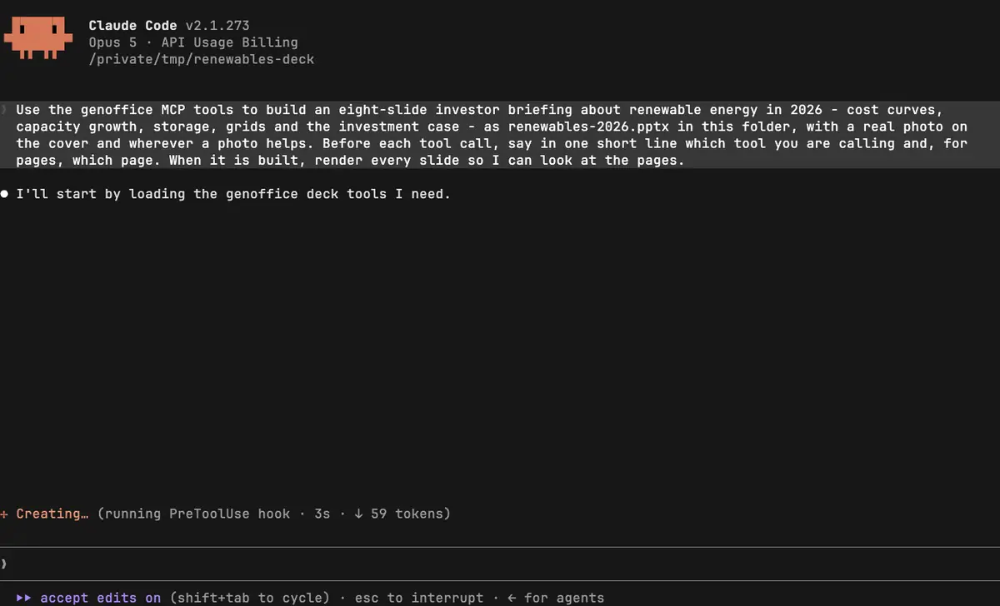

<table>
<tr>
<td width="50%">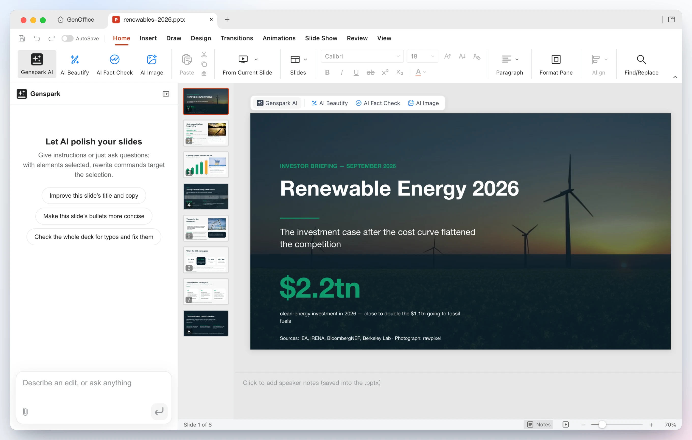</td>
<td width="50%">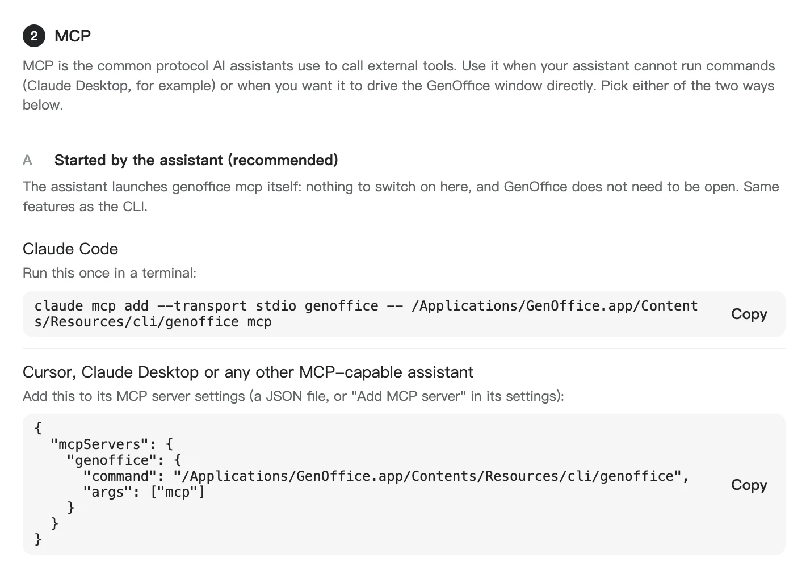</td>
</tr>
<tr>
<td><b>Satu gesaan, 38 panggilan alat, tanpa shell</b> — "Bina taklimat pelabur lapan slaid tentang tenaga boleh diperbaharui pada 2026, dengan foto sebenar pada muka depan dan di mana-mana sahaja foto membantu." Agen menarik rajah dan foto menggunakan <code>search</code>, bertanya kepada <code>media</code> sama ada setiap gambar calon adalah foto sebenar, memanggil <code>deck_start</code> dengan helaian gaya dan rangka, kemudian <code>deck_page</code> bagi setiap slaid; setiap halaman disemak berbanding rangka dan palet sebelum disimpan, <code>deck_build</code> memasang <code>.pptx</code>, <code>slides_audit</code> mencari limpahan, <code>slides_render</code> memulangkan PNG bagi setiap slaid sebagai kandungan imej yang boleh dilihat model, dan <code>deck_replace</code> membetulkan tiga halaman yang tidak disukainya.</td>
<td><b>Sambung sekali, daripada Tetapan → Integrasi</b> — salin baris <code>claude mcp add</code> untuk Claude Code, atau blok JSON ke dalam Cursor, Claude Desktop atau mana-mana klien MCP lain. Pilihan B menghidupkan pelayan HTTP tempatan untuk editor Word yang kelihatan. Kedua-duanya diterangkan dalam <a href="#mcp-server">Pelayan MCP</a>.</td>
</tr>
</table>

### 11 · Fail lama — `.doc`, `.xls` dan `.ppt` dari era 2000-an juga boleh dibuka

Fail `.doc` Word 97–2003, `.xls` Excel atau `.ppt` PowerPoint dibuka sebagai salinan `.docx`, `.xlsx` atau `.pptx` yang ditukar pada komputer anda; fail asal tidak pernah diubah. Imej, jadual, formula, format nombor, isian dan susun atur dibawa bersama. Apa yang dikekalkan dan digugurkan oleh setiap format diterangkan dalam [Fail lama dan ODF dibuka sebagai salinan yang ditukar](#legacy-and-odf-files-open-as-converted-copies).

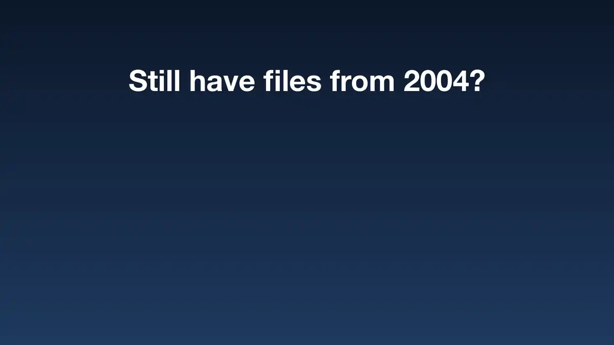

## Mengapa GenOffice

- **Sumber terbuka**, Apache-2.0, dibangunkan secara terbuka di GitHub.
- **Milik anda untuk dijalankan.** Aplikasi native untuk macOS, Windows dan
  Linux; fail kekal di cakera anda dan setiap suntingan, penyimpanan serta
  penukaran berlaku pada mesin anda sendiri.
- **Fail Office sebenar.** `.docx`, `.xlsx` dan `.pptx` native, terpelihara
  bit demi bit: bahagian fail yang tidak disentuh disalin seadanya.
- **AI yang menyunting dokumen itu sendiri.** Perubahan dijejak dalam Docs,
  formula dan carta langsung dalam Sheets, slaid dilukis terus pada kanvas,
  setiap pusingan AI adalah snapshot yang boleh anda kembalikan.
- **Model anda, kunci anda.** Log masuk dengan Genspark, atau bawa kunci
  untuk Claude, OpenAI, Gemini, DeepSeek dan lain-lain, termasuk pelayan
  setempat dan mana-mana endpoint serasi OpenAI.
- **PDF yang diuruskan dengan betul.** Sunting teks terus dalam halaman, dan
  tukar PDF kepada Word, Excel atau PowerPoint di peranti sendiri, dengan OCR
  sistem untuk hasil imbasan.
- **Markdown dan HTML juga**, dengan panel AI yang sama dan eksport setempat
  ke Word.
- **Carian yang menemui jawapan, bukan kata kunci.** Carian teks penuh
  merentasi setiap dokumen dalam folder anda, diindeks di peranti sendiri,
  dengan penyusunan semula pilihan oleh TypeSafe Jev, model pertimbangan
  System One.
- **Ask AI merentasi fail anda.** Bintangkan fail yang penting dan ajukan
  soalan dalam bahasa biasa; setiap jawapan merujuk fail asalnya, hanya satu
  klik jauhnya.
- **Skill.** Skill sedia ada atau `SKILL.md` anda sendiri, dilampirkan dari menu **+** di mana-mana panel AI.
- **Boleh dijalankan melalui skrip.** Baris arahan `genoffice`, skill agen
  dan pelayan MCP meletakkan setiap enjin di bawah khidmat Claude Code,
  Claude Desktop, Codex, Cursor dan agen lain, masih di peranti sendiri.
- **Percuma**, untuk individu dan pasukan.

## Bahagian belakang AI

**Log masuk dengan Genspark** dan tidak ada apa-apa yang perlu ditetapkan:
panggilan model disalurkan melalui proksi Genspark (keluarga Claude, GPT dan
Gemini) dan agen mendapat carian web serta imej, penjanaan imej, dan analisis
imej/audio/video.

**Atau bawa kunci anda sendiri.** Settings → AI menyenaraikan Claude, OpenAI,
Gemini, DeepSeek, Kimi, GLM, Qwen, Doubao, MiniMax, Grok, Mistral, OpenRouter, Requesty, Opper, Cheaper Inference, Atlas Cloud, SiliconFlow, PPIO, Command Code
dan OpenCode Zen/Go, ditambah slot tersuai untuk mana-mana titik akhir yang
serasi dengan OpenAI (URL asas + kunci), termasuk pelayan model setempat.
Carian dan media mempunyai pembekal tersendiri mengikut keupayaan di bawah
**AI Media & Search**: Serper, Serply, SearchApi, Tavily, Parallel, Keenable, Exa atau
Firecrawl untuk carian web, dan OpenAI, Gemini, Doubao/Seedream, GLM, Grok,
Qwen, MiniMax, Stability, FLUX atau mana-mana titik akhir imej serasi OpenAI
untuk penjanaan imej dan analisis imej/video, ditambah DeepSeek V4.1 Flash
untuk analisis imej.

**TypeSafe Jev** menyusun semula kedudukan carian fail pada skrin utama. Di
bawah **AI Media & Search → Local file search**, hidupkan Jev search
reranking dan pilih titik akhir:
[OpenRouter](https://openrouter.ai/typesafe) (model `typesafe/jev-1.13`) atau
API TypeSafe sendiri. Kunci itu disimpan pada peranti ini sahaja. Ia
dimatikan secara lalai; apabila dihidupkan, petikan 20 hasil setempat teratas
dihantar untuk dinilai dan tiada apa-apa lagi yang keluar dari mesin.

**Parallel** berfungsi tanpa akaun: Search MCP percumanya (dengan had kadar)
ialah carian web lalai apabila tiada log masuk Genspark atau kunci carian
ditetapkan, dan ia dijalankan sebelum pengikisan DuckDuckGo. Pilih Parallel
di bawah Web search dan masukkan kunci
[Parallel](https://platform.parallel.ai/) untuk menggunakan Search API
sebagai gantinya. Keenable juga tidak memerlukan kunci; kunci hanya
meningkatkan had kadar.

Keseluruhan rangkaian ini disertakan dengan tema terang, gelap dan sistem.
Tema hanya mengubah apa yang dipaparkan pada skrin: eksport, cetakan dan fail
yang disimpan sentiasa mengekalkan warna sebenar dokumen itu.

## <a id="skills"></a>Skill

Skill ialah fail `SKILL.md` yang memberitahu AI cara melakukan satu tugas dengan baik: laporan mingguan, NDA, rancangan pengajaran.
GenOffice menyertakan satu set skill dan menerima skill anda sendiri, dalam format yang sama digunakan oleh agen pengekodan.

- **Tetapan → Skill.** **Pasang** skill yang disyorkan, atau **Import** folder, zip atau satu fail `SKILL.md`. Tiada apa-apa dijalankan semasa import. Tab **Semua** menyenaraikan seluruh katalog yang disyorkan di satu tempat, dengan penerangan mengikut bahasa aplikasi.
- **Dalam sembang.** Buka menu **+** di sebelah kotak mesej mana-mana panel AI, pilih **Skill**, tandakan satu, lalu hantar. Skill hanya disertakan dengan mesej itu.

---

## <a id="command-line-and-agent-skill"></a>Baris arahan dan skill agen

Segala yang boleh dilakukan aplikasi pada sesuatu fail boleh dilakukan oleh
baris arahan `genoffice` dari terminal: memeriksa, menukar, mencipta, membaca
dan menyunting Word, Excel, PowerPoint, PDF, Markdown dan HTML pada enjin yang
sama, tanpa antara muka (headless). Ia dipasang bersama GenOffice, tidak
memerlukan runtime sendiri, dan tidak pernah menghantar dokumen ke mana-mana.
Digandingkan dengan **skill agen** yang disertakan, ia menjadikan agen
pengekodan sebagai pekerja dokumen yang menghasilkan fail Office sebenar dan
bukan anggaran dalam Markdown.

**Berfungsi dengan:** Claude Code, Codex, Cursor, Gemini CLI, GitHub Copilot,
OpenCode dan Windsurf terus tanpa tetapan tambahan, mana-mana agen lain yang
membaca skill, dan, melalui [pelayan MCP](#mcp-server), Claude Desktop serta
setiap klien MCP.

### Memasang skill

| Cara                                              | Apa yang berlaku                                                                                                                                                                                      |
| ------------------------------------------------- | ----------------------------------------------------------------------------------------------------------------------------------------------------------------------------------------------------- |
| **Tetapan → Integrasi** dalam aplikasi            | Menyenaraikan agen yang ditemui pada komputer ini; satu klik menulis skill ke dalam setiap satu yang anda pilih. Butang **Update** muncul apabila keluaran GenOffice membawa skill yang lebih baharu. |
| **Muat turun sebagai zip** pada halaman yang sama | Susun atur yang diterima oleh claude.ai, aplikasi desktop Claude dan pembantu lain sebagai skill yang dimuat naik.                                                                                    |
| `npx skills add genspark-ai/genoffice`            | Memasang daripada repositori ini ke dalam mana-mana agen yang serasi dengan skill.                                                                                                                    |

Kemudian mulakan sembang baharu dan minta sesuatu dokumen. Skill itu mengajar
agen bila perlu menggunakan `genoffice`, cara membaca fail sebelum
menyuntingnya, dan cara menyemak hasil kerjanya sendiri.

### Mula pantas dari terminal

```bash
genoffice --version
genoffice info report.docx --json                  # headings and blocks; or sheets, slides, pages
genoffice convert report.md --to pdf               # md/html/docx/xlsx/pptx → pdf, pdf → docx/xlsx/pptx/md/html, odt/ods/odp → docx/xlsx/pptx, doc/dot → docx, ppt → pptx, …
genoffice create --type docx --from notes.md --out notes.docx
genoffice create --type xlsx --from table.json --out sales.xlsx   # "=SUM(B2:B9)" cells stay live formulas
genoffice docs read report.docx --range 0-9 --json # then `docs apply --ops edits.json` edits in place
genoffice docs compare original.docx revised.docx --out redline.docx   # the differences as tracked Word revisions
genoffice render report.docx --out shots/          # one PNG per page, to look at what you made
genoffice open sales.xlsx                          # hand the result to the editor
```

Setiap arahan mencetak ringkasan satu baris, atau satu objek JSON dengan
`--json`. Suntingan bersifat atomik: op yang ditolak membiarkan fail tidak
tersentuh dan memulangkan ralat berpandu. `genoffice help` menyenaraikan set
arahan semasa; rujukan penuh ada dalam
[packages/cli/README.md](../../packages/cli/README.md).

### Apa yang sebenarnya dijalankan oleh agen

Deck Sistem Suria dalam [demo](#demo) hanya memerlukan satu gesaan dalam Claude
Code. Di sebaliknya, agen mengikuti aliran kerja berperingkat skill itu dan
CLI menyemak setiap peringkat sebelum peringkat seterusnya bermula:

```bash
genoffice capabilities --json                        # which cloud tools GenOffice has configured
genoffice guide slides design                        # the deck workflow and layout library
genoffice image "the eight planets in a row …" --aspect 16:9 --out deck/assets/cover.jpg
genoffice slides check deck/outline.json --json      # 8 pages, no findings
genoffice slides check deck/pages/01.json --json     # builds one slide, audits overflow and overlap
…                                                    # one page file per slide, fixed until each check is clean
genoffice create --type pptx --spec deck/pages --outline deck/outline.json --out deck/solar-system.pptx --json
genoffice slides render deck/solar-system.pptx --out deck/shots --json
genoffice slides audit deck/solar-system.pptx --json    # 8 slides, no layout issues
genoffice slides replace deck/solar-system.pptx --slide 4 --spec deck/pages/05.json --json
genoffice open deck/solar-system.pptx
```

Tiada panggilan model berlaku di dalam `genoffice`: agen yang berfikir, CLI
yang membina dan menyemak, dan hasilnya dibuka dalam GenOffice atau PowerPoint
sebagai `.pptx` biasa.

### <a id="mcp-server"></a>Pelayan MCP

Arahan yang sama tersedia sebagai alat [Model Context Protocol](https://modelcontextprotocol.io)
untuk pembantu yang tidak boleh menjalankan terminal, atau yang anda lebih
suka tidak diberi satu. Terdapat dua cara untuk masuk, kedua-duanya
ditunjukkan dengan cebisan sedia salin dalam **Tetapan → Integrasi → MCP**:

| Cara                                | Apa dia                                                                                                                                                                                                                                                                                                                                                                                                                                                                                                                 |
| ----------------------------------- | ----------------------------------------------------------------------------------------------------------------------------------------------------------------------------------------------------------------------------------------------------------------------------------------------------------------------------------------------------------------------------------------------------------------------------------------------------------------------------------------------------------------------- |
| **A · `genoffice mcp`** (disyorkan) | Pelayan stdio yang pembantu mulakan sendiri; GenOffice tidak perlu dibuka. Satu alat bagi setiap arahan (`info`, `convert`, `create_docx`, `create_xlsx`, `create_pptx`, `create_pdf`, `docs_read` / `docs_apply` / `docs_check`, `sheet_*`, `slides_*`, `render`, `guide`, `search`, `image`, `media`, `open`) ditambah aliran deck berperingkat `deck_start` → `deck_page` → `deck_build` → `deck_replace`. Ops, spesifikasi dan Markdown dihantar terus dalam argumen, jadi klien tanpa sistem fail tetap berfungsi. |
| **B · Pelayan HTTP tempatan**       | Berjalan di dalam aplikasi GenOffice pada `http://127.0.0.1:3093/mcp` (Streamable HTTP, dengan SSE lama). Alatnya memandu tab editor Word yang kelihatan: `create_session`, `insert_content`, `replace_blocks`, `apply_ops`, `read_document`, `save_session`, dan anda melihat dokumen itu terbentuk. Dimatikan secara lalai; hidupkan pada panel tetapan yang sama.                                                                                                                                                    |
| **C · `genoffice mcp --http`**      | Set alat stdio sebagai pelayan Streamable HTTP untuk klien pada mesin lain: kontena, sandbox, mesin kongsi dalam rangkaian anda. Fail bergerak bersama panggilan: `PUT /files/<name>` memuat naik satu fail dan memulangkan URL, setiap parameter `file` menerima URL http(s), dan alat yang menulis fail memulangkannya sebagai URL muat turun serta, apabila kecil, bait-baitnya sebagai sumber MCP. `--host 0.0.0.0` membukanya kepada rangkaian, `--token` melindunginya.                                           |

```bash
# Claude Code
claude mcp add --transport stdio genoffice -- genoffice mcp
```

```jsonc
// Cursor, Claude Desktop or any other MCP client
{ "mcpServers": { "genoffice": { "command": "genoffice", "args": ["mcp"] } } }
```

```bash
# On the machine that has GenOffice (private network; add --token for a shared box)
genoffice mcp --http 3093 --host 0.0.0.0 --token "$GENOFFICE_MCP_TOKEN"

# From the client: upload, then use the URL wherever a tool takes a file
curl -T report.docx -H "Authorization: Bearer $GENOFFICE_MCP_TOKEN" http://server:3093/files/
#   → { "url": "http://server:3093/files/<id>/report.docx", ... }
#   docs_read({ "file": "http://server:3093/files/<id>/report.docx" })
#   docs_apply(...) → output_url, downloadable with curl -o
```

Melalui HTTP, setiap sesi mendapat folder kerja peribadi, laluan relatif dan
folder deck diselesaikan di dalamnya, `open` tidak ditawarkan, dan apabila
`GENOFFICE_ALLOWED_ROOTS` tidak ditetapkan, alat-alat itu tidak boleh keluar
dari stor fail pelayan itu sendiri. `render`, `convert` ke PDF dan
`create_pdf` masih memulakan proses GenOffice tersembunyi, jadi hos headless
memerlukan aplikasi itu dipasang serta paparan maya (`xvfb-run`).

`genoffice` di sini ialah CLI yang disertakan di dalam aplikasi (pada macOS
`/Applications/GenOffice.app/Contents/Resources/cli/genoffice`; panel
tetapan memaparkan laluan tepat untuk pemasangan anda). Pelayan ini membawa
arahan aliran kerjanya sendiri dan mendedahkan rujukan operasi sebagai
sumber `genoffice://guide/*`, jadi tiada skill diperlukan; skill dan
pelayan MCP boleh wujud bersama dan pembantu memilih salah satu. Ciri awan
(`search`, `image`, `media`) masih melalui pembekal yang ditetapkan dalam
GenOffice; selebihnya berjalan secara tempatan, dan
`GENOFFICE_ALLOWED_ROOTS` mengehadkan setiap alat kepada folder yang anda
senaraikan.

Deck tenaga boleh diperbaharui dalam [demo](#demo) ialah gambaran, dari sudut
protokol, satu gesaan dalam Claude Code yang hanya menyambungkan pelayan
MCP `genoffice`:

```text
capabilities · guide(slides, spec) · guide(slides, design)
search(query) ×4                         → IEA, BNEF and IRENA figures for the slides
search(query, images) ×7 · media(url, ask) ×7
                                         → candidate photos, each one checked to be a real photograph
deck_start(dir, style, outline)          → outline checked: 8 pages to write
deck_page(dir, 0, page) … deck_page(dir, 7, page)
                                         → each page checked against the outline and the palette; one page sent again
deck_build(dir, out)                     → renewables-2026.pptx, no image failures
slides_audit(file) · slides_render(file, out)
                                         → no layout findings; 8 PNGs come back as image content
deck_replace(dir, n, page) ×3 · slides_render(file, out)
                                         → three pages fixed after looking at the renders
```

Tiga puluh lapan panggilan, kira-kira tiga belas minit, dan pembantu itu
langsung tidak menyentuh shell: rajah, foto, semua panduan, semakan dan
render bergerak sebagai hasil panggilan alat MCP. Hanya `search` dan `media`
meninggalkan mesin, kepada pembekal yang dikonfigurasikan dalam GenOffice.

## <a id="download"></a>Muat Turun

| Platform                             | Keperluan                                             | Muat Turun                                                                                |
| ------------------------------------ | ----------------------------------------------------- | ----------------------------------------------------------------------------------------- |
| **macOS** — Apple Silicon (arm64)    | macOS 11+                                             | [`.dmg` terkini (arm64)](https://github.com/genspark-ai/genoffice/releases/latest)        |
| **macOS** — Intel (x64)              | macOS 11+                                             | [`.dmg` terkini (x64)](https://github.com/genspark-ai/genoffice/releases/latest)          |
| **Windows** (x64, kebanyakan PC)     | Windows 10+, Intel/AMD                                | [Pemasang `-x64.exe` terkini](https://github.com/genspark-ai/genoffice/releases/latest)   |
| **Windows** pada Arm (ARM64)         | Windows 11 on Arm (Snapdragon X dan seumpamanya)      | [Pemasang `-arm64.exe` terkini](https://github.com/genspark-ai/genoffice/releases/latest) |
| **Linux** — Debian / Ubuntu          | x86_64, glibc 2.34+ (Ubuntu 22.04 atau lebih baharu)  | [`.deb` terkini](https://github.com/genspark-ai/genoffice/releases/latest)                |
| **Linux** — Fedora / RHEL / openSUSE | x86_64, glibc 2.34+ (Fedora 35+, RHEL 9+, Leap 15.6+) | [`.rpm` terkini](https://github.com/genspark-ai/genoffice/releases/latest)                |
| **Linux** — pengedaran lain          | x86_64, glibc 2.34+, FUSE 2                           | [`.AppImage` terkini](https://github.com/genspark-ai/genoffice/releases/latest)           |

Semua binaan berasal daripada `main`; pemasang macOS dan Windows telah
ditandatangani. Versi lama boleh didapati di halaman
[Releases](https://github.com/genspark-ai/genoffice/releases).

<details>
<summary><b>Memasang pada Linux</b></summary>

Fail deb dipasang menggunakan apt — ia menarik kebergantungan dan menambah
GenOffice ke menu aplikasi:

```bash
sudo apt install ./genoffice_<version>_amd64.deb
```

Pada Fedora / keluarga RHEL / openSUSE, pasang fail rpm sebaliknya:

```bash
sudo dnf install ./genoffice-<version>.x86_64.rpm     # Fedora / RHEL family
sudo zypper install ./genoffice-<version>.x86_64.rpm  # openSUSE
```

Fail deb dan rpm juga menambah templat kosong untuk Dolphin dalam KDE Plasma:
klik kanan dalam folder → **Create New** menyenaraikan _GenOffice Document_,
_GenOffice Spreadsheet_ dan _GenOffice Presentation_. Templat itu berada
dalam `/usr/share/templates` dan dibuang bersama pakej.

AppImage berjalan di tempatnya: pasang runtime FUSE 2
(`sudo apt install libfuse2`; pada Ubuntu 24.04 paketnya bernama
`libfuse2t64`), jadikan fail itu boleh dilaksanakan, kemudian jalankannya:

```bash
chmod +x GenOffice-<version>.AppImage
./GenOffice-<version>.AppImage
```

Pada Chromebook, pakej yang sama berjalan dalam persekitaran Linux (Crostini) — butirannya ada di [docs/platforms/chromeos.md](../platforms/chromeos.md).

</details>

## Cara ia berfungsi

Tujuh aplikasi Electron — Docs, Sheets, Slides, PDF, Markdown, HTML dan shell
bertab — berkongsi satu lapisan enjin pakej TypeScript tulen ditambah sidecar
Rust untuk `.xlsx`. Fail asal sentiasa menjadi sumber kebenaran: suntingan
digunakan sebagai tampung (patch) yang sempit, dan segala yang tidak
disentuh oleh editor itu kekal utuh selepas pergi-balik.

```
open docx ─► archive original by hash (never touched)
          ─► parse word/document.xml into a block tree, each block anchored to its original XML
          ─► Tiptap editor (manual + AI editing, dirty tracking)
save      ─► dirty blocks → OOXML fragments (referencing existing styles only)
          ─► splice into the original document.xml; untouched blocks keep their bytes
          ─► repack the zip; every other entry is copied byte-for-byte
```

Lawatan pakej demi pakej (enjin docx/pptx, `pdf2docx`, `html2docx`, teras
agen dan pembekal) terdapat dalam
[CONTRIBUTING.md](../../CONTRIBUTING.md#engine-packages).

### <a id="legacy-and-odf-files-open-as-converted-copies"></a>Fail lama dan ODF dibuka sebagai salinan yang ditukar

Format yang tidak dapat ditulis semula oleh GenOffice — Word lama
`.doc`/`.dot`, Hancom `.hwp`/`.hwpx`, Excel 97 `.xls`, `.tsv`, PowerPoint
lama `.ppt`, dan keluarga OpenDocument (`.odt`, `.ott`, `.ods`, `.ots`,
`.odp`, `.otp`) — ialah import, bukan fail asli.
Membuka salah satunya menukarkannya pada mesin anda kepada salinan `.docx`,
`.xlsx` atau `.pptx` dan membuka salinan itu; fail asal tidak dibaca lagi dan
tidak pernah ditulis.

- Docs dan Slides bertanya dahulu di mana salinan itu hendak diletakkan
  (secara lalai, `.docx`/`.pptx` senama di sebelah fail asal), jadi setiap
  Save selepas itu disimpan di situ. Fail `.ppt` ditukar bersama induk
  (masters), geometri bentuk, isian, gambar dan pemformatan teksnya, jadi
  deck itu kelihatan seperti yang dipaparkan PowerPoint; nota, animasi,
  peralihan dan hiperpautan belum dibawa bersama.
- Sheets membuka buku kerja yang ditukar itu serta-merta dan menghalakan Save
  yang pertama melalui Save As ke fail `.xlsx` baharu. `.csv` ialah
  pengecualian: ia mengekalkan identitinya dan Save menulis nilai kembali ke
  `.csv`, seperti yang dilakukan Excel.
- Penukaran ini sehala dan boleh menggugurkan ciri yang ada pada format
  sumber tetapi tiada pada OOXML. `.doc`, `.ppt`, `.hwp` dan format ODF
  memaparkan dialog pengesahan yang menyatakan hal ini; tandakan "Convert
  without asking next time" untuk melangkauinya, dan "Ask before converting
  legacy files" dalam Settings → General menghidupkannya semula.

## Pembangunan

```bash
npm install
npm run fixtures     # generate test .docx fixtures
npm test             # engine + app unit tests (docs/sheets/slides need no display)
npm run typecheck    # tsc --noEmit across every workspace
npm run dev          # all six editors + shell against Vite dev servers
npm run dev:docs     # a single app (same pattern works per workspace)
npm run dist:mac     # package macOS dmg (regenerates third-party notices)
npm run dist:win     # package Windows nsis installer
npm run dist:linux   # package Linux AppImage + deb + rpm
```

Aplikasi sheets juga memerlukan toolchain Rust untuk sidecar xlsx-nya
(`cargo` pada PATH); `npm run build -w @genoffice/sheets` mengkompilnya
secara automatik. Lihat [CONTRIBUTING.md](../../CONTRIBUTING.md) untuk semakan
yang perlu dilalui setiap perubahan dan cara pull request diterima masuk.

## Komuniti

GenOffice sedang dibangunkan secara aktif dan maklum balas anda membentuknya.

- **Laporkan pepijat atau minta ciri** di
  [GitHub Issues](https://github.com/genspark-ai/genoffice/issues).
- **Sertai sembang kumpulan GenOffice** di
  [GenTeam](https://genoffice.ai/join) untuk berbual dengan pasukan dan
  pengguna lain.
- **Ikuti [@merrickbuilds](https://x.com/merrickbuilds) di X** untuk nota
  keluaran, demo dan apa yang sedang dibina seterusnya.
- **Berikan bintang pada repo ini** jika GenOffice bermanfaat untuk anda —
  ini cara terbaik untuk menyokong projek ini.

## Soalan Lazim

<details>
<summary><b>Adakah GenOffice percuma?</b></summary>

Ya. GenOffice percuma dan sumber terbuka di bawah lesen Apache-2.0 — tiada
percubaan, tiada peringkat berbayar untuk aplikasi itu sendiri.

</details>

<details>
<summary><b>Bolehkah GenOffice membuka fail Microsoft Word, Excel dan PowerPoint?</b></summary>

Ya. GenOffice membuka dan menyimpan fail asli `.docx`, `.xlsx` dan `.pptx`.
Penyimpanan terpelihara bit demi bit: bahagian fail yang tidak anda sentuh
ditulis semula seadanya, jadi dokumen kekal berfungsi dalam Microsoft Office.
Fail lama `.doc`/`.dot`, `.xls` dan `.ppt` juga boleh dibuka, sebagai salinan
`.docx`/`.xlsx`/`.pptx` yang ditukar — lihat [Fail lama dan ODF dibuka
sebagai salinan yang ditukar](#legacy-and-odf-files-open-as-converted-copies).

</details>

<details>
<summary><b>Adakah GenOffice berfungsi luar talian?</b></summary>

Penyuntingan dokumen sepenuhnya setempat — fail tidak pernah keluar daripada
mesin anda untuk dibuka, disunting, disimpan atau ditukar. Ciri-ciri AI
(agen, carian, alat imej) memerlukan sambungan rangkaian, sama ada dengan log
masuk Genspark atau kunci API model anda sendiri.

</details>

<details>
<summary><b>Bolehkah GenOffice menyunting fail PDF?</b></summary>

Ya — penyuntingan teks dan imej PDF sebenar yang menulis semula strim
kandungan halaman dengan fon asal terpelihara, bukan anotasi yang sekadar
menutup.

</details>

<details>
<summary><b>Bolehkah GenOffice menukar PDF kepada Word, Excel atau PowerPoint?</b></summary>

Ya — sepenuhnya di peranti sendiri: pengekstrakan aksara PDFium ditambah
analisis susun atur berasaskan geometri, tanpa perkhidmatan awan, tanpa muat
naik. Halaman yang diimbas turut disokong: pada macOS dan Windows, OCR sistem
membacanya, jadi ia ditukar kepada teks yang boleh disunting bukan imej
halaman.

</details>

<details>
<summary><b>Bolehkah saya menggunakan model AI atau kunci API saya sendiri?</b></summary>

Ya. Selain log masuk Genspark tanpa kunci, GenOffice menyokong bawa kunci
anda sendiri untuk Claude, OpenAI, Gemini, DeepSeek, Kimi, GLM, Qwen, Doubao,
MiniMax, Grok, Mistral, OpenRouter, Requesty, Opper, Cheaper Inference,
Atlas Cloud dan OpenCode Zen/Go, ditambah mana-mana
titik akhir serasi OpenAI — termasuk pelayan model setempat. Carian,
penjanaan imej dan analisis imej/video memerlukan kunci tersendiri di bawah
Settings → AI Media & Search.

</details>

<details>
<summary><b>Bolehkah saya mematikan panel AI?</b></summary>

Ya. Settings → AI mempunyai suis **Show the AI sidebar**. Apabila dimatikan,
setiap editor menyembunyikan bar sisi itu; dokumen baharu berhenti membukanya
secara sendiri. Tindakan AI yang eksplisit — butang ribbon atau item menu —
masih membuka panel itu bagi dokumen tersebut, dan menutupnya mengembalikan
keadaan tersembunyi.

</details>

<details>
<summary><b>Bolehkah GenOffice menukar HTML kepada Word?</b></summary>

Ya — Export as Word dalam aplikasi HTML menghasilkan `.docx` asli yang boleh
disunting, sepenuhnya di peranti sendiri. Halaman itu dipaparkan dalam
Chromium terbina dalam dan dikurangkan kepada struktur Word sebenar: tajuk,
perenggan, senarai, jadual, kad, baris KPI, medan borang dan latar belakang
halaman; hanya visual yang tidak mempunyai persamaan dalam Word (carta, ikon,
kotak berhias) dibenamkan sebagai gambar.

</details>

<details>
<summary><b>Bolehkah saya memandu GenOffice daripada Claude Code, Codex, Cursor atau skrip?</b></summary>

Ya. GenOffice memasang baris arahan `genoffice` yang menjalankan enjin yang
sama tanpa antara muka: memeriksa, menukar, mencipta, membaca dan menyunting
dokumen dari terminal atau skrip, dengan output `--json` untuk program. Skill
agen yang disertakan mengajar Claude Code, Codex, Cursor, Gemini CLI, GitHub
Copilot, OpenCode dan Windsurf menggunakannya; pasang daripada
**Tetapan → Integrasi**. Lihat
[Baris arahan dan skill agen](#command-line-and-agent-skill).

</details>

<details>
<summary><b>Adakah GenOffice mengumpul sebarang data?</b></summary>

Binaan pakej rasmi menghantar analitik penggunaan yang terhad secara lalai,
dan anda boleh melumpuhkan pelaporan itu pada bila-bila masa di bawah
Settings → General. Analitik tidak pernah menghantar kandungan dokumen, nama
fail, laluan fail, identiti akaun atau alamat e-mel. Lihat
[GenOffice Privacy](../../PRIVACY.md) untuk pendedahan penuh peristiwa dan
data.

</details>

## Keselamatan

Lihat [SECURITY.md](../../SECURITY.md) untuk kedudukan keselamatan proses
(kotak pasir renderer, pengesahan IPC, kawalan pautan luar) dan model
ancaman untuk kandungan yang dijana AI.

## Penghargaan

GenOffice tidak akan wujud tanpa projek-projek sumber terbuka ini:

- [Electron](https://www.electronjs.org/) — runtime desktop untuk setiap
  aplikasi.
- [Univer](https://github.com/dream-num/univer) (Apache-2.0) — teras UI
  hamparan yang dilanjutkan oleh Sheets.
- [PDFium](https://pdfium.googlesource.com/pdfium/) (BSD-3-Clause, disertakan
  melalui [@embedpdf/pdfium](https://github.com/embedpdf/embed-pdf-viewer)) —
  enjin strim kandungan di sebalik penyuntingan teks dan imej PDF sebenar.
- [pdf.js](https://github.com/mozilla/pdf.js) (Apache-2.0) dan
  [pdf-lib](https://github.com/Hopding/pdf-lib) (MIT) — pemaparan PDF dan
  penyusunan dokumen.
- [Tiptap](https://tiptap.dev/) / [ProseMirror](https://prosemirror.net/) —
  editor blok dalam Docs dan Markdown.
- [CodeMirror](https://codemirror.net/) (MIT) — editor sumber dalam HTML.
- [Konva](https://konvajs.org/) — pemaparan kanvas untuk Slides dan carta
  Sheets.
- [HarfBuzz](https://github.com/harfbuzz/harfbuzz) (wasm) — metrik pembentukan
  teks untuk skrip kompleks.
- [calamine](https://github.com/tafia/calamine) dan
  [IronCalc](https://github.com/ironcalc/IronCalc) — lapisan baca dan kira
  bagi sidecar xlsx Rust.
- [libeot](https://github.com/umanwizard/libeot) (MPL-2.0) — penyahkod
  MicroType Express untuk fon PowerPoint terbenam, yang diport ke TypeScript.
- [rhwp](https://github.com/edwardkim/rhwp) (MIT) — membaca dokumen `.hwp`
  binari ke dalam HWPX untuk import Hancom; binaan WebAssembly-nya membawa
  crate Rust dan port hwp-extract Volexity yang disenaraikan dalam notis
  pihak ketiga. "한글", "한컴", "HWP" dan "HWPX" ialah tanda dagangan berdaftar
  Hancom Inc.; GenOffice tidak bergabung dengan Hancom.
- [React](https://react.dev/) (MIT) — lapisan UI setiap aplikasi.
- [Mermaid](https://mermaid.js.org/) (MIT) dan [KaTeX](https://katex.org/)
  (MIT) — rajah dan matematik dalam Markdown dan Docs.
- [opentype.js](https://opentype.js.org/) (MIT) — penghuraian fon untuk
  metrik dan carian glif.
- [JSZip](https://stuk.github.io/jszip/) (MIT) dan
  [fast-xml-parser](https://github.com/NaturalIntelligence/fast-xml-parser)
  (MIT) — lapisan bekas OOXML dan XML.
- [Fluent UI System Icons](https://github.com/microsoft/fluentui-system-icons)
  (MIT) — set ikon merentasi semua ribbon.
- [electron-updater](https://www.electron.build/) (MIT) — kemas kini dalam
  aplikasi.
- Fon Liberation, Carlito, Caladea, dan Noto CJK (OFL/Apache-2.0) — fon
  dokumen yang disertakan.

`npm run notices` menjana semula ringkasan lesen pihak ketiga yang disertakan
(`tools/gen-third-party-notices.mjs`); semua kebergantungan masa jalan adalah
MIT/Apache-2.0/BSD-3-Clause/OFL.

## Lesen

GenOffice dilesenkan di bawah [Apache License 2.0](../../LICENSE), dengan
satu kekecualian: direktori `ee/` dikhususkan untuk modul perusahaan pada
masa hadapan dan dilindungi oleh
[Lesen Perusahaan GenOffice](../../ee/LICENSE).

Nama dan logo GenOffice serta Genspark adalah tanda dagangan Mainfunc, Inc.
Lesen Apache-2.0 tidak memberikan kebenaran untuk menggunakannya (lihat
seksyen 6); fork perlulah menggunakan penjenamaan mereka sendiri.
