<p align="center">
  <a href="https://genoffice.ai/">
    <picture>
      <source srcset="../assets/readme/hero-dark.webp" media="(prefers-color-scheme: dark)">
      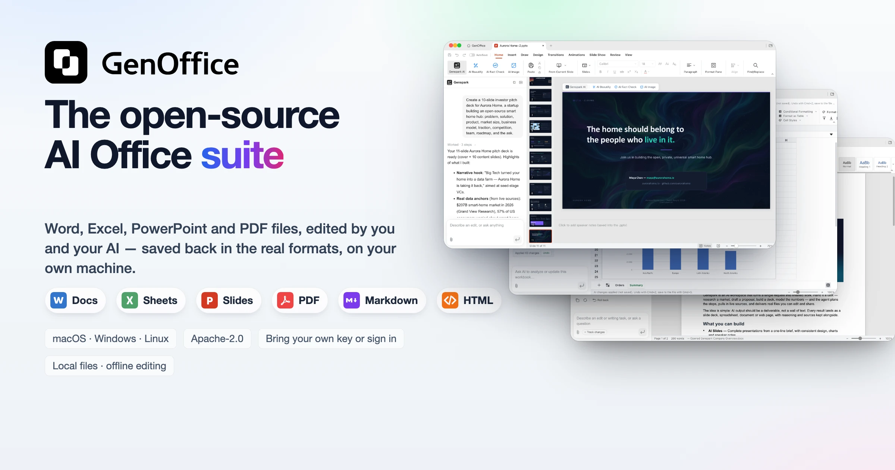
    </picture>
  </a>
</p>

<h1 align="center">GenOffice</h1>

<p align="center"><b>A primeira suíte de escritório open source com IA completa do mundo.</b><br>
Arquivos do Word, Excel, PowerPoint e PDF, editados por você e sua IA, salvos de volta nos formatos reais.</p>

<p align="center">
  <a href="../../LICENSE"></a>
  <a href="https://github.com/genspark-ai/genoffice/releases/latest"></a>
  <a href="https://github.com/genspark-ai/genoffice/releases"></a>
  <a href="https://github.com/genspark-ai/genoffice/stargazers"></a>
  <a href="https://x.com/merrickbuilds"></a>
</p>

<p align="center"><a href="../../README.md">English</a> · <a href="README.es.md">Español</a> · <b>Português</b> · <a href="README.de.md">Deutsch</a> · <a href="README.fr.md">Français</a> · <a href="README.zh-CN.md">简体中文</a> · <a href="README.zh-TW.md">繁體中文</a> · <a href="README.ko.md">한국어</a> · <a href="README.ja.md">日本語</a> · <a href="README.ar.md">العربية</a> · <a href="README.ru.md">Русский</a> · <a href="README.it.md">Italiano</a> · <a href="README.nl.md">Nederlands</a> · <a href="README.pl.md">Polski</a> · <a href="README.cs.md">Čeština</a> · <a href="README.id.md">Bahasa Indonesia</a> · <a href="README.ms.md">Bahasa Melayu</a> · <a href="README.th.md">ไทย</a> · <a href="README.hi.md">हिन्दी</a> · <a href="README.he.md">עברית</a> · <a href="README.vi.md">Tiếng Việt</a> · <a href="README.tr.md">Türkçe</a> · <a href="README.hu.md">Magyar</a></p>

<p align="center">
  <a href="#download"><b>Download</b></a> ·
  <a href="#skills"><b>Skills</b></a> ·
  <a href="#command-line-and-agent-skill"><b>CLI</b></a> ·
  <a href="#mcp-server"><b>MCP</b></a> ·
  <a href="https://genoffice.ai/"><b>Site</b></a> ·
  <a href="https://genoffice.ai/join"><b>Comunidade</b></a> ·
  <a href="https://x.com/merrickbuilds"><b>X</b></a> ·
  <a href="../../PRIVACY.md"><b>Privacidade</b></a>
</p>

O GenOffice é uma alternativa gratuita e de código aberto ao Microsoft Office
para macOS, Windows e Linux. Ele abre e salva arquivos nativos `.docx`,
`.xlsx` e `.pptx`, edita PDF, Markdown e HTML, e coloca um agente de IA ao
lado de cada documento — não um chat encaixado na lateral, mas um editor que
lê o arquivo, faz a alteração e mostra exatamente o que foi tocado. Arquivos
ODF (`.odt`, `.ods`, `.odp` e os modelos `.ott`/`.ots`/`.otp`) abrem como
cópias OOXML editáveis, assim como os arquivos antigos `.doc`/`.dot` do
Word, `.xls` do Excel 97 e `.ppt` do PowerPoint 97–2003 e os documentos da
Hancom (`.hwp`, `.hwpx`); as importações são apenas de abertura — salvar
grava OOXML, nunca o formato de origem.

- **Formatos reais, preservando cada byte.** Só o que você edita é reescrito.
  Todo o restante do arquivo permanece intacto byte a byte, então os
  documentos continuam funcionando no Word, no Excel e no PowerPoint.
- **IA que você pode revisar.** As edições chegam como alterações rastreadas e
  diffs, com reversão em um clique. As planilhas recebem fórmulas ao vivo, não
  números colados. Apresentações e páginas são geradas diretamente no canvas e
  permanecem totalmente editáveis. Oculte do modelo uma seleção do Docs ou um
  intervalo de células do Sheets e a IA vê apenas um marcador nomeado; as
  palavras originais permanecem no arquivo e voltam depois. A ocultação cobre
  a IA deste aplicativo — a CLI, as ferramentas MCP e a exportação headless
  leem o arquivo diretamente e ainda veem essas palavras.
- **Local por design.** Os arquivos são abertos, editados, salvos e
  convertidos na sua máquina. PDF → Word / Excel / PowerPoint, Markdown →
  Word e HTML → Word rodam localmente. Somente as chamadas de IA saem da
  máquina, para o provedor que você escolher.
- **Encontre arquivos pelo que eles dizem.** A tela inicial pesquisa os
  nomes, as pastas e o texto completo dos seus arquivos `.docx`, `.xlsx`,
  `.pptx`, PDF, Markdown e HTML a partir de um índice SQLite local, CJK
  incluído. Opcionalmente, os primeiros resultados são reordenados pelo
  **[TypeSafe Jev](https://typesafe.ai/)**, o modelo de julgamento System
  One, para que o arquivo que responde à sua pergunta venha primeiro.
- **Pergunte aos seus arquivos, com fontes.** Marque com estrela um conjunto
  de documentos e o **Ask AI** da tela inicial responde a perguntas sobre
  todos eles, citando o arquivo por trás de cada afirmação para que você
  possa abri-lo e conferir.
- **Suas chaves, ou nenhuma.** Faça login com o Genspark e pule as chaves, ou
  use sua própria chave para Claude, OpenAI, Gemini, DeepSeek, Kimi, GLM,
  Qwen, Doubao, MiniMax, Grok, Mistral, OpenRouter, Requesty, Opper, Cheaper
  Inference, Atlas Cloud, ou qualquer endpoint compatível com OpenAI,
  incluindo servidores locais.
- **Automatizável e pronto para agentes.** O app inclui uma linha de comando
  `genoffice` e um skill para Claude Code, Codex, Cursor, Gemini CLI, GitHub
  Copilot, OpenCode e Windsurf, para que um agente de programação possa criar,
  converter, ler e editar arquivos reais do Office na sua máquina sem abrir
  uma janela.

**Baixe:** [macOS](https://github.com/genspark-ai/genoffice/releases/latest) (Apple Silicon e Intel) ·
[Windows](https://github.com/genspark-ai/genoffice/releases/latest) (x64 e Arm) ·
[Linux](https://github.com/genspark-ai/genoffice/releases/latest) (deb, rpm, AppImage) —
detalhes e requisitos em [Download](#download).

## Demo

Seis aplicativos, um painel de IA, uma busca de arquivos reordenada pelo
TypeSafe Jev, um Ask AI que responde a partir dos seus arquivos marcados com
estrela citando as fontes, e uma linha de comando para o seu agente de
programação. Cada captura de tela é do aplicativo real no macOS, com a IA
acionada a partir do prompt que você pode ler no painel.

### 1 · Docs — abra e edite `.docx` com uma IA que você pode revisar

<table>
<tr>
<td width="50%">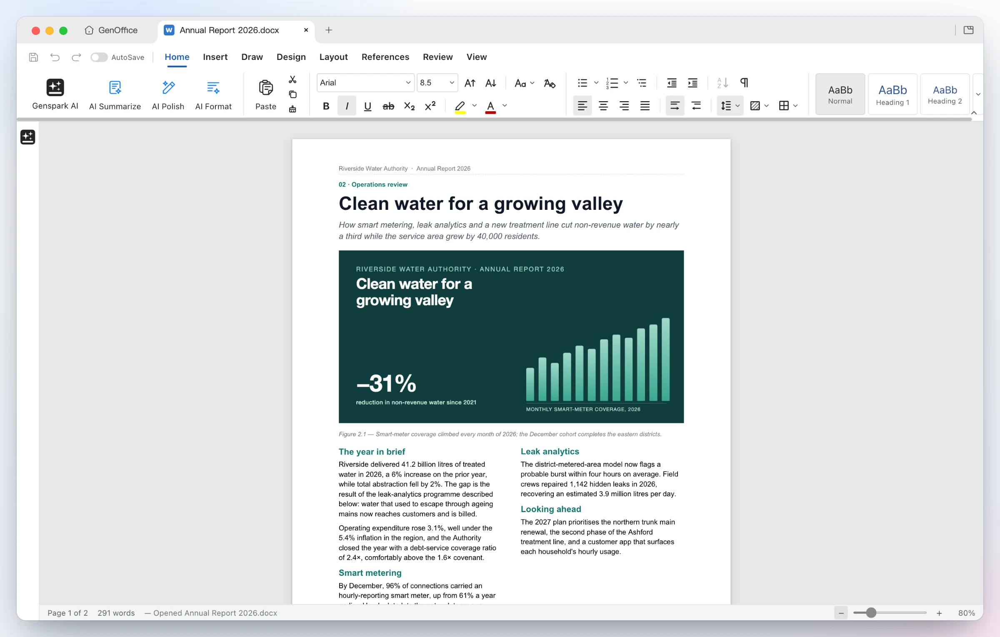</td>
<td width="50%">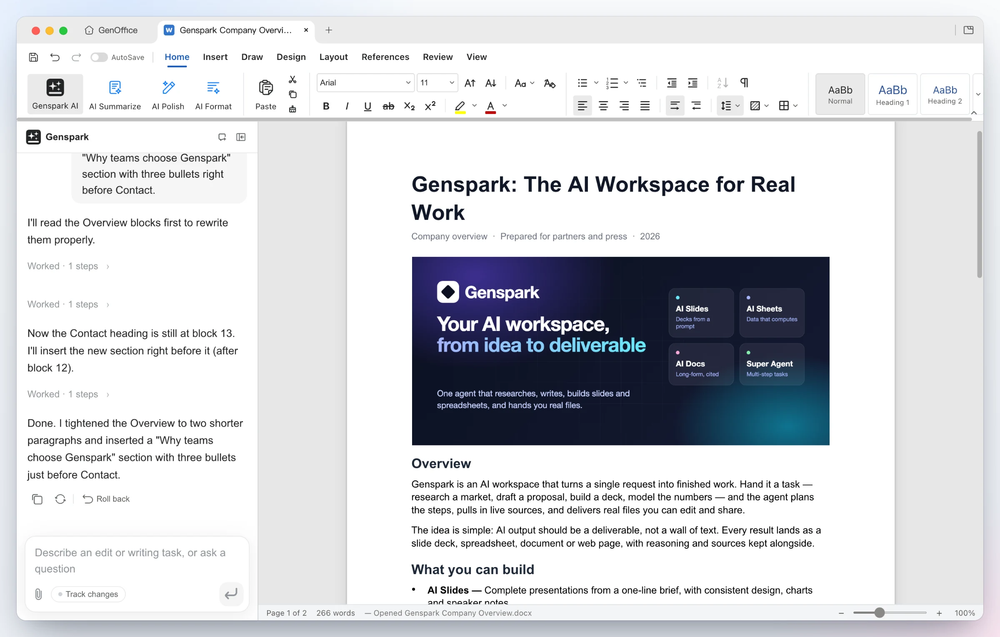</td>
</tr>
<tr>
<td><b>Abre o arquivo como o Word o organiza</b> — seções em duas colunas, imagens de sangria total, tabelas sombreadas, cabeçalhos e rodapés, paginação seguindo as métricas de linha do Word. Estilos, comentários, alterações rastreadas, equações, tinta digital e controles de conteúdo vão e voltam intactos. Uma aba <b>Mailings</b> transforma o documento em um modelo de mala direta: escolha uma lista de destinatários em <code>.xlsx</code> ou <code>.csv</code>, insira campos <code>MERGEFIELD</code> de verdade, pré-visualize registro por registro e mescle tudo em um único documento ou em um <code>.docx</code> por registro.</td>
<td><b>Peça a edição</b> — a IA lê os blocos de que precisa, reescreve a seção Overview e insere uma nova seção com marcadores. Cada turno da IA é um snapshot que você pode reverter; com o <b>Controle de alterações</b> ativado, as edições chegam como revisões no estilo do Word. Peça em vez disso um mapa mental e a resposta é um diagrama interativo do documento inteiro: ramos recolhíveis, zoom e panorâmica, um clique em um nó faz uma pergunta de acompanhamento e as citações saltam de volta ao bloco de onde vieram.</td>
</tr>
</table>

### 2 · Sheets — `.xlsx` com fórmulas e gráficos ao vivo, não números colados

<table>
<tr>
<td width="50%">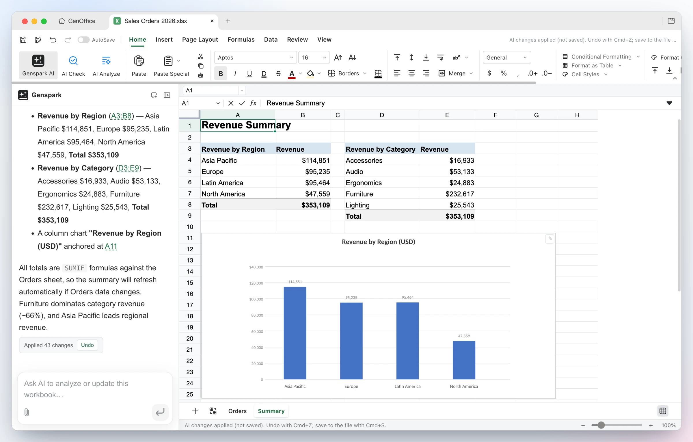</td>
<td width="50%">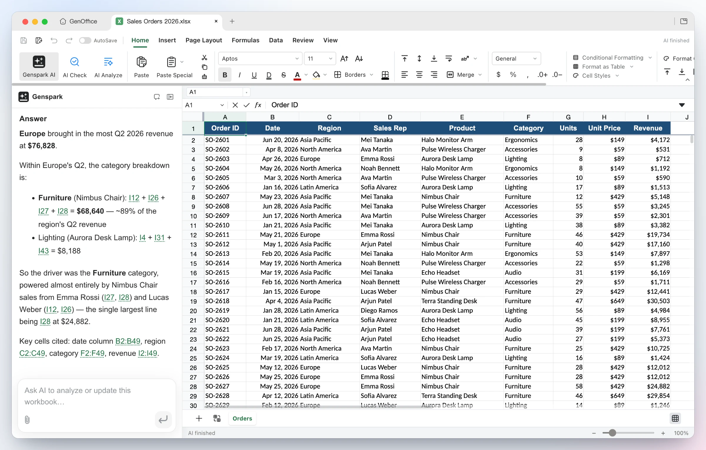</td>
</tr>
<tr>
<td><b>Construa</b> — a partir de uma única frase, o agente adiciona uma planilha Summary com <code>SUMIF</code>s reais por região e categoria, insere um gráfico de colunas e aplica as 43 alterações como um único lote que pode ser desfeito.</td>
<td><b>Pergunte</b> — perguntas sobre a pasta de trabalho voltam com o raciocínio e as células exatas usadas como citações clicáveis. Por baixo do capô: um mecanismo `.xlsx` próprio em Rust, tabelas dinâmicas, segmentações de dados, formatação condicional, rastreamento de fórmulas e imagens incorporadas nas células como rich values nativos do Excel — o Excel as reabre ainda na célula. As notas de célula podem carregar uma imagem, exibida sob o popup da nota.</td>
</tr>
</table>

### 3 · Slides — de um prompt a uma apresentação `.pptx`

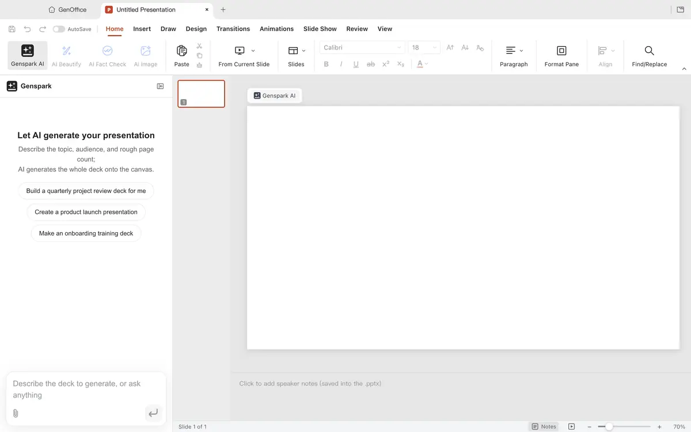

<table>
<tr>
<td width="50%">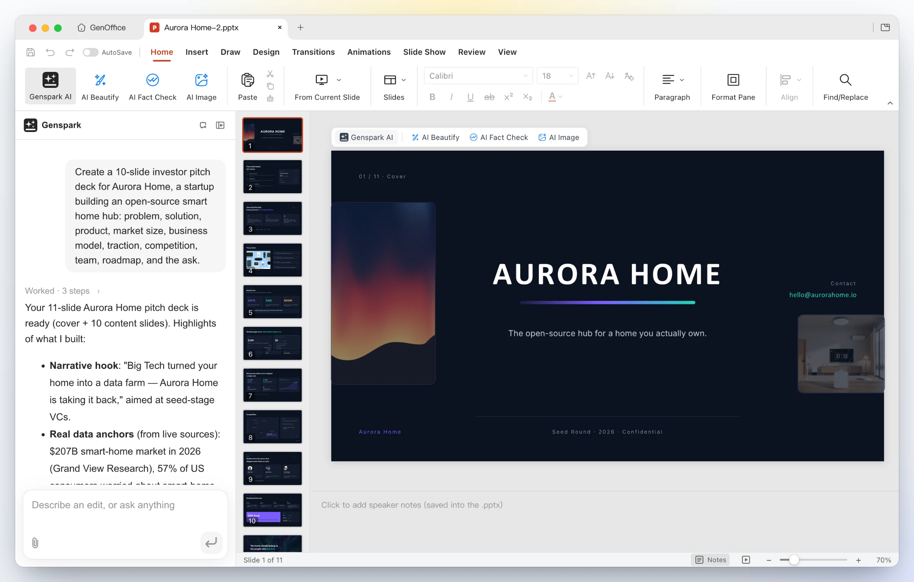</td>
<td width="50%">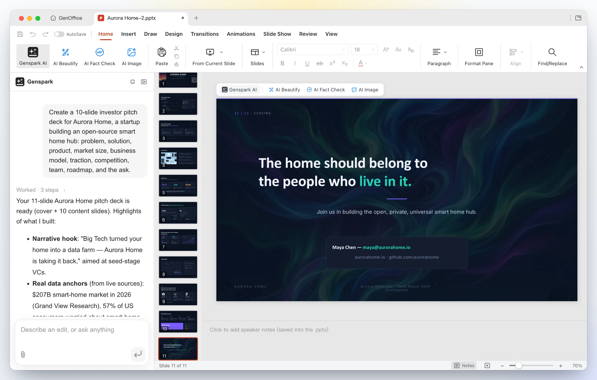</td>
</tr>
<tr>
<td><b>Uma linha de entrada</b> — "Crie uma apresentação de 10 slides para investidores da Aurora Home…". O GenOffice planeja a narrativa, pesquisa os números e redige cada slide diretamente no canvas como um `.pptx` real.</td>
<td><b>Uma apresentação finalizada</b> — onze slides projetados com tipografia e imagens consistentes e uma chamada para ação de encerramento; continue editando com slides mestres, layouts, guias inteligentes e recorte não destrutivo, ou peça ao painel para restilizar, reescrever e reordenar. Insira um <code>.glb</code> e ele é um modelo 3D de verdade: gire-o arrastando no editor, armazenado da maneira como o PowerPoint armazena 3D, e ainda 3D no PowerPoint.</td>
</tr>
</table>

**Slide Show → Record** narra a apresentação slide a slide, com pausa e
retomada. A narração e os tempos de avanço automático que ela mede são salvos
no `.pptx`, e o PowerPoint os reproduz da mesma forma.

### 4 · PDF — edite texto em PDF no lugar, converta PDF para Word no dispositivo

<table>
<tr>
<td width="50%">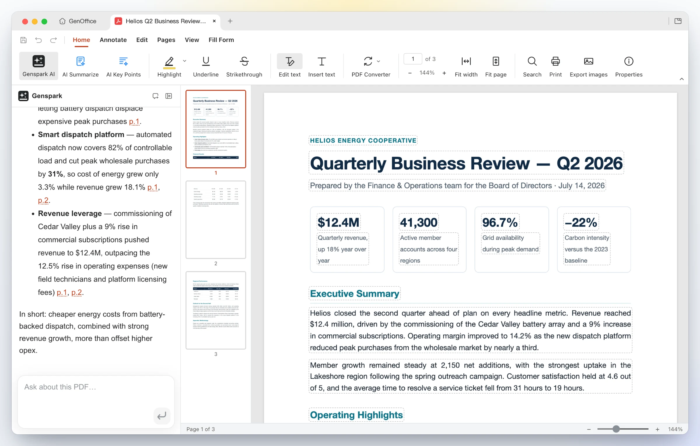</td>
<td width="50%">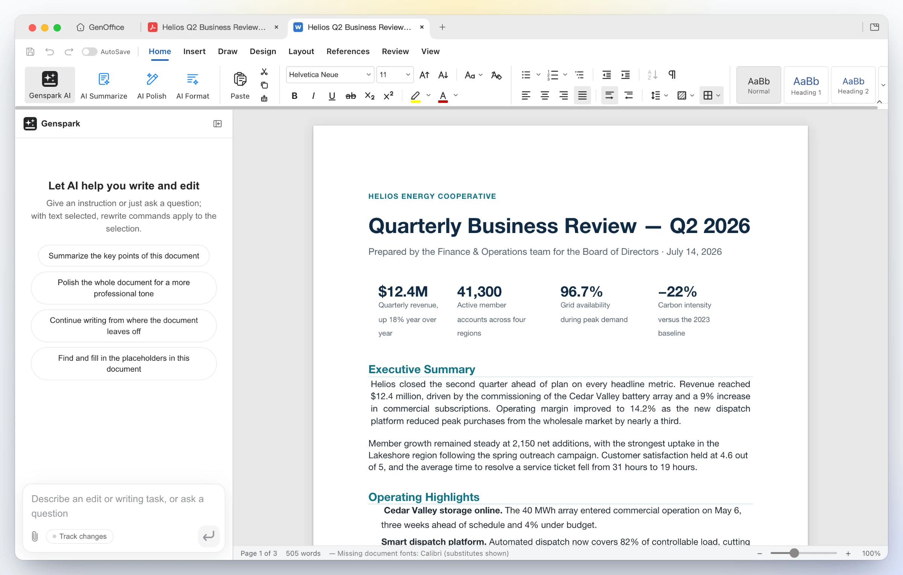</td>
</tr>
<tr>
<td><b>Edite dentro da página</b> — o modo Editar texto contorna cada bloco de texto para redigitação no lugar; o content stream é reescrito via PDFium com as fontes originais, não uma anotação de encobrimento. Pergunte à IA sobre um relatório extenso e receba respostas com citações de página.</td>
<td><b>Converta no dispositivo</b> — <b>Conversor de PDF → PDF para Word</b> produz um `.docx` editável que abre no Docs ao lado do original, com títulos, linhas de estatísticas e parágrafos intactos. Os destinos Excel e PowerPoint funcionam da mesma forma; páginas escaneadas passam pelo OCR do sistema.</td>
</tr>
</table>

### 5 · HTML — um construtor de páginas e interfaces com IA, briefing de design primeiro

Diga para que serve a página e para quem ela é. A IA propõe primeiro um
**briefing de design** — gancho, paleta, tipografia e direções de estilo —
e então constrói um único arquivo `.html` autocontido a partir desses
tokens.

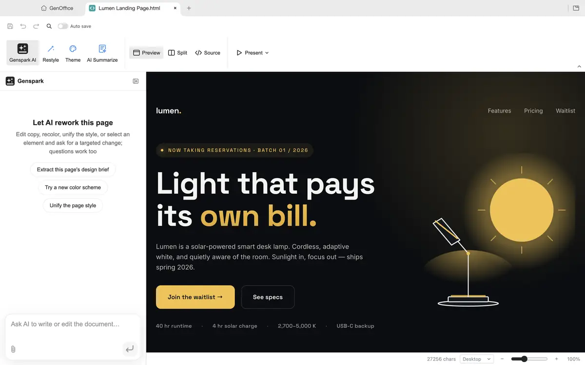

<table>
<tr>
<td width="50%">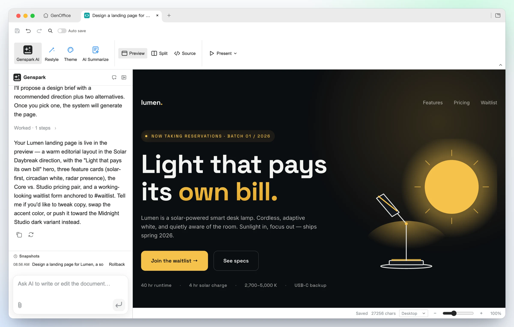</td>
<td width="50%">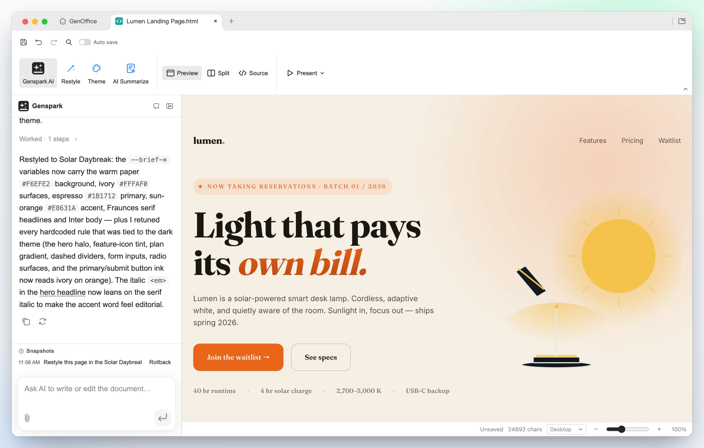</td>
</tr>
<tr>
<td><b>Gerada a partir de um prompt</b> — um hero em destaque, cartões de recursos, preços e um formulário de lista de espera para a Lumen, construídos na direção Midnight Studio. Clique em qualquer elemento para restilizá-lo, dê duplo clique para editar o texto, ou alterne para a visualização de código no CodeMirror.</td>
<td><b>Mesmo design, nova direção</b> — um único pedido de <b>Restilizar</b> troca os tokens do briefing e a página acompanha: papel quente, serifa editorial, destaque laranja-sol, nada reescrito. Apresente em tela cheia, ou exporte como PDF ou um documento do Word nativo e editável.</td>
</tr>
</table>
<table>
<tr>
<td width="50%">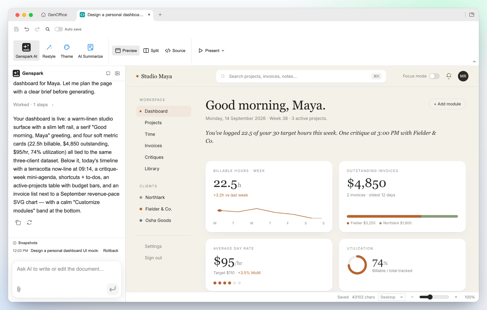</td>
<td width="50%">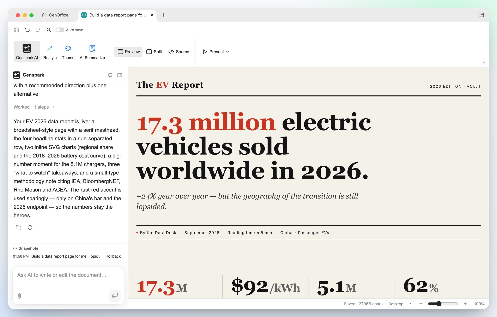</td>
</tr>
<tr>
<td><b>Mockups de interface</b> — o modelo inicial "painel pessoal" transforma uma persona em um layout funcional: barra lateral, saudação, sparkline de horas faturáveis, cartões de faturas e utilização, tudo em HTML real que você pode entregar a um desenvolvedor.</td>
<td><b>Histórias com dados</b> — o modelo inicial "relatório de dados" constrói um jornal editorial: cabeçalho serifado, um número de destaque, uma linha de estatísticas separada por regra, gráficos SVG inline e uma nota metodológica.</td>
</tr>
</table>

### 6 · Markdown — um editor em blocos sobre `.md` puro, com Ask AI

<table>
<tr>
<td width="50%">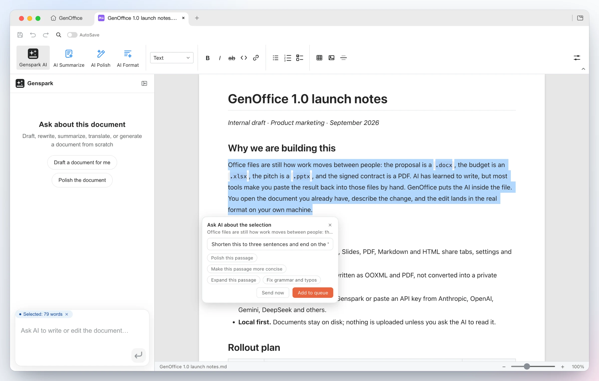</td>
<td width="50%">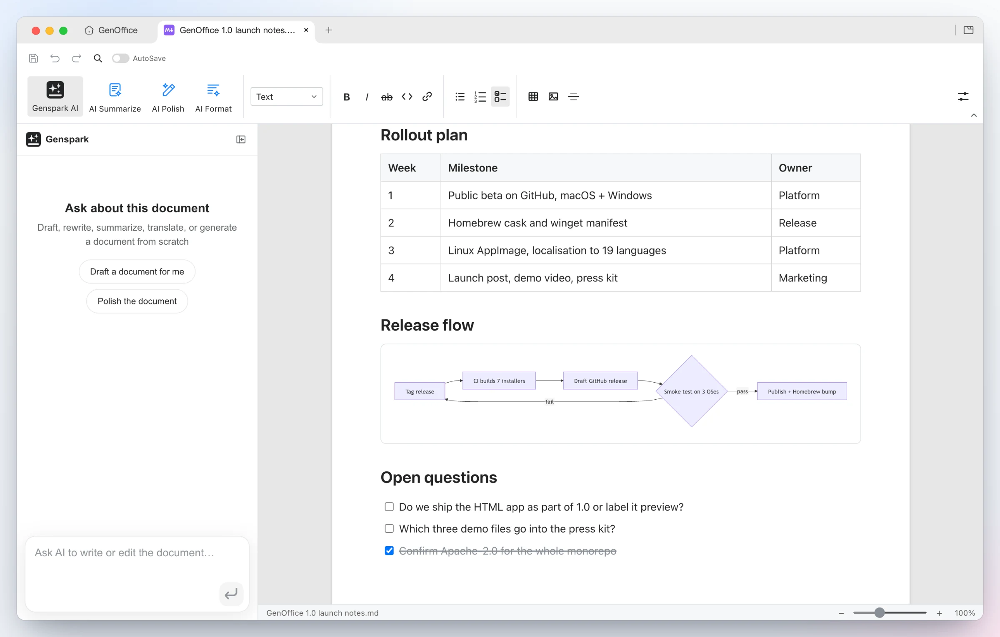</td>
</tr>
<tr>
<td><b>Pergunte à IA sobre uma seleção</b> — selecione qualquer trecho e um chip <b>Ask AI</b> aparece: digite uma instrução ou escolha uma sugestão, envie agora, ou coloque em fila várias edições ancoradas e execute-as de uma vez. A mesma entrada existe em todos os aplicativos.</td>
<td><b>Renderizado, salvo como Markdown puro</b> — títulos, listas, tabelas, imagens, blocos de código e diagramas Mermaid em um editor de blocos Tiptap, gravados de volta como `.md` puro, com uma exportação <b>Markdown → Word</b> totalmente local.</td>
</tr>
</table>

**Notas interligadas, como o Obsidian faz.** `[[wiki links]]` levam com um
clique à nota que nomeiam, digitar `[[` oferece autocompletar nomes de notas,
e `![[…]]` incorpora uma nota ou uma imagem inline. Um painel de **Backlinks**
lista todas as notas que apontam para a nota aberta, e a visualização de
**Graph** mapeia os links de todo o vault.

### <a id="7--search--find-the-file-that-answers-the-question-with-typesafe-jev"></a>7 · Busca — encontre o arquivo que responde à pergunta, com o TypeSafe Jev

Todos os arquivos da sua pasta de trabalho são indexados no dispositivo:
nomes, pastas e o texto extraído dos arquivos Word, Excel, PowerPoint, PDF,
Markdown e HTML, em um índice de texto completo SQLite com tokenização
adaptada a CJK. Ative a **Reordenação com Jev** e os 20 primeiros resultados
locais são avaliados pelo
[TypeSafe Jev](https://typesafe.ai/blog/introducing-system-one-models-and-jev),
o modelo System One que devolve uma pontuação de relevância calibrada por
documento em uma única chamada, em vez de gerar texto. A lista é reordenada
por essa pontuação; se a chamada falhar ou expirar, a ordem local permanece.


<table>
<tr>
<td width="50%"></td>
<td width="50%"></td>
</tr>
<tr>
<td><b>Mesmas palavras, respostas diferentes</b> — "laptop refresh policy" coincide palavra por palavra com uma política de atualização de cache do navegador, um plano de renovação de marca e um cronograma de atualização de dashboards, então o ranqueamento de texto completo os coloca primeiro. O Jev lê os trechos e leva ao topo o documento de padrões de equipamentos, aquele que define o ciclo de substituição de três anos. O selo <b>Jev</b> ao lado da contagem de resultados mostra quando a ordem veio do modelo.</td>
<td><b>Desativado por padrão, um interruptor para ativar</b> — Configurações → IA de Mídia e Busca → Pesquisa de arquivos locais. Escolha OpenRouter ou TypeSafe direto, cole uma chave e clique em Testar conexão. Somente com o interruptor ativado os trechos dos primeiros resultados saem do dispositivo; o índice em si nunca sai.</td>
</tr>
</table>

### 8 · Ask AI — seus arquivos marcados com estrela, respondidos com fontes

Marque com estrela os arquivos com que você trabalha e o **Ask AI** da tela
inicial os trata como uma base de conhecimento. Faça uma pergunta em
linguagem natural; o agente pesquisa os arquivos marcados, lê os que
precisa e responde com uma citação após cada afirmação. Clique em uma
citação e o arquivo abre no aplicativo certo. Anexe arquivos à pergunta
arrastando, colando ou pelo menu **+** — as imagens vão para o modelo como
entrada visual — e cada pergunta é mantida como uma conversa própria:
alterne entre elas, comece uma nova, exclua uma; a lista sobrevive a uma
reinicialização.


O Ask AI pesquisa o mesmo índice de texto completo local que a
[Busca](#7--search--find-the-file-that-answers-the-question-with-typesafe-jev)
e lê os arquivos em páginas, então o modelo só vê os resultados e os trechos
que pediu, através do provedor que você escolheu. Ele também pode chamar a
CLI `genoffice` integrada para criar arquivos diretamente; cada um aparece
como um cartão de artefato abaixo da resposta, e um clique o abre.

### 9 · CLI — seu agente de programação comanda o GenOffice, na sua máquina

O GenOffice inclui uma linha de comando `genoffice` e um skill de agente.
Instale o skill e o Claude Code, Codex, Cursor, Gemini CLI, GitHub Copilot,
OpenCode ou Windsurf poderão criar, converter, ler e editar arquivos reais do
Office com os mesmos mecanismos dos aplicativos, sem abrir uma janela.

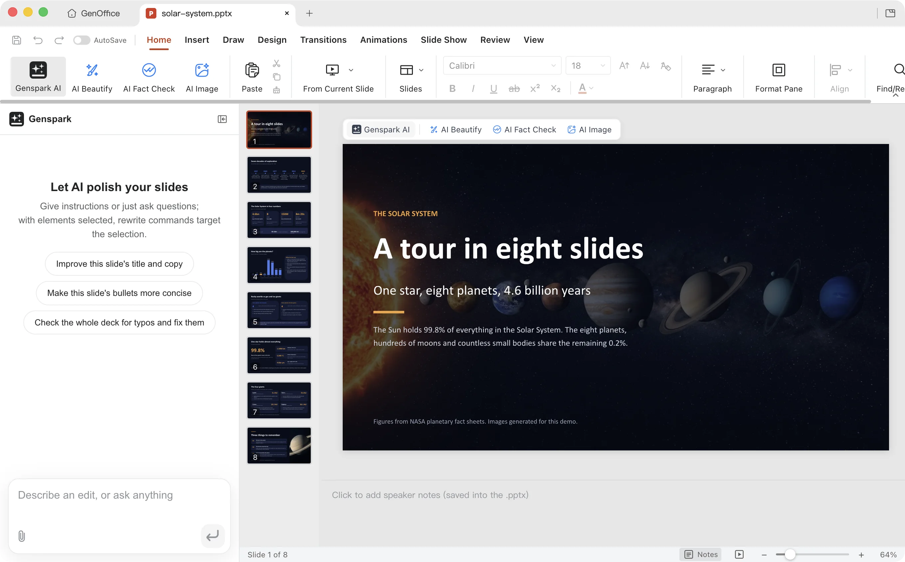

<table>
<tr>
<td width="50%">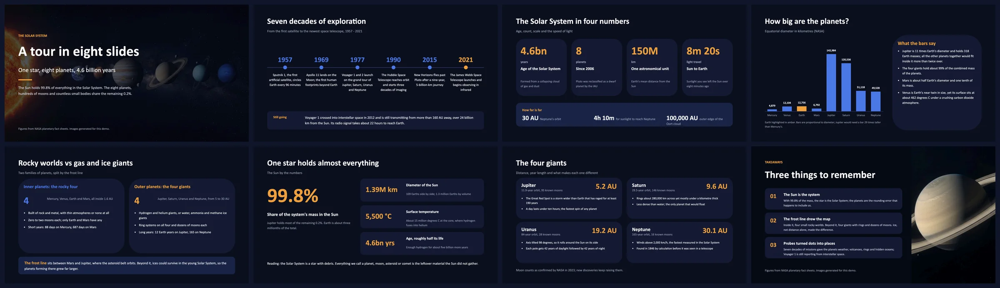</td>
<td width="50%">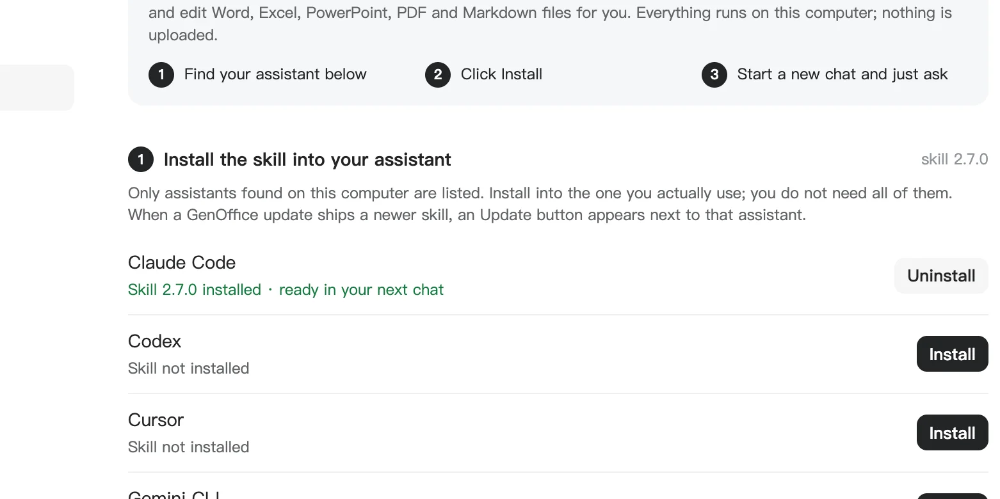</td>
</tr>
<tr>
<td><b>Um prompt para o seu agente</b> — "Crie uma apresentação de oito slides sobre o Sistema Solar." O agente lê o skill, escreve uma folha de estilos, um esboço e uma especificação de página por slide, gera as duas fotos com <code>genoffice image</code> e deixa o <code>genoffice slides check</code> rejeitar qualquer coisa que transborde ou se sobreponha antes que o <code>genoffice create</code> monte o <code>.pptx</code> e o <code>slides render</code> devolva um PNG por slide para conferir.</td>
<td><b>Instale uma vez, em Configurações → Integrações</b> — o GenOffice lista os agentes de programação que encontra neste computador e grava o skill em cada um que você escolher. Ou baixe o skill como zip, ou execute <code>npx skills add genspark-ai/genoffice</code>. Os comandos e o fluxo de trabalho completo estão em <a href="#command-line-and-agent-skill">Linha de comando e skill de agente</a>.</td>
</tr>
</table>

### 10 · MCP — as mesmas ferramentas através do Model Context Protocol

Todo comando do `genoffice` também é uma ferramenta MCP. O Claude Code, o
Claude Desktop, o Cursor e qualquer outro cliente MCP podem iniciar o
`genoffice mcp` por conta própria, sem precisar instalar nenhum skill nem
abrir uma janela, e obtêm 29 ferramentas além das referências de operações
como recursos. Um segundo servidor HTTP dentro do aplicativo permite que um
agente construa um documento Word em uma aba de editor visível enquanto você
observa.

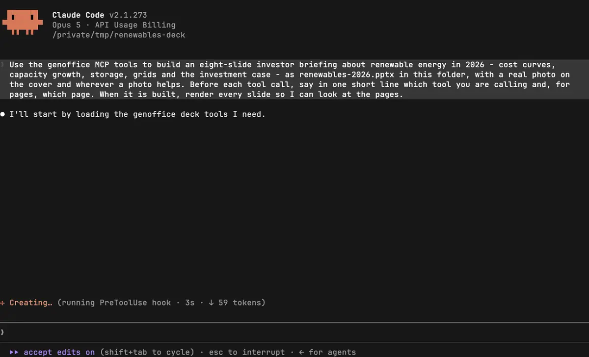

<table>
<tr>
<td width="50%">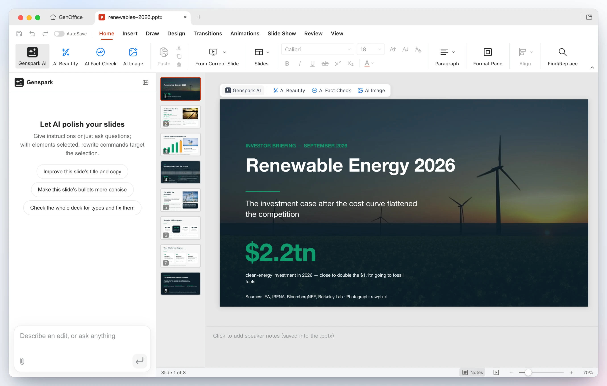</td>
<td width="50%">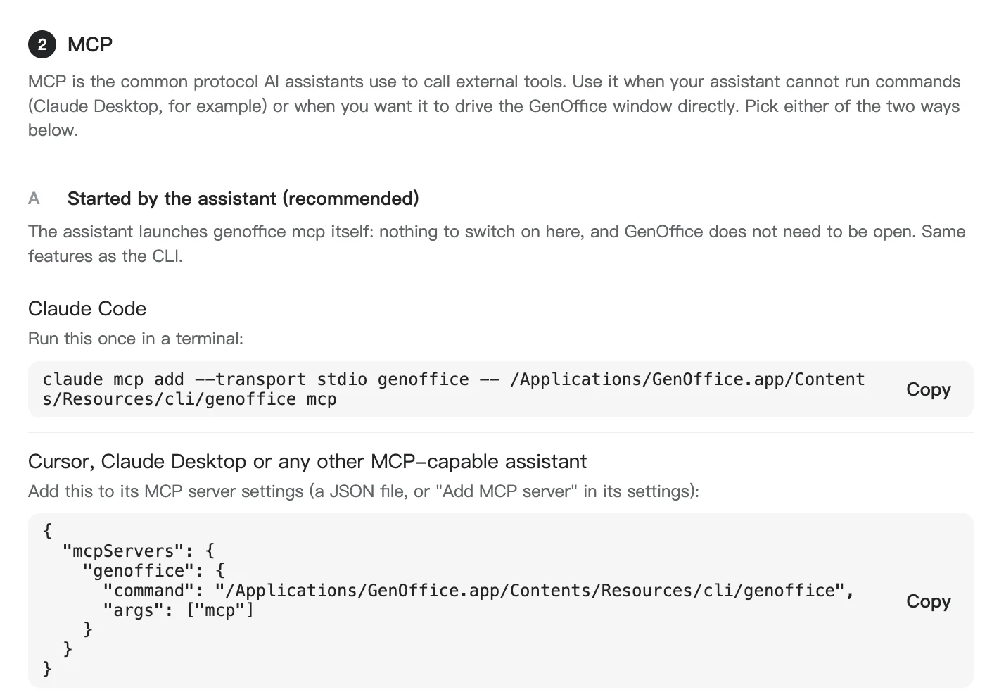</td>
</tr>
<tr>
<td><b>Um prompt, 38 chamadas de ferramenta, sem terminal</b> — "Crie uma apresentação de investidores de oito slides sobre energia renovável em 2026, com uma foto real na capa e onde mais uma foto ajudar." O agente obtém as figuras e as fotos com <code>search</code>, pergunta ao <code>media</code> se cada imagem candidata é uma fotografia real, chama <code>deck_start</code> com uma folha de estilos e um esboço, depois <code>deck_page</code> uma vez por slide; cada página é verificada em relação ao esboço e à paleta antes de ser mantida, <code>deck_build</code> monta o <code>.pptx</code>, <code>slides_audit</code> procura transbordamentos, <code>slides_render</code> devolve um PNG por slide como conteúdo de imagem que o modelo pode olhar, e <code>deck_replace</code> corrige as três páginas de que ele não gostou.</td>
<td><b>Conecte-se uma vez, em Configurações → Integrações</b> — copie a linha <code>claude mcp add</code> para o Claude Code, ou o bloco JSON no Cursor, no Claude Desktop ou em qualquer outro cliente MCP. A opção B ativa o servidor HTTP local para o editor de Word visível. Ambas estão descritas em <a href="#mcp-server">Servidor MCP</a>.</td>
</tr>
</table>

### 11 · Arquivos antigos — `.doc`, `.xls` e `.ppt` dos anos 2000 também abrem

Um `.doc` do Word 97–2003, um `.xls` do Excel ou um `.ppt` do PowerPoint abre como uma cópia convertida `.docx`, `.xlsx` ou `.pptx`, criada no seu computador; o arquivo original nunca é alterado. Imagens, tabelas, fórmulas, formatos de número, preenchimentos e layout são mantidos. O que cada formato mantém e o que perde está em [Arquivos antigos e ODF abrem como cópias convertidas](#legacy-and-odf-files-open-as-converted-copies).

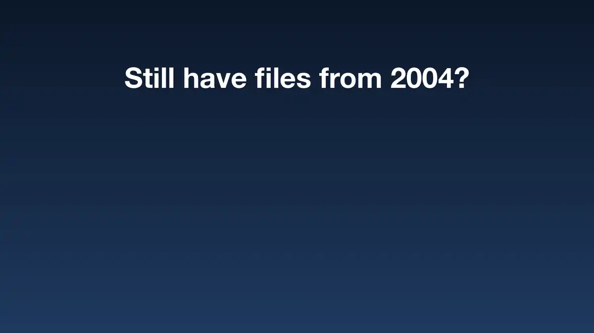

## Por que o GenOffice

- **Código aberto**, Apache-2.0, desenvolvido abertamente no GitHub.
- **Seu para executar.** Apps nativos para macOS, Windows e Linux; os arquivos
  ficam no seu disco e cada edição, salvamento e conversão acontece na sua
  máquina.
- **Arquivos reais do Office.** `.docx`, `.xlsx` e `.pptx` nativos, preservando
  cada byte: as partes de um arquivo que você não tocou são copiadas
  exatamente como estavam.
- **Uma IA que edita o próprio documento.** Alterações rastreadas no Docs,
  fórmulas e gráficos ao vivo no Sheets, slides desenhados diretamente no
  canvas, cada interação da IA gera um snapshot que você pode desfazer.
- **Seu modelo, sua chave.** Entre com o Genspark ou traga uma chave para
  Claude, OpenAI, Gemini, DeepSeek e outros, com servidores locais e qualquer
  endpoint compatível com OpenAI incluídos.
- **PDF feito como deve ser.** Edite o texto dentro da página e converta PDF
  para Word, Excel ou PowerPoint no dispositivo, com OCR do sistema para
  digitalizações.
- **Markdown e HTML também**, com o mesmo painel de IA e exportação local para
  Word.
- **Uma busca que encontra a resposta, não a palavra-chave.** Busca de texto
  completo em todos os documentos das suas pastas, indexados no dispositivo,
  com reordenação opcional pelo TypeSafe Jev, o modelo de julgamento System
  One.
- **Ask AI em todos os seus arquivos.** Marque com estrela os arquivos que
  importam e faça perguntas em linguagem natural; cada resposta cita o
  arquivo de onde veio, a um clique de distância.
- **Skills.** Skills prontos ou o seu próprio `SKILL.md`, anexados pelo menu **+** de qualquer painel de IA.
- **Automatizável.** Uma linha de comando `genoffice`, um skill de agente e
  um servidor MCP colocam todos os mecanismos a serviço do Claude Code, Claude
  Desktop, Codex, Cursor e outros agentes, ainda no dispositivo.
- **Gratuito**, para indivíduos e equipes.

## Usar no navegador

O aplicativo de área de trabalho também pode se servir por HTTP: inicie com
`genoffice --web-server` e abra `http://127.0.0.1:8931/` em uma aba do
navegador. Os seis editores são os mesmos pacotes que a janela de desktop
carrega e falam com os mesmos motores por um WebSocket — abra e salve
arquivos pela tela inicial e tudo é renderizado pelos mesmos pipelines.

- O serviço sempre exige o token de acesso: na inicialização é impressa uma
  URL `?token=…` que entrega um cookie ao navegador; compartilhe essa URL, não
  a porta pura. `--web-port` e `--web-host` movem o serviço (vincule `0.0.0.0`
  para o seu LAN e abra a URL impressa no outro aparelho); `--web-token` fixa
  um token de sua escolha.
- Uma pequena API sem interface embrulha a CLI para scripts:
  `curl --data-binary @report.docx 'http://127.0.0.1:8931/api/convert?to=pdf&name=report.docx&token=PRINTED_AT_STARTUP' > report.pdf`;
  `POST /api/info` retorna o resumo da estrutura do documento.
- Arrastar e soltar arquivos locais e a impressão nativa continuam
  exclusivos do desktop.

## Backends de IA

**Faça login com o Genspark** e não há nada para configurar: as chamadas de
modelo passam pelo proxy do Genspark (famílias Claude, GPT e Gemini) e os
agentes ganham busca na web e de imagens, geração de imagens e análise de
imagem/áudio/vídeo.

**Ou traga sua própria chave.** Configurações → IA lista Claude, OpenAI,
Gemini, DeepSeek, Kimi, GLM, Qwen, Doubao, MiniMax, Grok, Mistral, OpenRouter, Requesty, Opper, Cheaper Inference, Atlas Cloud, SiliconFlow, PPIO, Command Code
e OpenCode Zen/Go, além de um slot personalizado para qualquer endpoint
compatível com OpenAI (URL base + chave), incluindo servidores de modelo
locais. Busca e mídia têm seus próprios provedores por capacidade em **IA de
Mídia e Busca**: Serper, Serply, SearchApi, Tavily, Parallel, Keenable, Exa ou Firecrawl
para busca na web, e OpenAI, Gemini, Doubao/Seedream, GLM, Grok, Qwen,
MiniMax, Stability, FLUX ou qualquer endpoint de imagens compatível com
OpenAI para geração de imagens e análise de imagem/vídeo, além do DeepSeek
V4.1 Flash para análise de imagem.

O **TypeSafe Jev** reordena a busca de arquivos da tela inicial. Em **IA de
Mídia e Busca → Pesquisa de arquivos locais**, ative a Reordenação com Jev e
escolha um endpoint: [OpenRouter](https://openrouter.ai/typesafe) (modelo
`typesafe/jev-1.13`) ou a API da própria TypeSafe. A chave fica armazenada
somente neste dispositivo. Vem desativado por padrão; quando ativado, os
trechos dos 20 primeiros resultados locais são enviados para avaliação e
nada mais sai da máquina.

O **Parallel** funciona sem conta: seu Search MCP gratuito (com limite de
taxa) é a busca na web padrão sempre que não houver login no Genspark nem
chave de busca configurada, e ele roda antes do scraping do DuckDuckGo.
Selecione Parallel em Busca na web e informe uma chave do
[Parallel](https://platform.parallel.ai/) para usar a Search API em vez
disso. O Keenable também dispensa chave; uma chave apenas eleva os limites
de taxa.

A suíte completa vem com temas claro, escuro e do sistema. Os temas só
mudam o que aparece na tela: exportações, impressões e arquivos salvos
sempre mantêm as cores originais do documento.

## <a id="skills"></a>Skills

Um skill é um `SKILL.md` que ensina a IA a fazer bem uma tarefa: um relatório semanal, um NDA, um plano de aula.
O GenOffice traz um conjunto deles e aceita os seus, no mesmo formato usado pelos agentes de código.

- **Configurações → Skills.** **Instale** um skill recomendado ou **Importe** uma pasta, um zip ou um único `SKILL.md`. Nada é executado na importação. A aba **Todas** lista todo o catálogo recomendado em um só lugar, com descrições no idioma do aplicativo.
- **No chat.** Abra o menu **+** ao lado da caixa de texto de qualquer painel de IA, escolha **Skills**, marque um e envie. O skill acompanha só essa mensagem.

---

## <a id="command-line-and-agent-skill"></a>Linha de comando e skill de agente

Tudo o que os aplicativos fazem com um arquivo, a linha de comando `genoffice`
faz a partir de um terminal: inspecionar, converter, criar, ler e editar
Word, Excel, PowerPoint, PDF, Markdown e HTML com os mesmos mecanismos, sem
interface gráfica. Ela é instalada junto com o GenOffice, não precisa de
runtime próprio e nunca envia um documento para lugar nenhum. Combinada com
o **skill de agente** incluído, ela transforma um agente de programação em um
operário de documentos que produz arquivos reais do Office em vez de
aproximações em Markdown.

**Funciona com:** Claude Code, Codex, Cursor, Gemini CLI, GitHub Copilot,
OpenCode e Windsurf sem configuração, com qualquer outro agente que leia
skills e, através do [servidor MCP](#mcp-server), o Claude Desktop e todo
cliente MCP.

### Instalar o skill

| Como                                   | O que acontece                                                                                                                                                                              |
| -------------------------------------- | ------------------------------------------------------------------------------------------------------------------------------------------------------------------------------------------- |
| **Configurações → Integrações** no app | Lista os agentes encontrados neste computador; um clique grava o skill em cada um que você escolher. Um botão **Atualizar** aparece quando uma versão do GenOffice traz um skill mais novo. |
| **Baixar como zip** na mesma página    | O formato que o claude.ai, os aplicativos desktop do Claude e outros assistentes aceitam como skill enviado.                                                                                |
| `npx skills add genspark-ai/genoffice` | Instala a partir deste repositório em qualquer agente compatível com skills.                                                                                                                |

Depois, abra um novo chat e peça um documento. O skill ensina ao agente
quando recorrer ao `genoffice`, como ler um arquivo antes de editá-lo e como
verificar o próprio trabalho.

### Início rápido no terminal

```bash
genoffice --version
genoffice info report.docx --json                  # headings and blocks; or sheets, slides, pages
genoffice convert report.md --to pdf               # md/html/docx/xlsx/pptx → pdf, pdf → docx/xlsx/pptx/md/html, odt/ods/odp → docx/xlsx/pptx, doc/dot → docx, ppt → pptx, …
genoffice create --type docx --from notes.md --out notes.docx
genoffice create --type xlsx --from table.json --out sales.xlsx   # "=SUM(B2:B9)" cells stay live formulas
genoffice docs read report.docx --range 0-9 --json # then `docs apply --ops edits.json` edits in place
genoffice docs compare original.docx revised.docx --out redline.docx   # the differences as tracked Word revisions
genoffice render report.docx --out shots/          # one PNG per page, to look at what you made
genoffice open sales.xlsx                          # hand the result to the editor
```

Cada comando imprime um resumo de uma linha, ou um único objeto JSON com
`--json`. As edições são atômicas: uma operação rejeitada deixa o arquivo
intocado e volta com um erro orientado. `genoffice help` lista a superfície
de comandos atual; a referência completa está em
[packages/cli/README.md](../../packages/cli/README.md).

### O que o agente realmente executa

A apresentação do Sistema Solar da [demo](#demo) levou um único prompt no
Claude Code. Por trás, o agente seguiu o fluxo de trabalho em etapas do skill
e a CLI verificou cada etapa antes de começar a seguinte:

```bash
genoffice capabilities --json                        # which cloud tools GenOffice has configured
genoffice guide slides design                        # the deck workflow and layout library
genoffice image "the eight planets in a row …" --aspect 16:9 --out deck/assets/cover.jpg
genoffice slides check deck/outline.json --json      # 8 pages, no findings
genoffice slides check deck/pages/01.json --json     # builds one slide, audits overflow and overlap
…                                                    # one page file per slide, fixed until each check is clean
genoffice create --type pptx --spec deck/pages --outline deck/outline.json --out deck/solar-system.pptx --json
genoffice slides render deck/solar-system.pptx --out deck/shots --json
genoffice slides audit deck/solar-system.pptx --json    # 8 slides, no layout issues
genoffice slides replace deck/solar-system.pptx --slide 4 --spec deck/pages/05.json --json
genoffice open deck/solar-system.pptx
```

Nenhuma chamada a um modelo acontece dentro do `genoffice`: o agente pensa, a
CLI constrói e verifica, e o resultado abre no GenOffice ou no PowerPoint
como um `.pptx` comum.

### <a id="mcp-server"></a>Servidor MCP

Os mesmos comandos estão disponíveis como ferramentas de
[Model Context Protocol](https://modelcontextprotocol.io) para assistentes
que não conseguem rodar um terminal ou aos quais você prefere não dar um.
Há duas formas de entrada, ambas mostradas com trechos prontos para copiar
em **Configurações → Integrações → MCP**:

| Forma                                 | O que é                                                                                                                                                                                                                                                                                                                                                                                                                                                                                                                                            |
| ------------------------------------- | -------------------------------------------------------------------------------------------------------------------------------------------------------------------------------------------------------------------------------------------------------------------------------------------------------------------------------------------------------------------------------------------------------------------------------------------------------------------------------------------------------------------------------------------------- |
| **A · `genoffice mcp`** (recomendado) | Um servidor stdio que o próprio assistente inicia; o GenOffice não precisa estar aberto. Uma ferramenta por comando (`info`, `convert`, `create_docx`, `create_xlsx`, `create_pptx`, `create_pdf`, `docs_read` / `docs_apply` / `docs_check`, `sheet_*`, `slides_*`, `render`, `guide`, `search`, `image`, `media`, `open`) mais o fluxo de apresentação em etapas `deck_start` → `deck_page` → `deck_build` → `deck_replace`. Operações, especificações e Markdown são passados inline, então um cliente sem sistema de arquivos também funciona. |
| **B · Servidor HTTP local**           | Roda dentro do aplicativo GenOffice em `http://127.0.0.1:3093/mcp` (Streamable HTTP, com SSE legado). Suas ferramentas comandam uma aba de editor de Word visível: `create_session`, `insert_content`, `replace_blocks`, `apply_ops`, `read_document`, `save_session`, e você observa o documento tomar forma. Desativado por padrão; ative-o no mesmo painel de configurações.                                                                                                                                                                    |
| **C · `genoffice mcp --http`**        | O conjunto de ferramentas stdio como um servidor Streamable HTTP para clientes em outras máquinas: um contêiner, um sandbox, uma máquina compartilhada na sua rede. Os arquivos viajam com as chamadas: `PUT /files/<name>` envia um e devolve uma URL, todo parâmetro `file` aceita uma URL http(s), e uma ferramenta que grava um arquivo o devolve como uma URL de download e, quando pequeno, também os bytes como recurso MCP. `--host 0.0.0.0` o abre para a rede, `--token` o protege.                                                      |

```bash
# Claude Code
claude mcp add --transport stdio genoffice -- genoffice mcp
```

```jsonc
// Cursor, Claude Desktop or any other MCP client
{ "mcpServers": { "genoffice": { "command": "genoffice", "args": ["mcp"] } } }
```

```bash
# On the machine that has GenOffice (private network; add --token for a shared box)
genoffice mcp --http 3093 --host 0.0.0.0 --token "$GENOFFICE_MCP_TOKEN"

# From the client: upload, then use the URL wherever a tool takes a file
curl -T report.docx -H "Authorization: Bearer $GENOFFICE_MCP_TOKEN" http://server:3093/files/
#   → { "url": "http://server:3093/files/<id>/report.docx", ... }
#   docs_read({ "file": "http://server:3093/files/<id>/report.docx" })
#   docs_apply(...) → output_url, downloadable with curl -o
```

Por HTTP, cada sessão recebe uma pasta temporária privada, os caminhos
relativos e as pastas de apresentação são resolvidos dentro dela, o `open`
não é oferecido e, com `GENOFFICE_ALLOWED_ROOTS` não definido, as
ferramentas não conseguem sair do armazenamento de arquivos do próprio
servidor. `render`, `convert` para PDF e `create_pdf` ainda iniciam um
processo oculto do GenOffice, então um host headless precisa do aplicativo
instalado e de um display virtual (`xvfb-run`).

Aqui, `genoffice` é a CLI que vem dentro do aplicativo (no macOS
`/Applications/GenOffice.app/Contents/Resources/cli/genoffice`; o painel de
configurações mostra o caminho exato da sua instalação). O servidor traz
suas próprias instruções de fluxo de trabalho e expõe as referências de
operações como recursos `genoffice://guide/*`, então nenhum skill é
necessário; o skill e o servidor MCP podem coexistir, e o assistente
escolhe um. Os recursos de nuvem (`search`, `image`, `media`) ainda passam
pelo provedor configurado no GenOffice; todo o resto roda localmente, e o
`GENOFFICE_ALLOWED_ROOTS` limita cada ferramenta às pastas que você listar.

A apresentação sobre energia renovável da [demo](#demo) é como fica, do lado
do protocolo, um único prompt no Claude Code com apenas o servidor MCP do
`genoffice` conectado:

```text
capabilities · guide(slides, spec) · guide(slides, design)
search(query) ×4                         → IEA, BNEF and IRENA figures for the slides
search(query, images) ×7 · media(url, ask) ×7
                                         → candidate photos, each one checked to be a real photograph
deck_start(dir, style, outline)          → outline checked: 8 pages to write
deck_page(dir, 0, page) … deck_page(dir, 7, page)
                                         → each page checked against the outline and the palette; one page sent again
deck_build(dir, out)                     → renewables-2026.pptx, no image failures
slides_audit(file) · slides_render(file, out)
                                         → no layout findings; 8 PNGs come back as image content
deck_replace(dir, n, page) ×3 · slides_render(file, out)
                                         → three pages fixed after looking at the renders
```

Trinta e oito chamadas, cerca de treze minutos, e o assistente nunca tocou
em um terminal: as figuras, as fotos, os guias, as verificações e as
renderizações viajaram todos como resultados de ferramentas MCP. Só
`search` e `media` saíram da máquina, para o provedor configurado no
GenOffice.

## <a id="download"></a>Download

| Plataforma                           | Requisitos                                            | Download                                                                                         |
| ------------------------------------ | ----------------------------------------------------- | ------------------------------------------------------------------------------------------------ |
| **macOS** — Apple Silicon (arm64)    | macOS 11+                                             | [`.dmg` mais recente (arm64)](https://github.com/genspark-ai/genoffice/releases/latest)          |
| **macOS** — Intel (x64)              | macOS 11+                                             | [`.dmg` mais recente (x64)](https://github.com/genspark-ai/genoffice/releases/latest)            |
| **Windows** (x64, maioria dos PCs)   | Windows 10+, Intel/AMD                                | [Instalador `-x64.exe` mais recente](https://github.com/genspark-ai/genoffice/releases/latest)   |
| **Windows** no Arm (ARM64)           | Windows 11 no Arm (Snapdragon X e similares)          | [Instalador `-arm64.exe` mais recente](https://github.com/genspark-ai/genoffice/releases/latest) |
| **Linux** — Debian / Ubuntu          | x86_64, glibc 2.34+ (Ubuntu 22.04 ou mais recente)    | [`.deb` mais recente](https://github.com/genspark-ai/genoffice/releases/latest)                  |
| **Linux** — Fedora / RHEL / openSUSE | x86_64, glibc 2.34+ (Fedora 35+, RHEL 9+, Leap 15.6+) | [`.rpm` mais recente](https://github.com/genspark-ai/genoffice/releases/latest)                  |
| **Linux** — outras distribuições     | x86_64, glibc 2.34+, FUSE 2                           | [`.AppImage` mais recente](https://github.com/genspark-ai/genoffice/releases/latest)             |

Todas as builds vêm da `main`; os instaladores de macOS e Windows são
assinados. Versões mais antigas estão na página de
[Releases](https://github.com/genspark-ai/genoffice/releases).

<details>
<summary><b>Instalando no Linux</b></summary>

O deb instala com o apt — ele traz as dependências e adiciona o GenOffice
ao menu de aplicativos:

```bash
sudo apt install ./genoffice_<version>_amd64.deb
```

No Fedora / família RHEL / openSUSE, instale o rpm em vez disso:

```bash
sudo dnf install ./genoffice-<version>.x86_64.rpm     # Fedora / RHEL family
sudo zypper install ./genoffice-<version>.x86_64.rpm  # openSUSE
```

O deb e o rpm também adicionam modelos em branco para o Dolphin do KDE
Plasma: clique com o botão direito em uma pasta → **Create New** lista
_GenOffice Document_, _GenOffice Spreadsheet_ e _GenOffice Presentation_.
Eles ficam em `/usr/share/templates` e são removidos junto com o pacote.

O AppImage roda no lugar: instale o runtime FUSE 2
(`sudo apt install libfuse2`; no Ubuntu 24.04 o pacote é `libfuse2t64`),
torne o arquivo executável e então execute-o:

```bash
chmod +x GenOffice-<version>.AppImage
./GenOffice-<version>.AppImage
```

Em um Chromebook, os mesmos pacotes rodam dentro do ambiente Linux (Crostini) — os detalhes estão em [docs/platforms/chromeos.md](../platforms/chromeos.md).

</details>

## Como funciona

Sete aplicativos Electron — Docs, Sheets, Slides, PDF, Markdown, HTML e o
shell com abas — compartilham uma camada de mecanismo de pacotes TypeScript
puro, além de um sidecar em Rust para `.xlsx`. O arquivo original é sempre a
fonte da verdade: as edições são aplicadas como patches estreitos, e tudo o
que o editor não tocou sobrevive intacto à ida e volta.

```
open docx ─► archive original by hash (never touched)
          ─► parse word/document.xml into a block tree, each block anchored to its original XML
          ─► Tiptap editor (manual + AI editing, dirty tracking)
save      ─► dirty blocks → OOXML fragments (referencing existing styles only)
          ─► splice into the original document.xml; untouched blocks keep their bytes
          ─► repack the zip; every other entry is copied byte-for-byte
```

O tour pacote a pacote (mecanismos de docx/pptx, `pdf2docx`, `html2docx`, o
núcleo do agente e os provedores) está em
[CONTRIBUTING.md](../../CONTRIBUTING.md#engine-packages).

### <a id="legacy-and-odf-files-open-as-converted-copies"></a>Arquivos antigos e ODF abrem como cópias convertidas

Os formatos que o GenOffice não consegue gravar de volta — os antigos
`.doc`/`.dot` do Word, `.hwp`/`.hwpx` da Hancom, `.xls` do Excel 97, `.tsv`,
o antigo `.ppt` do PowerPoint e a família OpenDocument (`.odt`, `.ott`,
`.ods`, `.ots`, `.odp`, `.otp`) — são importações, não arquivos nativos.
Abrir um deles o converte, na sua máquina, em uma cópia `.docx`, `.xlsx` ou
`.pptx` e abre essa cópia; o original nunca mais é lido e nunca é gravado.

- O Docs e o Slides perguntam primeiro onde colocar a cópia (por padrão, o
  `.docx`/`.pptx` irmão ao lado do original), então todo salvamento
  posterior vai para lá. Um `.ppt` é convertido com seus slides mestres, a
  geometria das formas, os preenchimentos, as imagens e a formatação de
  texto, então a apresentação fica como o PowerPoint a mostrava; anotações,
  animações, transições e hiperlinks ainda não são transferidos.
- O Sheets abre a pasta de trabalho convertida imediatamente e encaminha o
  primeiro salvamento pelo Salvar como para um `.xlsx` novo. O `.csv` é a
  exceção: ele mantém sua identidade e salvar grava os valores de volta no
  `.csv`, como o Excel faz.
- A conversão é de mão única e pode descartar recursos que o formato de
  origem tem, mas o OOXML não. `.doc`, `.ppt`, `.hwp` e os formatos ODF
  mostram uma caixa de confirmação avisando disso; marque "Da próxima vez,
  converter sem perguntar" para pulá-la, e "Perguntar antes de converter
  arquivos antigos" em Configurações → Geral a reativa.

## Desenvolvimento

```bash
npm install
npm run fixtures     # generate test .docx fixtures
npm test             # engine + app unit tests (docs/sheets/slides need no display)
npm run typecheck    # tsc --noEmit across every workspace
npm run dev          # all six editors + shell against Vite dev servers
npm run dev:docs     # a single app (same pattern works per workspace)
npm run dist:mac     # package macOS dmg (regenerates third-party notices)
npm run dist:win     # package Windows nsis installer
npm run dist:linux   # package Linux AppImage + deb + rpm
```

O aplicativo sheets também precisa de um toolchain Rust para seu sidecar
xlsx (`cargo` no PATH); `npm run build -w @genoffice/sheets` compila isso
automaticamente. Veja [CONTRIBUTING.md](../../CONTRIBUTING.md) para as
verificações que toda alteração precisa passar e como os pull requests são
integrados.

## Comunidade

O GenOffice está em desenvolvimento ativo e o seu feedback ajuda a moldá-lo.

- **Relate um bug ou peça um recurso** em
  [GitHub Issues](https://github.com/genspark-ai/genoffice/issues).
- **Participe do grupo de chat do GenOffice** no
  [GenTeam](https://genoffice.ai/join) para falar com a equipe e outros usuários.
- **Siga [@merrickbuilds](https://x.com/merrickbuilds) no X** para notas de
  versão, demos e o que está sendo construído a seguir.
- **Dê uma estrela no repositório** se o GenOffice for útil para você — é a
  melhor forma de apoiar o projeto.

## Perguntas frequentes

<details>
<summary><b>O GenOffice é gratuito?</b></summary>

Sim. O GenOffice é gratuito e de código aberto sob a licença Apache-2.0 —
sem teste gratuito, sem nível pago para os próprios aplicativos.

</details>

<details>
<summary><b>O GenOffice pode abrir arquivos do Microsoft Word, Excel e PowerPoint?</b></summary>

Sim. O GenOffice abre e salva arquivos nativos `.docx`, `.xlsx` e `.pptx`.
O salvamento preserva cada byte: as partes do arquivo que você não tocou são
gravadas de volta byte a byte, então os documentos continuam funcionando no
Microsoft Office. Arquivos antigos `.doc`/`.dot`, `.xls` e `.ppt` também
abrem, como cópias convertidas `.docx`/`.xlsx`/`.pptx` — veja [Arquivos
antigos e ODF abrem como cópias
convertidas](#legacy-and-odf-files-open-as-converted-copies).

</details>

<details>
<summary><b>O GenOffice funciona offline?</b></summary>

A edição de documentos é totalmente local — os arquivos nunca saem da sua
máquina para serem abertos, editados, salvos ou convertidos. Os recursos de
IA (agentes, busca, ferramentas de imagem) precisam de conexão de rede, com
login no Genspark ou sua própria chave de API de modelo.

</details>

<details>
<summary><b>O GenOffice pode editar arquivos PDF?</b></summary>

Sim — edição real de texto e imagem em PDF, que reescreve o content stream
da página preservando as fontes originais, em vez de anotações de
encobrimento.

</details>

<details>
<summary><b>O GenOffice pode converter PDF para Word, Excel ou PowerPoint?</b></summary>

Sim — totalmente no dispositivo: extração de caracteres via PDFium mais
análise de layout baseada em geometria, sem serviço na nuvem, sem upload.
Páginas escaneadas também são cobertas: no macOS e no Windows o OCR do
sistema as lê, então elas são convertidas em texto editável em vez de uma
imagem da página.

</details>

<details>
<summary><b>Posso usar meu próprio modelo de IA ou chave de API?</b></summary>

Sim. Além do login sem chave pelo Genspark, o GenOffice permite trazer sua
própria chave para Claude, OpenAI, Gemini, DeepSeek, Kimi, GLM, Qwen,
Doubao, MiniMax, Grok, Mistral, OpenRouter, Requesty, Opper, Cheaper
Inference, Atlas Cloud e OpenCode Zen/Go, além de qualquer endpoint compatível com OpenAI — incluindo servidores de modelo
locais. Busca, geração de imagens e análise de imagem/vídeo usam suas
próprias chaves em Configurações → IA de Mídia e Busca.

</details>

<details>
<summary><b>Posso desligar o painel de IA?</b></summary>

Sim. Configurações → IA traz um interruptor **Mostrar a barra lateral de IA**.
Desligado, todos os editores escondem a barra lateral; novos documentos param
de abri-la por conta própria. Uma ação explícita de IA — um botão da faixa de
opções, um item de menu — ainda abre o painel para aquele documento, e
fechá-lo retorna ao estado oculto.

</details>

<details>
<summary><b>O GenOffice pode converter HTML para Word?</b></summary>

Sim — Exportar como Word no aplicativo HTML produz um `.docx` nativo e
editável, totalmente no dispositivo. A página é renderizada no Chromium
integrado e reduzida a estruturas reais do Word: títulos, parágrafos,
listas, tabelas, cartões, linhas de KPIs, campos de formulário e fundos de
página; apenas elementos visuais sem equivalente no Word (gráficos, ícones,
caixas decoradas) são incorporados como imagens.

</details>

<details>
<summary><b>Posso comandar o GenOffice a partir do Claude Code, Codex, Cursor ou de um script?</b></summary>

Sim. O GenOffice instala uma linha de comando `genoffice` que executa os
mesmos mecanismos sem interface gráfica: inspecione, converta, crie, leia e
edite documentos a partir de um terminal ou de um script, com saída `--json`
para programas. O skill de agente incluído ensina o Claude Code, Codex,
Cursor, Gemini CLI, GitHub Copilot, OpenCode e Windsurf a usá-la; instale-o
em **Configurações → Integrações**. Veja
[Linha de comando e skill de agente](#command-line-and-agent-skill).

</details>

<details>
<summary><b>O GenOffice coleta algum dado?</b></summary>

As builds empacotadas oficiais enviam análises de uso limitadas por padrão,
e você pode desativar esse envio a qualquer momento em Configurações →
Geral. As análises nunca enviam conteúdo de documentos, nomes de arquivos,
caminhos de arquivos, identidade da conta ou endereços de e-mail. Veja
[GenOffice Privacy](../../PRIVACY.md) para a lista completa de eventos e
divulgações de dados.

</details>

## Segurança

Veja [SECURITY.md](../../SECURITY.md) para a postura de segurança do
processo (sandboxing do renderer, validação de IPC, controle de links
externos) e os modelos de ameaça para conteúdo gerado por IA.

## Agradecimentos

O GenOffice não seria possível sem estes projetos de código aberto:

- [Electron](https://www.electronjs.org/) — o runtime de desktop de todos os aplicativos.
- [Univer](https://github.com/dream-num/univer) (Apache-2.0) — o núcleo de
  interface de planilhas que o Sheets estende.
- [PDFium](https://pdfium.googlesource.com/pdfium/) (BSD-3-Clause,
  empacotado via [@embedpdf/pdfium](https://github.com/embedpdf/embed-pdf-viewer))
  — o mecanismo de content stream por trás da edição real de texto e imagem
  em PDF.
- [pdf.js](https://github.com/mozilla/pdf.js) (Apache-2.0) e
  [pdf-lib](https://github.com/Hopding/pdf-lib) (MIT) — renderização de PDF
  e montagem de documentos.
- [Tiptap](https://tiptap.dev/) / [ProseMirror](https://prosemirror.net/) —
  os editores em blocos do Docs e do Markdown.
- [CodeMirror](https://codemirror.net/) (MIT) — o editor de código-fonte do HTML.
- [Konva](https://konvajs.org/) — renderização em canvas para os gráficos do
  Slides e do Sheets.
- [HarfBuzz](https://github.com/harfbuzz/harfbuzz) (wasm) — métricas de
  text-shaping para escritas complexas.
- [calamine](https://github.com/tafia/calamine) e
  [IronCalc](https://github.com/ironcalc/IronCalc) — as camadas de leitura e
  cálculo do sidecar xlsx em Rust.
- [libeot](https://github.com/umanwizard/libeot) (MPL-2.0) — o decodificador
  MicroType Express para fontes do PowerPoint incorporadas, portado para
  TypeScript.
- [rhwp](https://github.com/edwardkim/rhwp) (MIT) — lê documentos `.hwp`
  binários e os converte em HWPX para a importação da Hancom; sua build
  WebAssembly traz os crates Rust e o port do hwp-extract da Volexity
  listados nos avisos de terceiros. "한글", "한컴", "HWP" e "HWPX" são marcas
  registradas da Hancom Inc.; o GenOffice não é afiliado à Hancom.
- [React](https://react.dev/) (MIT) — a camada de interface de todos os
  aplicativos.
- [Mermaid](https://mermaid.js.org/) (MIT) e [KaTeX](https://katex.org/)
  (MIT) — diagramas e fórmulas matemáticas no Markdown e no Docs.
- [opentype.js](https://opentype.js.org/) (MIT) — análise de fontes para
  métricas e busca de glifos.
- [JSZip](https://stuk.github.io/jszip/) (MIT) e
  [fast-xml-parser](https://github.com/NaturalIntelligence/fast-xml-parser)
  (MIT) — as camadas de contêiner OOXML e XML.
- [Fluent UI System Icons](https://github.com/microsoft/fluentui-system-icons)
  (MIT) — o conjunto de ícones usado nas faixas de opções.
- [electron-updater](https://www.electron.build/) (MIT) — atualizações
  dentro do próprio aplicativo.
- Fontes Liberation, Carlito, Caladea e Noto CJK (OFL/Apache-2.0) — fontes
  de documento incluídas.

`npm run notices` regenera o resumo de licenças de terceiros incluído
(`tools/gen-third-party-notices.mjs`); todas as dependências de runtime são
MIT/Apache-2.0/BSD-3-Clause/OFL.

## Licença

O GenOffice é licenciado sob a [Apache License 2.0](../../LICENSE), com uma
exceção: o diretório `ee/` é reservado para futuros módulos empresariais e
é coberto pela [GenOffice Enterprise License](../../ee/LICENSE).

Os nomes e logotipos GenOffice e Genspark são marcas registradas da
Mainfunc, Inc. A licença Apache-2.0 não concede permissão para usá-los (veja
a seção 6); forks devem usar sua própria marca.
