<p align="center">
  <a href="https://genoffice.ai/">
    <picture>
      <source srcset="../assets/readme/hero-dark.webp" media="(prefers-color-scheme: dark)">
      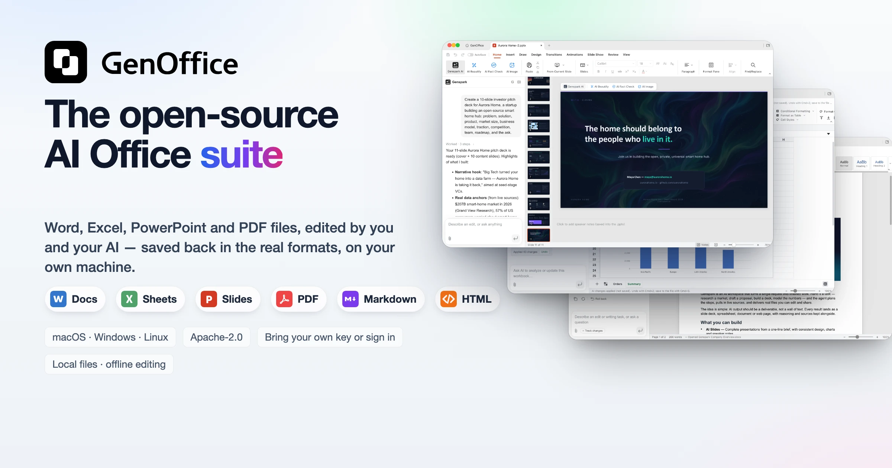
    </picture>
  </a>
</p>

<h1 align="center">GenOffice</h1>

<p align="center"><b>Bộ ứng dụng văn phòng AI mã nguồn mở đầy đủ tính năng đầu tiên trên thế giới.</b><br>
Tệp Word, Excel, PowerPoint và PDF do bạn và AI của bạn cùng chỉnh sửa, được lưu lại đúng định dạng gốc.</p>

<p align="center">
  <a href="../../LICENSE"></a>
  <a href="https://github.com/genspark-ai/genoffice/releases/latest"></a>
  <a href="https://github.com/genspark-ai/genoffice/releases"></a>
  <a href="https://github.com/genspark-ai/genoffice/stargazers"></a>
  <a href="https://x.com/merrickbuilds"></a>
</p>

<p align="center"><a href="../../README.md">English</a> · <a href="README.es.md">Español</a> · <a href="README.pt-BR.md">Português (Brasil)</a> · <a href="README.de.md">Deutsch</a> · <a href="README.fr.md">Français</a> · <a href="README.zh-CN.md">简体中文</a> · <a href="README.zh-TW.md">繁體中文</a> · <a href="README.ko.md">한국어</a> · <a href="README.ja.md">日本語</a> · <a href="README.ar.md">العربية</a> · <a href="README.ru.md">Русский</a> · <a href="README.it.md">Italiano</a> · <a href="README.nl.md">Nederlands</a> · <a href="README.pl.md">Polski</a> · <a href="README.cs.md">Čeština</a> · <a href="README.id.md">Bahasa Indonesia</a> · <a href="README.ms.md">Bahasa Melayu</a> · <a href="README.th.md">ไทย</a> · <a href="README.hi.md">हिन्दी</a> · <a href="README.he.md">עברית</a> · <b>Tiếng Việt</b></p>

<p align="center">
  <a href="#download"><b>Tải xuống</b></a> ·
  <a href="#skills"><b>Skill</b></a> ·
  <a href="#command-line-and-agent-skill"><b>CLI</b></a> ·
  <a href="#mcp-server"><b>MCP</b></a> ·
  <a href="https://genoffice.ai/"><b>Trang chủ</b></a> ·
  <a href="https://genoffice.ai/join"><b>Cộng đồng</b></a> ·
  <a href="https://x.com/merrickbuilds"><b>X</b></a> ·
  <a href="../../PRIVACY.md"><b>Quyền riêng tư</b></a>
</p>

GenOffice là lựa chọn thay thế Microsoft Office miễn phí, mã nguồn mở cho
macOS, Windows và Linux. Ứng dụng mở và lưu các tệp `.docx`, `.xlsx` và
`.pptx` gốc, chỉnh sửa PDF, Markdown và HTML, và đặt một agent AI bên cạnh
mọi tài liệu — không phải một ô chat gắn thêm bên hông, mà là một trình
soạn thảo đọc tệp, thực hiện thay đổi, và chỉ cho bạn chính xác những gì nó
đã động tới.

- **Định dạng gốc, giữ nguyên từng byte.** Chỉ những phần bạn chỉnh sửa mới
  được ghi lại. Mọi thứ khác trong tệp được giữ nguyên từng byte, nên tài
  liệu vẫn mở và hoạt động bình thường trong Word, Excel và PowerPoint.
- **AI có thể kiểm tra lại.** Thay đổi của AI được ghi dưới dạng theo dõi
  thay đổi (tracked changes) và diff, hoàn tác một cú bấm. Bảng tính nhận
  công thức sống, không phải con số dán vào. Slide và trang được tạo trực
  tiếp lên khung vẽ và vẫn chỉnh sửa được toàn bộ.
- **Cục bộ ngay từ thiết kế.** Tệp được mở, chỉnh sửa, lưu và chuyển đổi
  ngay trên máy của bạn. PDF → Word / Excel / PowerPoint, Markdown → Word
  và HTML → Word đều chạy trên máy. Chỉ các lời gọi AI mới rời khỏi máy,
  đến nhà cung cấp bạn chọn.
- **Tìm tệp theo nội dung của nó.** Màn hình chính tìm kiếm theo tên, thư
  mục và toàn văn của các tệp `.docx`, `.xlsx`, `.pptx`, PDF, Markdown và
  HTML qua một chỉ mục SQLite cục bộ, có hỗ trợ CJK. Nếu muốn, các kết quả
  hàng đầu được xếp lại thứ hạng bởi **[TypeSafe
  Jev](https://typesafe.ai/)** — mô hình phán đoán System One — để tệp trả
  lời được câu hỏi của bạn đứng lên đầu.
- **Hỏi chính tệp của bạn, kèm nguồn.** Gắn sao một nhóm tài liệu và
  **Ask AI** trên màn hình chính sẽ trả lời câu hỏi trên toàn bộ nhóm đó,
  mỗi thông điệp đều trích dẫn tệp nguồn để bạn mở ra kiểm chứng.
- **Khoá của bạn, hoặc không cần khoá.** Đăng nhập Genspark để khỏi cần
  khoá, hoặc mang khoá riêng của bạn cho Claude, OpenAI, Gemini, DeepSeek,
  Kimi, GLM, Qwen, Doubao, MiniMax, Grok, Mistral, OpenRouter, Requesty,
  Opper, Cheaper Inference, Atlas Cloud, hoặc bất kỳ điểm cuối tương thích
  OpenAI nào, kể cả máy chủ mô hình cục bộ.
- **Viết script được và sẵn sàng cho agent.** Ứng dụng đi kèm dòng lệnh
  `genoffice` và một skill cho Claude Code, Codex, Cursor, Gemini CLI,
  GitHub Copilot, OpenCode và Windsurf, để agent lập trình có thể tạo,
  chuyển đổi, đọc và chỉnh sửa tệp Office thật ngay trên máy của bạn mà
  không cần mở cửa sổ nào.

**Tải ngay:** [macOS](https://github.com/genspark-ai/genoffice/releases/latest) (Apple Silicon và Intel) ·
[Windows](https://github.com/genspark-ai/genoffice/releases/latest) (x64 và Arm) ·
[Linux](https://github.com/genspark-ai/genoffice/releases/latest) (deb, rpm, AppImage) —
chi tiết và yêu cầu hệ thống xem mục [Tải xuống](#download).

## Demo

Sáu ứng dụng, một panel AI, tìm kiếm tệp được xếp lại thứ hạng bởi TypeSafe
Jev, một Ask AI trả lời từ các tệp bạn gắn sao kèm nguồn, và một dòng lệnh
cho agent lập trình của bạn. Mọi ảnh chụp màn hình đều là ứng dụng thật
trên macOS, với AI được điều khiển bằng chính prompt bạn đọc được trong panel.

### 1 · Docs — mở và chỉnh sửa `.docx` với AI có thể kiểm tra lại

<table>
<tr>
<td width="50%"></td>
<td width="50%">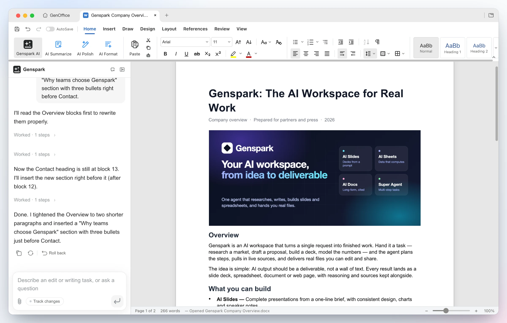</td>
</tr>
<tr>
<td><b>Mở tệp đúng như Word trình bày</b> — các phần nhiều cột, ảnh tràn khổ,
bảng có nền tô, header và footer, phân trang theo thước dòng của Word.
Style, comment, theo dõi thay đổi, công thức toán và mực viết tay được giữ
nguyên hai chiều.</td>
<td><b>Yêu cầu AI chỉnh</b> — AI đọc những khối nó cần, viết lại phần Tổng
quan và chèn một mục gạch đầu dòng mới. Mỗi lượt AI là một bản chụp có thể
hoàn tác; bật <b>Theo dõi thay đổi</b> thì chỉnh sửa đến dưới dạng revision
theo chuẩn Word.</td>
</tr>
</table>

### 2 · Sheets — `.xlsx` với công thức sống và biểu đồ, không phải con số dán vào

<table>
<tr>
<td width="50%"></td>
<td width="50%"></td>
</tr>
<tr>
<td><b>Xây dựng</b> — từ một câu, agent thêm một sheet Tổng hợp với công thức
<code>SUMIF</code> thật theo vùng và theo ngành, chèn biểu đồ cột, và áp 43
thay đổi thành một lô hoàn tác được cùng lúc.</td>
<td><b>Hỏi nó</b> — câu hỏi về sổ tính được trả lời kèm cách suy luận và
đúng những ô đã dùng dưới dạng trích dẫn bấm được. Bên dưới: một engine
<code>.xlsx</code> Rust tự phát triển, pivot table, slicer, định dạng có
điều kiện và truy vết công thức.</td>
</tr>
</table>

### 3 · Slides — từ một prompt thành bộ slide `.pptx`


<table>
<tr>
<td width="50%"></td>
<td width="50%"></td>
</tr>
<tr>
<td><b>Một dòng vào</b> — "Tạo bộ slide pitch đầu tư 10 slide cho Aurora
Home…". GenOffice lập mạch truyện, tra số liệu, và phác từng slide lên khung
vẽ dưới dạng <code>.pptx</code> thật.</td>
<td><b>Một bộ slide hoàn chỉnh ra</b> — mười một slide được thiết kế với
typography, hình ảnh nhất quán và lời kêu gọi hành động ở slide cuối; tiếp
tục chỉnh với master, layout, smart guide và cắt ảnh không phá hủy, hoặc
bảo panel đổi phong cách, viết lại và sắp lại thứ tự.</td>
</tr>
</table>

### 4 · PDF — chỉnh sửa chữ PDF tại chỗ, chuyển PDF sang Word ngay trên máy

<table>
<tr>
<td width="50%"></td>
<td width="50%"></td>
</tr>
<tr>
<td><b>Sửa bên trong trang</b> — chế độ Edit text khoanh vùng mọi khối chữ
để gõ lại tại chỗ; content stream được viết lại qua PDFium với phông gốc
được giữ, không phải lớp chú thích che đậy. Hỏi AI về một báo cáo dài và
nhận câu trả lời kèm trích dẫn trang.</td>
<td><b>Chuyển đổi trên máy</b> — <b>PDF Converter → PDF to Word</b> tạo ra
<code>.docx</code> chỉnh sửa được, mở trong Docs cạnh bản gốc, giữ nguyên
tiêu đề, hàng số liệu và đoạn văn. Đích Excel và PowerPoint hoạt động như
thế; trang scan đi qua OCR của hệ điều hành.</td>
</tr>
</table>

### 5 · HTML — trình xây dựng trang web và UI bằng AI, khởi đầu từ design brief

Hãy nói trang đó dành cho việc gì và dành cho ai. AI đề xuất **design
brief** trước — hook, bảng màu, typography và các hướng phong cách — rồi
xây một tệp `.html` tự chứa duy nhất theo các token đó.

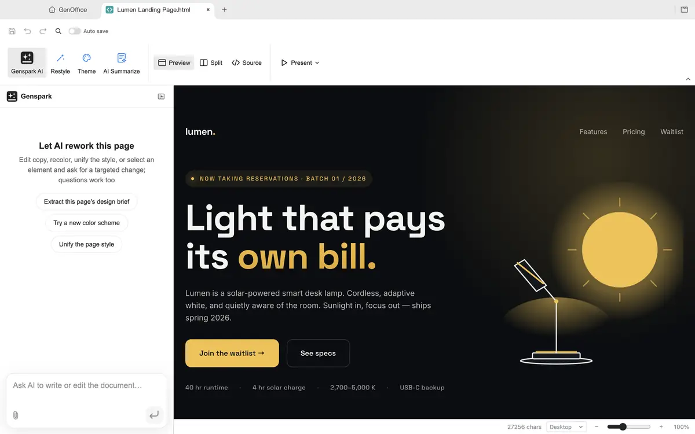

<table>
<tr>
<td width="50%">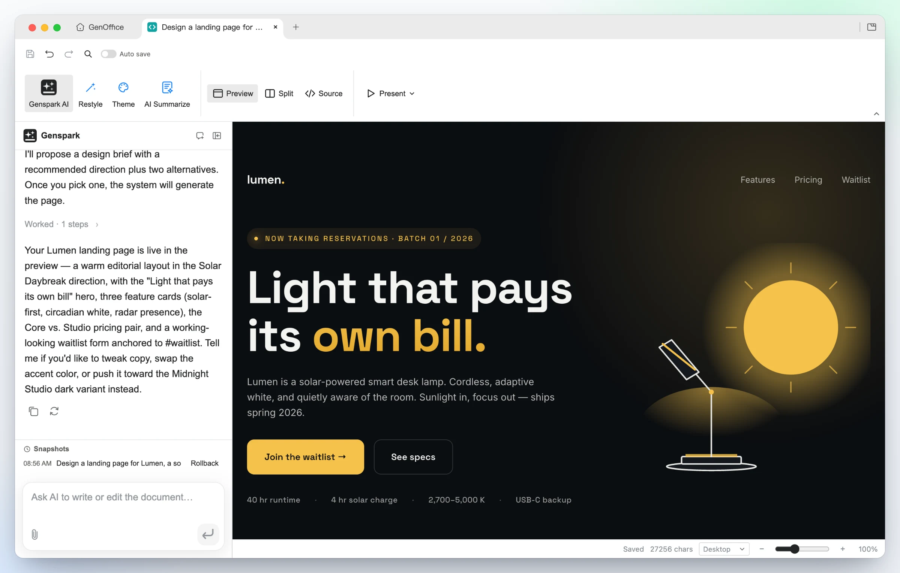</td>
<td width="50%"></td>
</tr>
<tr>
<td><b>Tạo từ một prompt</b> — hero ấn tượng, thẻ tính năng, bảng giá và
form danh sách chờ cho Lumen, xây theo hướng Midnight Studio. Bấm vào phần
tử nào cũng đổi được phong cách, nhấp đúp để sửa chữ, hoặc chuyển sang chế
độ xem mã CodeMirror.</td>
<td><b>Cùng thiết kế, hướng mới</b> — một yêu cầu <b>Restyle</b> thay các
token của brief và trang theo ngay: giấy ấm, serif kiểu báo chí, điểm nhấn
cam nắng, không gì bị viết lại. Trình chiếu toàn màn hình, hoặc xuất ra PDF
hay tài liệu Word gốc chỉnh sửa được.</td>
</tr>
</table>
<table>
<tr>
<td width="50%">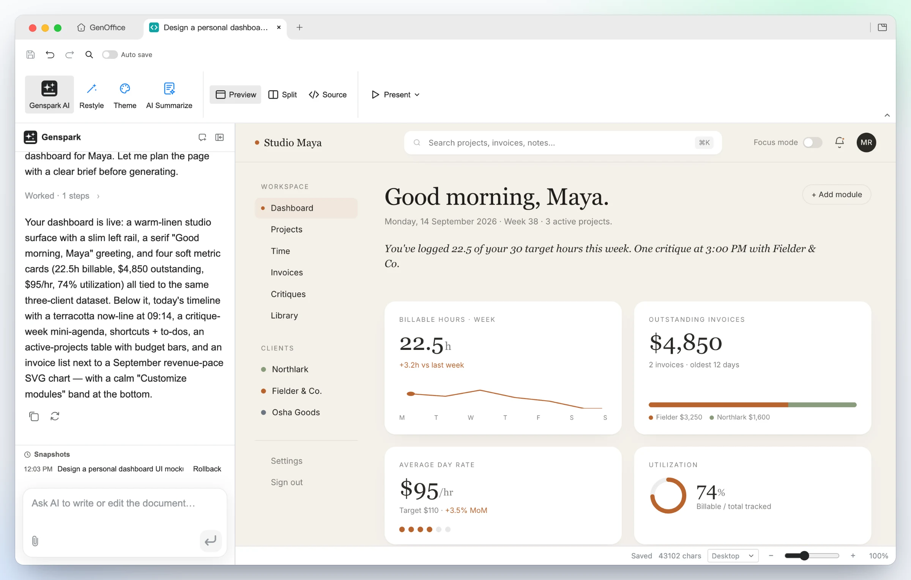</td>
<td width="50%">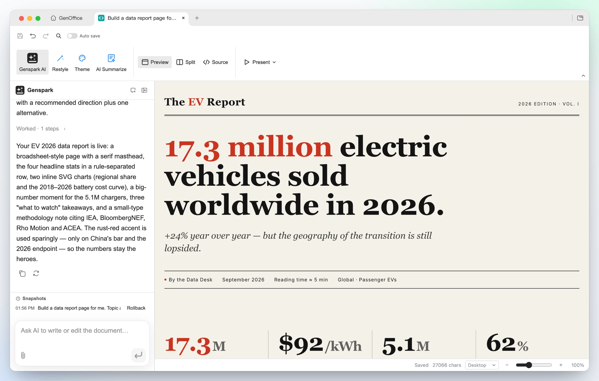</td>
</tr>
<tr>
<td><b>Mockup UI</b> — mẫu "dashboard cá nhân" biến một chân dung người dùng
thành layout chạy được: rail trái, lời chào, sparkline giờ tính phí, thẻ
hoá đơn và mức sử dụng — toàn bộ là HTML thật bạn có thể đưa thẳng cho lập
trình viên.</td>
<td><b>Câu chuyện dữ liệu</b> — mẫu "báo cáo dữ liệu" dựng một trang báo
kiểu editorial: đầu đề serif, một con số tiêu đề, hàng số liệu phân tách
bằng kẻ ngang, biểu đồ SVG nhúng và chú thích phương pháp.</td>
</tr>
</table>

### 6 · Markdown — trình soạn thảo khối trên `.md` thuần, kèm Ask AI

<table>
<tr>
<td width="50%"></td>
<td width="50%">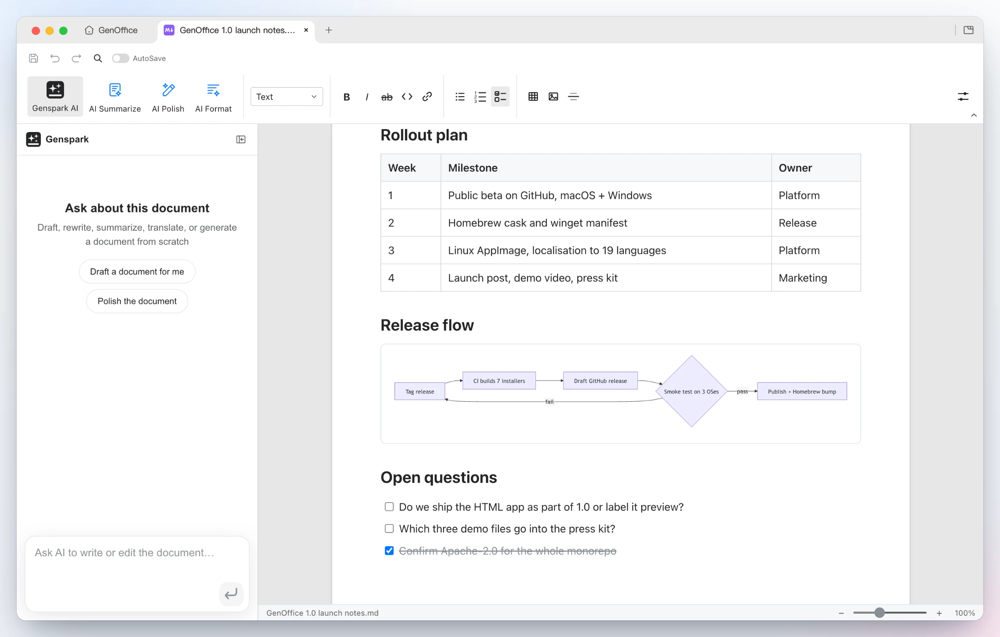</td>
</tr>
<tr>
<td><b>Hỏi AI về một đoạn chọn</b> — chọn bất kỳ đoạn nào và một chip
<b>Ask AI</b> xuất hiện: gõ hướng dẫn hoặc chọn gợi ý, gửi ngay, hoặc xếp
hàng đợi nhiều chỉnh sửa có neo và chạy một lượt. Cửa vào giống hệt tồn tại
trong mọi ứng dụng.</td>
<td><b>Hiển thị đẹp, lưu dạng Markdown thuần</b> — tiêu đề, danh sách, bảng,
ảnh, khối mã và sơ đồ Mermaid trong trình soạn thảo khối Tiptap, ghi ngược
thành <code>.md</code> thuần, với xuất <b>Markdown → Word</b> hoàn toàn cục bộ.</td>
</tr>
</table>

### 7 · Search — tìm ra tệp trả lời được câu hỏi, với TypeSafe Jev

Mọi tệp trong thư mục làm việc của bạn được lập chỉ mục ngay trên máy: tên,
thư mục và văn bản trích xuất của các tệp Word, Excel, PowerPoint, PDF,
Markdown và HTML, trong một chỉ mục toàn văn SQLite có phân tách từ nhận
biết CJK. Bật **Jev search reranking** và 20 kết quả cục bộ hàng đầu được
phán đoán bởi [TypeSafe
Jev](https://typesafe.ai/blog/introducing-system-one-models-and-jev) — mô
hình System One trả về một điểm liên quan hiệu chuẩn cho mỗi tài liệu trong
một lần gọi thay vì sinh văn bản. Danh sách được sắp lại theo điểm đó; nếu
lời gọi thất bại hoặc quá thời gian, thứ tự cục bộ được giữ nguyên.


<table>
<tr>
<td width="50%">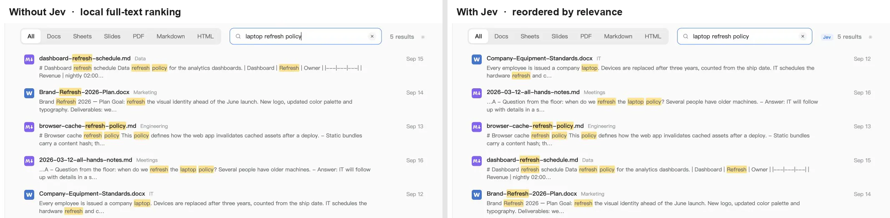</td>
<td width="50%">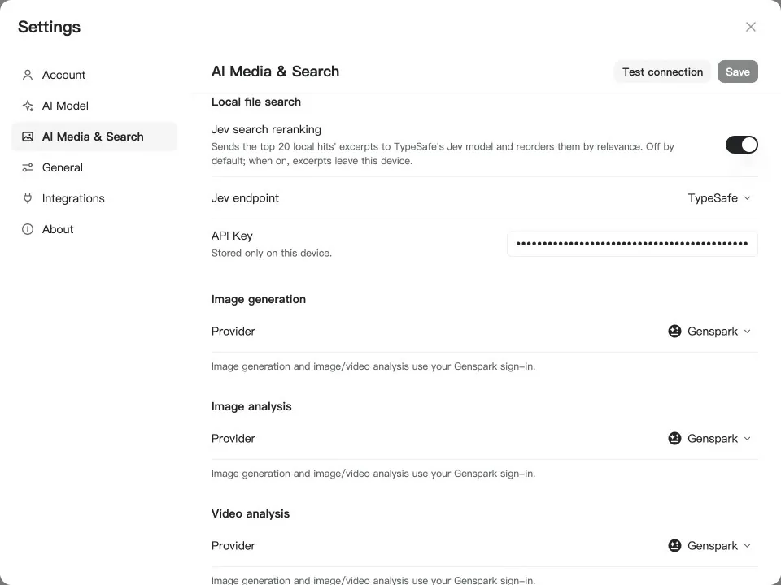</td>
</tr>
<tr>
<td><b>Cùng chữ, khác câu trả lời</b> — "laptop refresh policy" khớp chữ với
chữ với một chính sách bộ nhớ đệm, một kế hoạch làm mới thương hiệu và một
lịch làm mới dashboard, nên thứ hạng toàn văn đẩy chúng lên đầu. Jev đọc
đoạn trích và đưa tài liệu tiêu chuẩn trang thiết bị — tài liệu nêu chu kỳ
thay thế ba năm — lên đầu. Huy hiệu <b>Jev</b> cạnh số đếm kết quả cho biết
khi nào thứ tự đến từ mô hình.</td>
<td><b>Mặc định tắt, một công tắc để bật</b> — Settings → AI Media &
Search → Local file search. Chọn OpenRouter hoặc TypeSafe trực tiếp, dán
khoá, bấm Test connection. Chỉ khi công tắc bật, đoạn trích của các kết quả
hàng đầu mới rời khỏi máy; bản thân chỉ mục thì không bao giờ.</td>
</tr>
</table>

### 8 · Ask AI — các tệp bạn gắn sao, được trả lời kèm nguồn

Gắn sao những tệp bạn đang làm việc và **Ask AI** trên màn hình chính coi
chúng là một cơ sở tri thức. Đặt câu hỏi bằng ngôn ngữ thường ngày; agent
tìm trong các tệp đã gắn sao, đọc những tệp nó cần và trả lời với một trích
dẫn sau mỗi thông điệp. Bấm vào trích dẫn và tệp mở trong đúng ứng dụng.

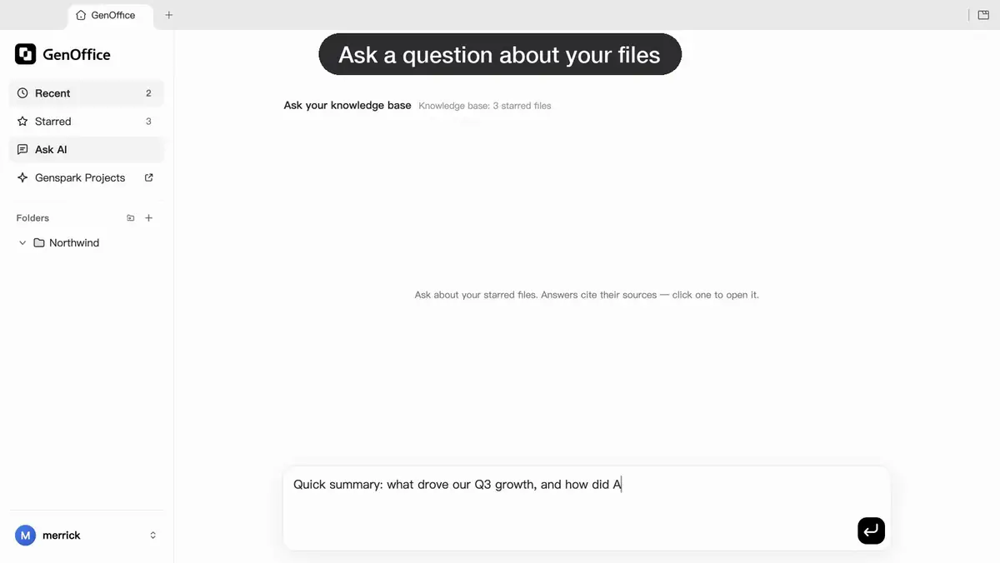

Ask AI tìm kiếm trên cùng chỉ mục toàn văn trên máy với
[Search](#7--search--find-the-file-that-answers-the-question-with-typesafe-jev)
và đọc tệp theo từng trang, nên mô hình chỉ thấy các kết quả trùng và đúng
đoạn nó cần, qua nhà cung cấp bạn đã chọn.

### 9 · CLI — agent lập trình của bạn điều khiển GenOffice, ngay trên máy của bạn

GenOffice đi kèm dòng lệnh `genoffice` và một agent skill. Cài skill và
Claude Code, Codex, Cursor, Gemini CLI, GitHub Copilot, OpenCode hay
Windsurf có thể tạo, chuyển đổi, đọc và chỉnh sửa tệp Office thật qua cùng
những engine với các ứng dụng, mà không mở cửa sổ nào.


<table>
<tr>
<td width="50%">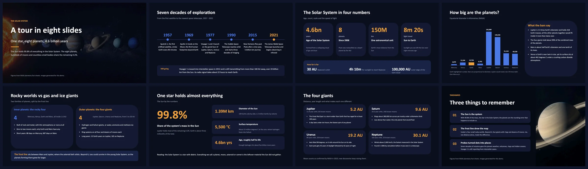</td>
<td width="50%">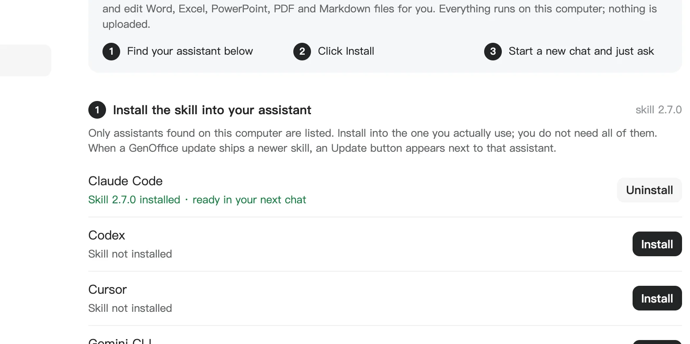</td>
</tr>
<tr>
<td><b>Một prompt cho agent của bạn</b> — "Dựng bộ slide tám phần về Hệ Mặt
Trời." Agent đọc skill, viết một style sheet, một dàn ý và đặc tả từng trang,
tạo hai bức ảnh bằng <code>genoffice image</code>, và để
<code>genoffice slides check</code> chối mọi thứ tràn hoặc chồng lấn trước
khi <code>genoffice create</code> lắp <code>.pptx</code> và
<code>slides render</code> trả về một PNG mỗi slide để xem.</td>
<td><b>Cài một lần, từ Settings → Integrations</b> — GenOffice liệt kê các
agent lập trình tìm thấy trên máy này và ghi skill vào mỗi agent bạn chọn.
Hoặc tải skill dưới dạng zip, hoặc chạy <code>npx skills add
genspark-ai/genoffice</code>. Các lệnh và toàn bộ quy trình nằm ở
<a href="#command-line-and-agent-skill">Dòng lệnh và agent skill</a>.</td>
</tr>
</table>

### 10 · MCP — cùng bộ công cụ qua Model Context Protocol

Mỗi lệnh `genoffice` cũng là một công cụ MCP. Claude Code, Claude Desktop,
Cursor và bất kỳ MCP client nào khác có thể tự chạy `genoffice mcp`, không
cần cài skill, không cần mở cửa sổ, và nhận 29 công cụ cùng các tài liệu
tham chiếu op dưới dạng resources. Một máy chủ HTTP thứ hai bên trong ứng
dụng cho phép agent dựng một tài liệu Word trong một tab trình soạn thảo
hiện rõ trong khi bạn xem.

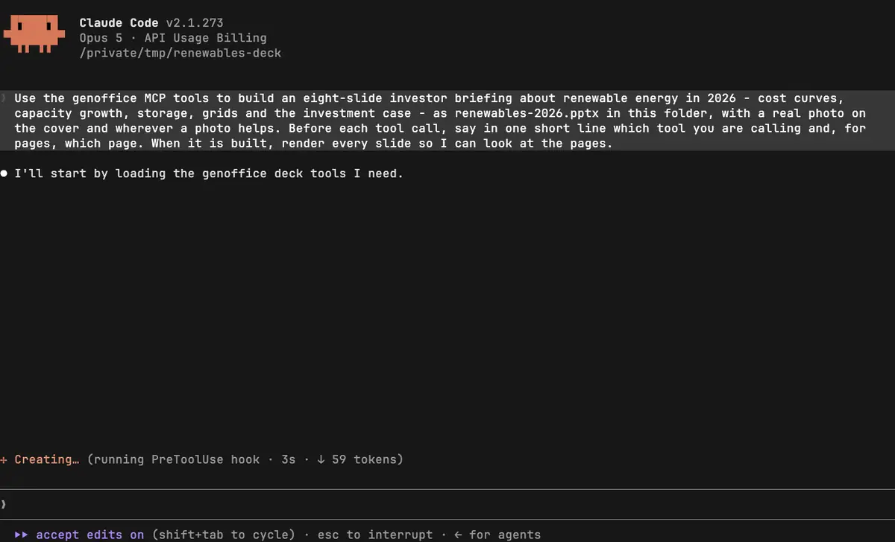

<table>
<tr>
<td width="50%">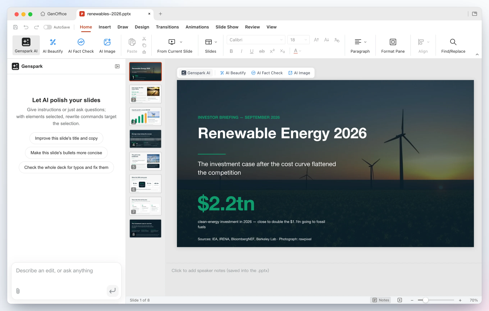</td>
<td width="50%">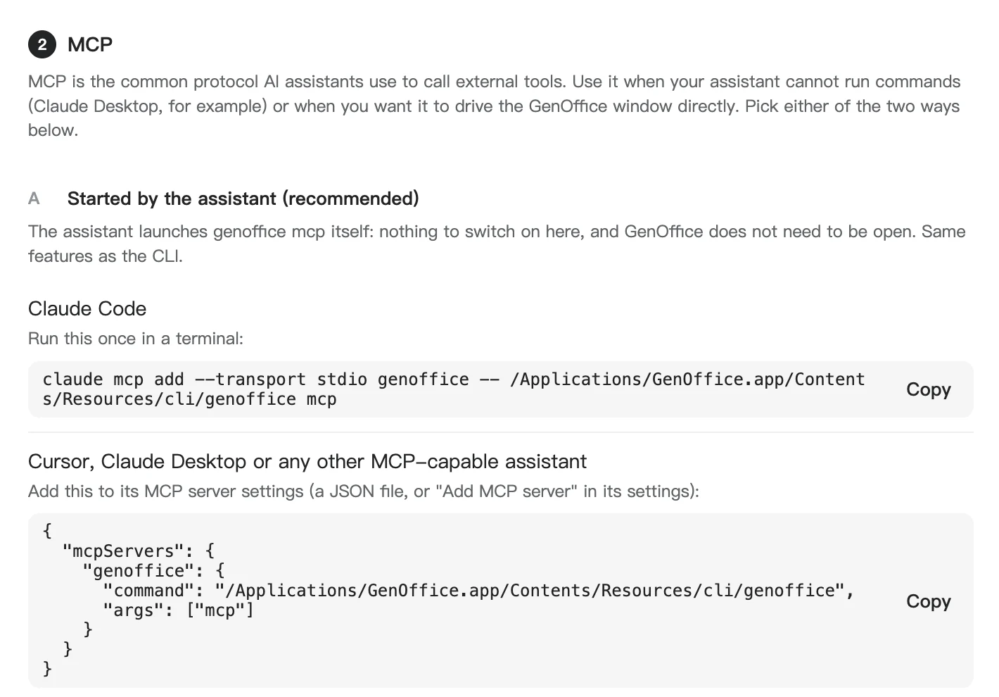</td>
</tr>
<tr>
<td><b>Một prompt, 38 lần gọi công cụ, không cần shell</b> — "Dựng một bản
báo cáo đầu tư tám slide về năng lượng tái tạo năm 2026, có ảnh thật ở bìa
và ở mọi chỗ một bức ảnh giúp được." Agent kéo số liệu và ảnh bằng
<code>search</code>, hỏi <code>media</code> từng ảnh ứng viên có phải ảnh
chụp thật không, gọi <code>deck_start</code> với style sheet và dàn ý, rồi
<code>deck_page</code> mỗi slide một lần; mỗi trang được kiểm tra với dàn ý
và bảng màu trước khi được giữ, <code>deck_build</code> lắp
<code>.pptx</code>, <code>slides_audit</code> rà tràn khung,
<code>slides_render</code> trả về một PNG mỗi slide dưới dạng nội dung ảnh
mô hình xem được, và <code>deck_replace</code> sửa ba trang nó ưng chưa.</td>
<td><b>Kết nối một lần, từ Settings → Integrations</b> — sao chép dòng
<code>claude mcp add</code> cho Claude Code, hoặc khối JSON vào Cursor,
Claude Desktop hay MCP client khác. Tuỳ chọn B bật máy chủ HTTP cục bộ cho
trình soạn thảo Word hiện rõ. Cả hai được mô tả ở
<a href="#mcp-server">Máy chủ MCP</a>.</td>
</tr>
</table>

## Vì sao chọn GenOffice

- **Mã nguồn mở**, Apache-2.0, xây công khai trên GitHub.
- **Thuộc về bạn để chạy.** Ứng dụng gốc cho macOS, Windows và Linux; tệp
  nằm trên đĩa của bạn và mọi lần chỉnh, lưu hay chuyển đổi đều xảy ra trên
  máy của bạn.
- **Tệp Office thật.** `.docx`, `.xlsx` và `.pptx` gốc, giữ nguyên từng
  byte: những phần của tệp bạn không đụng tới được sao chép chính xác như
  chúng vốn có.
- **Một AI tự chỉnh tài liệu.** Theo dõi thay đổi trong Docs, công thức và
  biểu đồ sống trong Sheets, slide vẽ thẳng lên khung vẽ, mỗi lượt AI là
  một bản chụp hoàn tác được.
- **Mô hình của bạn, khoá của bạn.** Đăng nhập Genspark, hoặc mang khoá cho
  Claude, OpenAI, Gemini, DeepSeek và nhiều nhà cung cấp khác, gồm cả máy
  chủ mô hình cục bộ và bất kỳ điểm cuối tương thích OpenAI nào.
- **PDF được làm đúng kiểu.** Sửa chữ bên trong trang, và chuyển PDF sang
  Word, Excel hay PowerPoint ngay trên máy, với OCR hệ điều hành cho trang scan.
- **Markdown và HTML cũng thế**, cùng panel AI và xuất cục bộ ra Word.
- **Tìm kiếm tìm ra câu trả lời, không phải từ khoá.** Tìm kiếm toàn văn
  trên mọi tài liệu trong thư mục của bạn, lập chỉ mục trên máy, với tuỳ
  chọn xếp lại thứ hạng bằng TypeSafe Jev — mô hình phán đoán System One.
- **Ask AI trên toàn bộ tệp của bạn.** Gắn sao những tệp quan trọng và hỏi
  bằng ngôn ngữ thường ngày; mọi câu trả lời đều trích dẫn tệp nguồn, cách
  một cú bấm.
- **Skill.** Skill có sẵn hoặc `SKILL.md` của riêng bạn, đính kèm từ menu **+** của bất kỳ bảng AI nào.
- **Viết script được.** Dòng lệnh `genoffice`, một agent skill và một máy
  chủ MCP đặt mọi engine phục vụ Claude Code, Claude Desktop, Codex, Cursor
  và các agent khác — vẫn ngay trên máy.
- **Miễn phí**, cho cả cá nhân lẫn nhóm.

## Các backend AI

**Đăng nhập Genspark** và không có gì phải cấu hình: các lời gọi mô hình đi
qua proxy Genspark (họ Claude, GPT và Gemini) và các agent có tìm kiếm web
và ảnh, tạo ảnh, cùng phân tích ảnh/âm thanh/video.

**Hoặc mang khoá riêng của bạn.** Settings → AI liệt kê Claude, OpenAI,
Gemini, DeepSeek, Kimi, GLM, Qwen, Doubao, MiniMax, Grok, Mistral,
OpenRouter, Requesty, Opper, Cheaper Inference, Atlas Cloud và OpenCode
Zen/Go, cùng một ô tuỳ biến cho bất kỳ điểm cuối tương thích OpenAI nào
(base URL + khoá), kể cả máy chủ mô hình cục bộ. Search và media có nhà
cung cấp riêng theo từng khả năng dưới **AI Media & Search**: Serper,
Serply, Tavily hoặc Parallel cho tìm kiếm web; OpenAI, Gemini,
Doubao/Seedream, GLM, Grok, Qwen, MiniMax hoặc bất kỳ điểm cuối ảnh tương
thích OpenAI nào cho tạo ảnh và phân tích ảnh/video, cùng DeepSeek V4.1
Flash cho phân tích ảnh.

**TypeSafe Jev** xếp lại thứ hạng tìm kiếm tệp trên màn hình chính. Dưới
**AI Media & Search → Local file search**, bật Jev search reranking và chọn
điểm cuối: [OpenRouter](https://openrouter.ai/typesafe) (mô hình
`typesafe/jev-1.13`) hoặc API của chính TypeSafe. Khoá chỉ được lưu trên
chính thiết bị này. Mặc định tính năng tắt; khi bật, đoạn trích của 20 kết
quả cục bộ hàng đầu được gửi đi để phán đoán và không gì khác rời khỏi máy.

**Parallel** hoạt động không cần tài khoản: Search MCP miễn phí của nó
(giới hạn tần suất) là tìm kiếm web mặc định khi chưa có đăng nhập
Genspark hay khoá tìm kiếm, và chạy trước bước scrape DuckDuckGo. Chọn
Parallel dưới Web search và nhập khoá
[Parallel](https://platform.parallel.ai/) để dùng Search API thay thế.

Toàn bộ bộ ứng dụng có giao diện sáng, tối và theo hệ thống. Giao diện chỉ
thay đổi những gì trên màn hình: xuất, in và tệp đã lưu luôn giữ màu riêng
của tài liệu.

<a id="skills"></a>

## Skill

Skill là một tệp `SKILL.md` chỉ cho AI cách làm tốt một việc: báo cáo tuần, NDA, giáo án.
GenOffice đi kèm một bộ skill và nhận cả skill của bạn, cùng định dạng mà các agent lập trình dùng.

- **Cài đặt → Skill.** **Cài** một skill được đề xuất, hoặc **Nhập** một thư mục, một tệp zip hay một `SKILL.md` đơn lẻ. Không có gì chạy khi nhập.
- **Trong trò chuyện.** Mở menu **+** cạnh ô nhập của bất kỳ bảng AI nào, chọn **Skill**, tích một cái rồi gửi. Skill chỉ đi kèm đúng tin nhắn đó.

---

## Dòng lệnh và agent skill

Mọi thứ các ứng dụng làm được với một tệp, dòng lệnh `genoffice` làm được
từ terminal: soát, chuyển đổi, tạo, đọc và chỉnh sửa Word, Excel,
PowerPoint, PDF, Markdown và HTML trên cùng những engine, không giao diện.
Nó cài cùng GenOffice, không cần runtime riêng, và không bao giờ gửi tài
liệu đi đâu. Ghép với **agent skill** đi kèm, nó biến một agent lập trình
thành người thợ tài liệu tạo ra tệp Office thật thay vì các bản xấp xỉ
Markdown.

**Hoạt động với:** Claude Code, Codex, Cursor, Gemini CLI, GitHub Copilot,
OpenCode và Windsurf ngay từ đầu, bất kỳ agent nào đọc được skill, và, qua
[máy chủ MCP](#mcp-server), Claude Desktop cùng mọi MCP client.

### Cài skill

| Cách                                       | Điều gì xảy ra                                                                                                                                                      |
| ------------------------------------------ | ------------------------------------------------------------------------------------------------------------------------------------------------------------------- |
| **Settings → Integrations** trong ứng dụng | Liệt kê các agent tìm thấy trên máy này; một cú bấm ghi skill vào từng agent bạn chọn. Nút **Update** xuất hiện khi một bản phát hành GenOffice mang skill mới hơn. |
| **Download as zip** trên cùng trang        | Đúng cấu trúc claude.ai, ứng dụng Claude desktop và các trợ lý khác chấp nhận như skill tải lên.                                                                    |
| `npx skills add genspark-ai/genoffice`     | Cài từ kho lưu trữ này vào bất kỳ agent tương thích skills nào.                                                                                                     |

Sau đó mở một cuộc trò chuyện mới và yêu cầu một tài liệu. Skill dạy agent
khi nào nên dùng tới `genoffice`, cách đọc tệp trước khi sửa, và cách tự
kiểm tra sản phẩm của mình.

### Quickstart từ terminal

```bash
genoffice --version
genoffice info report.docx --json                  # headings and blocks; or sheets, slides, pages
genoffice convert report.md --to pdf               # md/html/docx/xlsx/pptx → pdf, pdf → docx/xlsx/pptx/md/html, …
genoffice create --type docx --from notes.md --out notes.docx
genoffice create --type xlsx --from table.json --out sales.xlsx   # "=SUM(B2:B9)" cells stay live formulas
genoffice docs read report.docx --range 0-9 --json # then `docs apply --ops edits.json` edits in place
genoffice render report.docx --out shots/          # one PNG per page, to look at what you made
genoffice open sales.xlsx                          # hand the result to the editor
```

Mỗi lệnh in một dòng tóm tắt, hoặc một đối tượng JSON duy nhất với `--json`.
Chỉnh sửa là nguyên tử: một op bị chối bỏ giữ nguyên tệp và trả về lỗi có
hướng dẫn. `genoffice help` liệt kê bề mặt lệnh hiện tại; tài liệu tham
chiếu đầy đủ nằm ở [packages/cli/README.md](../../packages/cli/README.md).

### Agent thực sự chạy những gì

Bộ slide Hệ Mặt Trời trong [demo](#demo) chỉ tốn một prompt trong Claude
Code. Phía sau, agent đi theo quy trình từng bước của skill và CLI kiểm tra
mỗi giai đoạn trước khi giai đoạn sau bắt đầu:

```bash
genoffice capabilities --json                        # which cloud tools GenOffice has configured
genoffice guide slides design                        # the deck workflow and layout library
genoffice image "the eight planets in a row …" --aspect 16:9 --out deck/assets/cover.jpg
genoffice slides check deck/outline.json --json      # 8 pages, no findings
genoffice slides check deck/pages/01.json --json     # builds one slide, audits overflow and overlap
…                                                    # one page file per slide, fixed until each check is clean
genoffice create --type pptx --spec deck/pages --outline deck/outline.json --out deck/solar-system.pptx --json
genoffice slides render deck/solar-system.pptx --out deck/shots --json
genoffice slides audit deck/solar-system.pptx --json    # 8 slides, no layout issues
genoffice slides replace deck/solar-system.pptx --slide 4 --spec deck/pages/05.json --json
genoffice open deck/solar-system.pptx
```

Không có lời gọi mô hình nào diễn ra bên trong `genoffice`: agent là người
suy nghĩ, CLI là người dựng và kiểm tra, và kết quả mở trong GenOffice hay
PowerPoint như một `.pptx` bình thường.

### Máy chủ MCP

Các lệnh này cũng có sẵn dưới dạng công cụ
[Model Context Protocol](https://modelcontextprotocol.io), cho những trợ lý
không chạy được terminal hoặc mà bạn không muốn trao terminal. Có hai lối
vào, cả hai đều có snippet sao-chép-ngay trong **Settings → Integrations →
MCP**:

| Cách                                  | Là gì                                                                                                                                                                                                                                                                                                                                                                                                                                                                                |
| ------------------------------------- | ------------------------------------------------------------------------------------------------------------------------------------------------------------------------------------------------------------------------------------------------------------------------------------------------------------------------------------------------------------------------------------------------------------------------------------------------------------------------------------ |
| **A · `genoffice mcp`** (khuyến nghị) | Một máy chủ stdio trợ lý tự khởi động; GenOffice không cần mở. Một công cụ cho mỗi lệnh (`info`, `convert`, `create_docx`, `create_xlsx`, `create_pptx`, `create_pdf`, `docs_read` / `docs_apply` / `docs_check`, `sheet_*`, `slides_*`, `render`, `guide`, `search`, `image`, `media`, `open`) cùng luồng deck theo giai đoạn `deck_start` → `deck_page` → `deck_build` → `deck_replace`. Ops, spec và Markdown được truyền inline, nên client không có hệ thống tệp vẫn dùng được. |
| **B · Máy chủ HTTP cục bộ**           | Chạy bên trong ứng dụng GenOffice tại `http://127.0.0.1:3093/mcp` (Streamable HTTP, kèm SSE kiểu cũ). Các công cụ của nó điều khiển một tab trình soạn thảo Word hiện rõ: `create_session`, `insert_content`, `replace_blocks`, `apply_ops`, `read_document`, `save_session`, và bạn xem tài liệu thành hình. Mặc định tắt; bật trong cùng pane cài đặt.                                                                                                                             |
| **C · `genoffice mcp --http`**        | Bộ công cụ stdio dưới dạng máy chủ Streamable HTTP cho client trên máy khác: một container, một sandbox, một máy dùng chung trong mạng của bạn. Tệp đi cùng lời gọi: `PUT /files/<name>` tải lên một tệp và trả về URL, mọi tham số `file` nhận URL http(s), và công cụ ghi tệp trả lại dưới dạng URL tải xuống cùng, khi tệp nhỏ, các byte dưới dạng MCP resource. `--host 0.0.0.0` mở ra mạng, `--token` bảo vệ nó.                                                                |

```bash
# Claude Code
claude mcp add --transport stdio genoffice -- genoffice mcp
```

```jsonc
// Cursor, Claude Desktop hoặc bất kỳ MCP client nào khác
{ "mcpServers": { "genoffice": { "command": "genoffice", "args": ["mcp"] } } }
```

```bash
# Trên máy có GenOffice (mạng riêng; thêm --token cho máy dùng chung)
genoffice mcp --http 3093 --host 0.0.0.0 --token "$GENOFFICE_MCP_TOKEN"

# Từ phía client: tải lên, rồi dùng URL ở mọi nơi công cụ nhận tệp
curl -T report.docx -H "Authorization: Bearer $GENOFFICE_MCP_TOKEN" http://server:3093/files/
#   → { "url": "http://server:3093/files/<id>/report.docx", ... }
#   docs_read({ "file": "http://server:3093/files/<id>/report.docx" })
#   docs_apply(...) → output_url, tải về được bằng curl -o
```

Qua HTTP, mỗi phiên có một thư mục riêng, đường dẫn tương đối và thư mục
deck được phân giải bên trong nó, `open` không được cung cấp, và khi
`GENOFFICE_ALLOWED_ROOTS` chưa đặt các công cụ không thể ra khỏi kho tệp
của chính máy chủ. `render`, `convert` sang PDF và `create_pdf` vẫn khởi
một tiến trình GenOffice ẩn, nên máy chủ không giao diện cần cài ứng dụng
và một màn hình ảo (`xvfb-run`).

`genoffice` ở đây là CLI đi trong ứng dụng (trên macOS
`/Applications/GenOffice.app/Contents/Resources/cli/genoffice`; pane cài
đặt in đúng đường dẫn cho bản cài của bạn). Máy chủ mang theo hướng dẫn quy
trình riêng và cung cấp các tài liệu tham chiếu op dưới dạng resources
`genoffice://guide/*`, nên không cần skill; skill và máy chủ MCP có thể
cùng tồn tại và trợ lý tự chọn một. Tính năng đám mây (`search`, `image`,
`media`) vẫn đi qua nhà cung cấp cấu hình trong GenOffice; mọi thứ khác
chạy cục bộ, và `GENOFFICE_ALLOWED_ROOTS` giới hạn mọi công cụ trong các
thư mục bạn liệt kê.

Bộ slide năng lượng tái tạo trong [demo](#demo) là cảnh một prompt trong
Claude Code chỉ gắn đúng máy chủ MCP `genoffice` trông ra sao từ phía giao
thức:

```text
capabilities · guide(slides, spec) · guide(slides, design)
search(query) ×4                         → IEA, BNEF and IRENA figures for the slides
search(query, images) ×7 · media(url, ask) ×7
                                         → candidate photos, each one checked to be a real photograph
deck_start(dir, style, outline)          → outline checked: 8 pages to write
deck_page(dir, 0, page) … deck_page(dir, 7, page)
                                         → each page checked against the outline and the palette; one page sent again
deck_build(dir, out)                     → renewables-2026.pptx, no image failures
slides_audit(file) · slides_render(file, out)
                                         → no layout findings; 8 PNGs come back as image content
deck_replace(dir, n, page) ×3 · slides_render(file, out)
                                         → three pages fixed after looking at the renders
```

Ba mươi tám lần gọi, khoảng mười ba phút, và trợ lý không hề đụng vào một
shell: số liệu, ảnh, hướng dẫn, kiểm tra và bản kết xuất đều đi như kết quả
công cụ MCP. Chỉ `search` và `media` rời khỏi máy, đến nhà cung cấp cấu
hình trong GenOffice.

## Tải xuống

| Nền tảng                             | Yêu cầu                                               | Tải xuống                                                                                   |
| ------------------------------------ | ----------------------------------------------------- | ------------------------------------------------------------------------------------------- |
| **macOS** — Apple Silicon (arm64)    | macOS 11+                                             | [`.dmg` mới nhất (arm64)](https://github.com/genspark-ai/genoffice/releases/latest)         |
| **macOS** — Intel (x64)              | macOS 11+                                             | [`.dmg` mới nhất (x64)](https://github.com/genspark-ai/genoffice/releases/latest)           |
| **Windows** (x64, đa số máy tính)    | Windows 10+, Intel/AMD                                | [Trình cài `-x64.exe` mới nhất](https://github.com/genspark-ai/genoffice/releases/latest)   |
| **Windows** on Arm (ARM64)           | Windows 11 on Arm (Snapdragon X và tương tự)          | [Trình cài `-arm64.exe` mới nhất](https://github.com/genspark-ai/genoffice/releases/latest) |
| **Linux** — Debian / Ubuntu          | x86_64, glibc 2.34+ (Ubuntu 22.04 trở lên)            | [`.deb` mới nhất](https://github.com/genspark-ai/genoffice/releases/latest)                 |
| **Linux** — Fedora / RHEL / openSUSE | x86_64, glibc 2.34+ (Fedora 35+, RHEL 9+, Leap 15.6+) | [`.rpm` mới nhất](https://github.com/genspark-ai/genoffice/releases/latest)                 |
| **Linux** — các bản phân phối khác   | x86_64, glibc 2.34+, FUSE 2                           | [`.AppImage` mới nhất](https://github.com/genspark-ai/genoffice/releases/latest)            |

Mọi bản dựng đều đến từ `main`; trình cài macOS và Windows có ký số. Các
phiên bản cũ nằm trên trang
[Releases](https://github.com/genspark-ai/genoffice/releases).

<details>
<summary><b>Cài trên Linux</b></summary>

Bản deb cài bằng apt — nó kéo các phụ thuộc và thêm GenOffice vào menu
ứng dụng:

```bash
sudo apt install ./genoffice_<version>_amd64.deb
```

Trên Fedora / họ RHEL / openSUSE, cài bản rpm:

```bash
sudo dnf install ./genoffice-<version>.x86_64.rpm     # Fedora / RHEL family
sudo zypper install ./genoffice-<version>.x86_64.rpm  # openSUSE
```

AppImage chạy tại chỗ: cài runtime FUSE 2
(`sudo apt install libfuse2`; trên Ubuntu 24.04 gói tên là `libfuse2t64`),
đặt bit thực thi rồi chạy:

```bash
chmod +x GenOffice-<version>.AppImage
./GenOffice-<version>.AppImage
```

</details>

## Kiến trúc hoạt động

Bảy ứng dụng Electron — Docs, Sheets, Slides, PDF, Markdown, HTML và shell
đa tab — dùng chung một tầng engine gồm các package TypeScript thuần cộng
với một sidecar Rust cho `.xlsx`. Tệp gốc luôn là nguồn chân lý: chỉnh sửa
được áp dụng như các bản vá hẹp, và mọi thứ trình soạn thảo không đụng tới
sống sót qua vòng lưu-gỡ nguyên vẹn.

```
open docx ─► archive original by hash (never touched)
          ─► parse word/document.xml into a block tree, each block anchored to its original XML
          ─► Tiptap editor (manual + AI editing, dirty tracking)
save      ─► dirty blocks → OOXML fragments (referencing existing styles only)
          ─► splice into the original document.xml; untouched blocks keep their bytes
          ─► repack the zip; every other entry is copied byte-for-byte
```

Chuyến tham quan từng package (engine docx/pptx, `pdf2docx`, `html2docx`,
phần lõi agent và các nhà cung cấp) nằm ở
[CONTRIBUTING.md](../../CONTRIBUTING.md#engine-packages).

## Phát triển

```bash
npm install
npm run fixtures     # generate test .docx fixtures
npm test             # engine + app unit tests (docs/sheets/slides need no display)
npm run typecheck    # tsc --noEmit across every workspace
npm run dev          # all six editors + shell against Vite dev servers
npm run dev:docs     # a single app (same pattern works per workspace)
npm run dist:mac     # package macOS dmg (regenerates third-party notices)
npm run dist:win     # package Windows nsis installer
npm run dist:linux   # package Linux AppImage + deb + rpm
```

Ứng dụng sheets cần thêm một toolchain Rust cho xlsx sidecar của nó
(`cargo` trên PATH); `npm run build -w @genoffice/sheets` tự biên dịch nó.
Xem [CONTRIBUTING.md](../../CONTRIBUTING.md) để biết các kiểm tra mọi thay
đổi phải qua và cách pull request được hợp nhất.

## Cộng đồng

GenOffice đang được phát triển liên tục và phản hồi của bạn định hình nó.

- **Báo lỗi hoặc đề xuất tính năng** trong
  [GitHub Issues](https://github.com/genspark-ai/genoffice/issues).
- **Tham gia trò chuyện nhóm GenOffice** trên
  [GenTeam](https://genoffice.ai/join) để nói chuyện với đội ngũ và những
  người dùng khác.
- **Theo dõi [@merrickbuilds](https://x.com/merrickbuilds) trên X** để nhận
  ghi chú phát hành, demo và những gì đang được xây tiếp.
- **Gắn sao cho kho mã** nếu GenOffice hữu ích với bạn — đó là cách tốt nhất
  để ủng hộ dự án.

## Câu hỏi thường gặp

<details>
<summary><b>GenOffice có miễn phí không?</b></summary>

Có. GenOffice miễn phí và mã nguồn mở theo giấy phép Apache-2.0 — không
dùng thử, không bậc trả phí cho chính các ứng dụng.

</details>

<details>
<summary><b>GenOffice có mở được tệp Microsoft Word, Excel và PowerPoint không?</b></summary>

Có. GenOffice mở và lưu các tệp `.docx`, `.xlsx` và `.pptx` gốc. Việc lưu
giữ nguyên từng byte: những phần của tệp bạn không đụng tới được ghi lại
nguyên vẹn từng byte, nên tài liệu vẫn hoạt động bình thường trong
Microsoft Office.

</details>

<details>
<summary><b>GenOffice có chạy ngoại tuyến không?</b></summary>

Chỉnh sửa tài liệu hoàn toàn cục bộ — tệp không bao giờ rời máy của bạn để
được mở, sửa, lưu hay chuyển đổi. Các tính năng AI (agent, tìm kiếm, công
cụ ảnh) cần kết nối mạng, với đăng nhập Genspark hoặc khoá API mô hình của
riêng bạn.

</details>

<details>
<summary><b>GenOffice có chỉnh được tệp PDF không?</b></summary>

Có — chỉnh sửa chữ và ảnh PDF thật sự, viết lại content stream của trang
với phông gốc được giữ, không phải các chú thích che đậy.

</details>

<details>
<summary><b>GenOffice có chuyển PDF sang Word, Excel hay PowerPoint được không?</b></summary>

Có — hoàn toàn trên máy: trích xuất ký tự mức PDFium cộng phân tích bố cục
theo hình học, không dịch vụ đám mây, không tải lên. Trang scan cũng được
lo: trên macOS và Windows, OCR của hệ điều hành đọc chúng, nên chúng chuyển
thành chữ chỉnh sửa được thay vì một ảnh trang.

</details>

<details>
<summary><b>Có thể dùng mô hình AI hay khoá API riêng không?</b></summary>

Có. Ngoài đăng nhập Genspark không cần khoá, GenOffice hỗ trợ mang khoá
riêng cho Claude, OpenAI, Gemini, DeepSeek, Kimi, GLM, Qwen, Doubao,
MiniMax, Grok, Mistral, OpenRouter, Requesty, Opper, Cheaper Inference,
Atlas Cloud và OpenCode Zen/Go, cùng bất kỳ điểm cuối tương thích OpenAI
nào — kể cả máy chủ mô hình cục bộ. Tìm kiếm, tạo ảnh và phân tích
ảnh/video nhận khoá riêng dưới Settings → AI Media & Search.

</details>

<details>
<summary><b>GenOffice có chuyển HTML sang Word được không?</b></summary>

Có — Export as Word trong ứng dụng HTML tạo ra một `.docx` gốc chỉnh sửa
được hoàn toàn trên máy. Trang được kết xuất trong Chromium tích hợp và
thu gọn thành các cấu trúc Word thật: tiêu đề, đoạn văn, danh sách, bảng,
thẻ, hàng KPI, trường form và nền trang; chỉ những phần hiển thị không có
đối tác Word (biểu đồ, icon, hộp trang trí) được nhúng dưới dạng ảnh.

</details>

<details>
<summary><b>Có thể điều khiển GenOffice từ Claude Code, Codex, Cursor hoặc một script không?</b></summary>

Có. GenOffice cài dòng lệnh `genoffice` chạy cùng những engine ở chế độ
headless: soát, chuyển đổi, tạo, đọc và chỉnh sửa tài liệu từ terminal hoặc
script, với đầu ra `--json` cho chương trình. Agent skill đi kèm dạy Claude
Code, Codex, Cursor, Gemini CLI, GitHub Copilot, OpenCode và Windsurf cách
dùng nó; cài từ **Settings → Integrations**. Xem
[Dòng lệnh và agent skill](#command-line-and-agent-skill).

</details>

<details>
<summary><b>GenOffice có thu thập dữ liệu nào không?</b></summary>

Các bản dựng đóng gói chính thức gửi phân tích sử dụng giới hạn theo mặc
định, và bạn có thể tắt báo cáo bất cứ lúc nào dưới Settings → General.
Phân tích không bao giờ gửi nội dung tài liệu, tên tệp, đường dẫn tệp, định
danh tài khoản hay địa chỉ email. Xem [GenOffice
Privacy](../../PRIVACY.md) để biết đầy đủ các kê khai sự kiện và dữ liệu.

</details>

## Bảo mật

Xem [SECURITY.md](../../SECURITY.md) để biết tư thế bảo mật của quy trình
(cô lập renderer, kiểm định IPC, kiểm soát liên kết ngoài) và các mô hình
mối đe dọa cho nội dung do AI tạo ra.

## Lời cảm ơn

GenOffice sẽ không thể có được nếu thiếu các dự án mã nguồn mở này:

- [Electron](https://www.electronjs.org/) — runtime desktop cho mọi ứng dụng.
- [Univer](https://github.com/dream-num/univer) (Apache-2.0) — lõi giao
  diện bảng tính mà Sheets mở rộng.
- [PDFium](https://pdfium.googlesource.com/pdfium/) (BSD-3-Clause, đóng gói
  qua [@embedpdf/pdfium](https://github.com/embedpdf/embed-pdf-viewer)) —
  engine content-stream đằng sau việc chỉnh sửa chữ và ảnh PDF thật sự.
- [pdf.js](https://github.com/mozilla/pdf.js) (Apache-2.0) và
  [pdf-lib](https://github.com/Hopding/pdf-lib) (MIT) — kết xuất PDF và lắp
  ráp tài liệu.
- [Tiptap](https://tiptap.dev/) / [ProseMirror](https://prosemirror.net/) —
  các trình soạn thảo khối trong Docs và Markdown.
- [CodeMirror](https://codemirror.net/) (MIT) — trình soạn thảo mã trong HTML.
- [Konva](https://konvajs.org/) — kết xuất canvas cho biểu đồ Slides và Sheets.
- [HarfBuzz](https://github.com/harfbuzz/harfbuzz) (wasm) — số liệu định
  hình chữ cho các hệ chữ phức tạp.
- [calamine](https://github.com/tafia/calamine) và
  [IronCalc](https://github.com/ironcalc/IronCalc) — tầng đọc và tầng tính
  của sidecar xlsx Rust.
- [libeot](https://github.com/umanwizard/libeot) (MPL-2.0) — bộ giải mã
  MicroType Express cho phông nhúng PowerPoint, được chuyển sang TypeScript.
- [React](https://react.dev/) (MIT) — tầng giao diện của mọi ứng dụng.
- [Mermaid](https://mermaid.js.org/) (MIT) và [KaTeX](https://katex.org/)
  (MIT) — sơ đồ và công thức toán trong Markdown và Docs.
- [opentype.js](https://opentype.js.org/) (MIT) — phân tích phông cho số
  liệu bố cục và tra glyph.
- [JSZip](https://stuk.github.io/jszip/) (MIT) và
  [fast-xml-parser](https://github.com/NaturalIntelligence/fast-xml-parser)
  (MIT) — các tầng container OOXML và XML.
- [Fluent UI System Icons](https://github.com/microsoft/fluentui-system-icons)
  (MIT) — bộ icon trên các ribbon.
- [electron-updater](https://www.electron.build/) (MIT) — cập nhật ngay
  trong ứng dụng.
- Các phông Liberation, Carlito, Caladea và Noto CJK (OFL/Apache-2.0) —
  phông tài liệu đóng gói sẵn.

`npm run notices` tái tạo bản tóm tắt giấy phép bên thứ ba đóng gói
(`tools/gen-third-party-notices.mjs`); mọi phụ thuộc thời gian chạy đều là
MIT/Apache-2.0/BSD-3-Clause/OFL.

## Giấy phép

GenOffice được cấp phép theo [Giấy phép Apache
2.0](../../LICENSE), với một ngoại lệ: thư mục `ee/` được dành cho các mô
đun doanh nghiệp tương lai và chịu sự điều chỉnh của [GenOffice Enterprise
License](../../ee/LICENSE).

Tên và logo GenOffice và Genspark là nhãn hiệu của Mainfunc, Inc. Giấy phép
Apache-2.0 không cấp quyền sử dụng chúng (xem mục 6); các fork nên dùng
thương hiệu riêng của mình.
